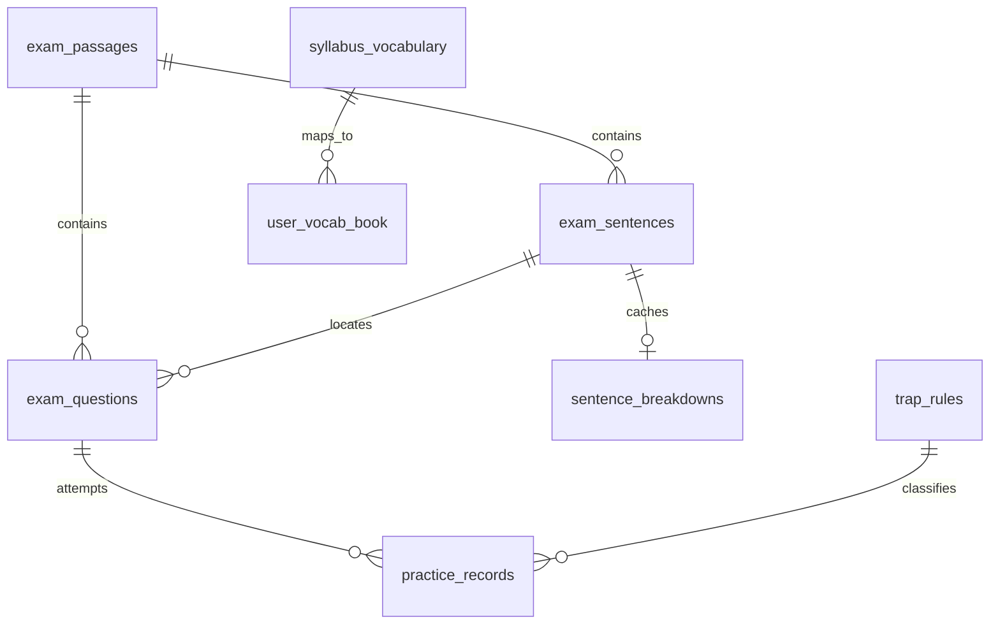

# 研英智学 · 软件工程答辩项目档案

> 版本：2026-10-23  
> 代码基线：`main @ 1973158`（动态加载文章与句子拆解）  
> 当前运行形态：React 工作台 + FastAPI + SQLite；保留早期 Streamlit MVP  
> 当前本地演示库：5,064 词条、33 条熟词僻义、8 条陷阱规则、8 篇导入真题 + 2 篇示例、43 题、153 句、7 个单词本条目、21 条练习记录

---

## 1. 一页速览

**项目定位**

面向考研英语一/英语二的阅读训练智能工作台。它不是“套壳聊天框”，而是把阅读训练拆成四个可验证的动作：

1. 看懂句子：主干、从句、修饰、翻译、语法点。
2. 做对题目：原文定位、题型判断、选项陷阱验伪。
3. 记住词汇：单词 + 原句语境 + 出处进入单词本。
4. 形成反馈：答题记录、正确率、薄弱题型、复习计划。

**核心产品主张**

> 工具负责事实，模型负责表达，数据库负责状态。

- 大纲属性、真题出处、错题、单词本来自 SQLite，不靠模型记忆。
- 长难句、选项分析、单词归档走确定性流程；只有开放讲解才交给 DeepSeek。
- 一次操作会改变下一次页面看到的数据，形成“训练 → 记录 → 报告 → 复习”的闭环。

**技术形态**

| 层 | 技术 | 说明 |
| --- | --- | --- |
| Web 前端 | React 19 + Vite 8 + TypeScript 7 + Tailwind CSS 4 | 8 个页面、统一设计系统 |
| 路由 | React Router 7 | 8 个业务路由 + 404 重定向 |
| 后端 | FastAPI + Pydantic 2 | 26 个 HTTP 端点、OpenAPI 文档 |
| 数据 | SQLite（WAL、外键） | 9 张表，单用户演示库 |
| 生成层 | DeepSeek `deepseek-chat`（OpenAI 兼容） | 导入结构化、开放讲解、句子拆解 |
| 文档解析 | pypdf + httpx | PDF 抽取、公开 URL 下载 |
| 旧形态 | Streamlit | 早期 MVP，保留可运行 |

**规模快照**

| 指标 | 当前值 |
| --- | --- |
| 考研词条 | 5,064 |
| 熟词僻义 | 33（27 条基础 + 6 条补充） |
| 陷阱规则 | 8（核心六类 + 过度推理 / 张冠李戴） |
| 完整导入文章 | 8 篇（2023/2024 英语一 Text 1–4） |
| 导入题目 | 40 道，每篇 5 道 |
| 导入文章句子 | 145 句 |
| 示例文章 | 2 篇，8 句，3 题 |
| 合计 | 10 个 passage / 43 题 / 153 句 |
| 前端页面 | 8 个 + 404 |
| API 端点 | 26 个 |
| 数据表 | 9 张 |
| 已缓存单句拆解 | 5 条 |

---

## 2. 问题定义与需求

### 2.1 用户问题

考研英语阅读的难点不是“没有答案”，而是：

- 句子结构复杂，逐词翻译后仍然不知道谁修饰谁。
- 选项看似都沾边，缺少“逐项验伪”的方法。
- 通用大模型能讲，但出处、考频、错题状态不可追溯。
- 单词、长难句、选项、复习计划分散在四五个工具里，无法形成闭环。

### 2.2 产品目标

| 目标 | 可验证结果 |
| --- | --- |
| 让句子可拆 | 每句输出五步结构，且能切换文章与句子 |
| 让选项可验 | 作答前不剧透，提交后逐项给陷阱与原文反证 |
| 让事实可查 | `tool_trace` 与 `citations` 由后端返回，不由模型生成 |
| 让学习有状态 | 单词本、答题记录、复习时间写入 SQLite |
| 让素材可扩展 | PDF/文本导入后自动进入阅读、长难句、对话三个入口 |

### 2.3 明确不做什么

- 不宣称覆盖 2010–2026 全部真题。
- 不宣称收录官方 5,500 词全集。
- 不做商业题库的批量抓取。
- 不做多用户、登录、支付、云同步。
- 不把模型输出当作标准答案；答案序列来自公开资料并人工核对。

---

## 3. 总体架构

### 3.1 运行拓扑

```text
┌─────────────────────────────────────────────────────────┐
│ Browser                                                  │
│ React 19 + Vite 5173                                     │
│ Dashboard / Sentence / Options / Chat / Wordbook / ...   │
└───────────────────────┬─────────────────────────────────┘
                        │  /api/*（Vite dev proxy）
                        ▼
┌─────────────────────────────────────────────────────────┐
│ FastAPI 8000                                             │
│                                                         │
│  app.py        路由、校验、导入、断句拆解、健康检查        │
│  tools.py      4 个确定性领域工具                         │
│  workflows.py  句子 / 选项 / 对话工作流                   │
│  llm.py        DeepSeek 调用、JSON 清洗、失败回退         │
│  seed.py       词库、示例、陷阱、演示状态                 │
│  db.py         9 张表 schema、SQLite 连接                 │
└───────────────┬───────────────────────┬─────────────────┘
                │                       │
                ▼                       ▼
        SQLite app.db            DeepSeek API（可选）
        9 张表 / WAL              deepseek-chat
```

### 3.2 部署边界

- 开发环境：Vite `5173` 通过代理转发 `/api` 到 FastAPI `8000`。
- 生产环境：可用 `VITE_API_BASE=https://your-api.example.com/api` 指向独立 API。
- 前后端没有共享进程内存；所有业务状态通过 HTTP + SQLite 传递。
- `.env` 只存在服务端，前端永远拿不到 `LLM_API_KEY`。

### 3.3 为什么这样分层

| 决策 | 原因 |
| --- | --- |
| 前后端分离 | 页面可以独立迭代；API 可被 Streamlit、脚本、未来移动端复用 |
| 工具层独立 | 词库、真题、单词本、错题各自可测试、可替换 |
| 工作流编排 | “意图 → 工具 → 结构化回答”是显式流程，不是把所有逻辑塞进路由 |
| 生成层可插拔 | 没 Key 也能运行；模型失败只影响讲解，不影响事实与状态 |
| 单用户 SQLite | 课程演示成本低、可离线、数据可交付；扩展点明确 |

### 3.4 一次“提交选项”的调用链

```text
用户点击 B + 提交
  → OptionsPage.handleSubmit
  → 前端先乐观写入 records（即时镜像）
  → POST /api/workflow/options {question_id, user_answer}
      → get_question(question_id)
      → get_sentence(source_sentence_id)
      → search_past_exams(定位句片段)
      → record_option_attempt(...)
          → INSERT practice_records
      → 返回 question / source_sentence / citations / is_correct / tool_trace
  → 前端展示逐项陷阱、定位句高亮、工具链
  → 报告页读取 /api/state，看到新增记录
```

---

## 4. 数据模型

### 4.1 九张表

| 表 | 角色 | 关键字段 |
| --- | --- | --- |
| `syllabus_vocabulary` | 考研词库 | `word`、`basic_meaning`、`rare_meaning`、`level`、`exam_frequency` |
| `exam_passages` | 阅读文章 | `id`、`year`、`exam_type`、`text_number`、`text` |
| `exam_sentences` | 句子切片 | `id`、`passage_id`、`paragraph`、`sentence_index`、`text`、`source_label` |
| `exam_questions` | 题目与解析 | `id`、`passage_id`、`number`、`options_json`、`correct_answer`、`analysis_json`、`steps_json`、`source_sentence_id` |
| `sentence_breakdowns` | 单句五步拆解缓存 | `sentence_id`、`data_json`、`llm_used` |
| `trap_rules` | 陷阱知识库 | `name`、`definition`、`signals`、`example`、`tone` |
| `user_vocab_book` | 单词本 | `spelling`、`meaning`、`source`、`context`、`familiarity`、`interval_days`、`repetition`、`next_review` |
| `practice_records` | 答题记录 | `question_id`、`question_type`、`user_answer`、`correct_answer`、`is_correct`、`trap_type` |
| `agent_runs` | 工作流日志 | `workflow`、`input_json`、`output_json`、`tool_trace_json` |

### 4.2 ER 关系



### 4.3 数据资产与真实性边界

- 词库：`server/data/kaoyan_vocab.txt`，公共词库去重后 5,064 条；不是官方 5,500 全集。
- 熟词僻义：`server/data/rare_meanings.json`，27 条基础 + 6 条补充，共 33 条。
- 示例文章：`server/data/exam_slices.json`，2 篇、8 句、3 题，用于工作流演示。
- 导入真题：8 篇、40 题、145 句，存于被忽略的 `server/data/app.db`；为课程测试另导出 `server/data/demo_snapshot.json`，可用 `scripts/load_demo.py` 恢复。
- `exam_frequency` 是**当前 153 个句子语料内的出现次数**，不是历年考频。
- 题目答案来自公开 PDF/答案页，人工核对；2024 Text 4 的 `Idaho case` 已修正为 `Sackett case`；2023 Text 2 首次解析失败后已重跑。

---

## 5. 后端设计

### 5.1 模块职责

| 文件 | 职责 |
| --- | --- |
| `app.py` | FastAPI 实例、请求模型、26 个端点、PDF/文本导入、文章与句子查询、健康检查 |
| `db.py` | 9 张表 schema、SQLite 连接、WAL、外键、初始化 |
| `seed.py` | 词库导入、示例文章、陷阱规则、7 个演示单词、20 条练习记录 |
| `tools.py` | 4 个核心工具与查询、状态、报告、SM-2 更新 |
| `workflows.py` | 句子、选项、对话三条编排链；意图路由；确定性/LLM 策略 |
| `llm.py` | DeepSeek 客户端、JSON 提取与清洗、导入结构化、批量选项分析、句子拆解 |
| `prompts.py` | 生成层 System Prompt |
| `scripts/auto_import.py` | 本地 PDF / 文本 / URL 的 CLI 导入入口 |

### 5.2 四个核心工具

| 工具 | 输入 | 输出 | 防止的问题 |
| --- | --- | --- | --- |
| `check_syllabus_vocab` | 文本或词表 | 大纲属性、等级、释义、熟词僻义、切片频次 | “这个词超不超纲”靠猜 |
| `search_past_exams` | 查询词 / 语法标签 | 句子切片 + 强制出处 | 举例无来源、编造真题 |
| `add_to_vocab_book` | 单词、语境、出处 | 单词本记录 + 下次复习 | 聊完即忘 |
| `record_trap_mistake` | 题目、选项 | 练习记录 + 陷阱类型 | 错题不留痕 |

所有工具返回统一 trace：

```json
{"tool": "check_syllabus_vocab", "args": {}, "summary": "检索 19 个实词，命中 16 个大纲词", "duration_ms": 1}
```

### 5.3 三条工作流

#### 句子工作流

```text
sentence_id
  → get_sentence
  → check_syllabus_vocab(原句)
  → search_past_exams(语法标签)
  → 当前句强制进入 citations，并过滤为同 passage
  → 返回句子、Top 词条、出处、tool_trace
```

#### 选项工作流

```text
question_id + user_answer
  → get_question
  → get_sentence(source_sentence_id)
  → search_past_exams(定位句片段)
  → record_trap_mistake（有答案时）
  → 返回正误、陷阱、出处、tool_trace
```

#### 对话工作流

```text
message + context_id
  → _context 读取 passage / sentences / questions
  → 意图路由
  → 调用工具或句子/选项工作流
  → 生成结构化 sections
  → 证据敏感意图锁定 deterministic
  → 开放讲解按需 polish（DeepSeek）
```

### 5.4 对话意图路由

| 意图 | 触发词示例 | 处理 | 是否走 LLM |
| --- | --- | --- | --- |
| 单词本归档 | “加入单词本 / 归档 / 收藏” | `add_to_vocab_book` | 否 |
| 长难句 | “从句 / 长难句 / 拆解 / 句子” | 句子工作流 + 可选五步拆解缓存 | 否（证据锁定） |
| 选项 | “选项 / 陷阱 / 错误选项 / 排除” | 选项工作流 | 否 |
| 熟词僻义 | “熟词僻义 / address / plant” | 词库检索 | 是（开放讲解） |
| 核心词 | “核心词 / 关键词 / 生词 / 词汇” | 当前 passage 词库筛选 | 否 |
| 复习计划 | “计划 / 复习 / 单词” | `get_report` + 到期词 | 是（开放讲解） |
| 段落主旨 | “主旨 / 总结 / 段落 / 态度” | 原文首尾 + 题干定位抽取 | 否 |
| 默认 | 其他 | 能力与数据状态 | 是（可关闭） |

### 5.5 LLM 使用原则

**输入给模型的只有：**

- 用户问题
- 工具已经确定的事实
- 结构化 base answer
- 必要的原文与出处

**模型不允许生成：**

- `tool_trace`
- `citations`
- 单词是否在大纲、等级、考频
- 题目正确答案
- 数据库写入结果

**失败策略：**

- 没有 Key：返回确定性答案，`llm_used=false`。
- 调用失败/JSON 不合法：回退确定性答案。
- 导入解析失败：写入 fallback 解析，并标记 `analysis_source=fallback`。
- 句子拆解失败：返回兜底结构，页面仍可展示。

### 5.6 真题导入流水线

```text
PDF URL / 本地 PDF / 原始文本
  → pypdf 抽取
  → 按 Text N 切片
  → DeepSeek 抽取 passage + 5 questions + options
  → 可选答案序列覆盖（answer_source=provided）
  → 题号映射：21–25 / 26–30 / 31–35 / 36–40
  → 批量生成选项分析
  → 校验每题只有一个“正确”选项
  → 写入 passages / sentences / questions
  → 阅读、长难句、对话自动可选
```

- UI：阅读训练页 → 添加真题 → PDF 自动导入（模态框）。
- CLI：`python scripts/auto_import.py --pdf ... --year ... --text-number ... --answer-key ...`
- 当前 8 篇文章全部使用答案序列；没有把模型推断答案当标准答案。

### 5.7 API 端点（26 个）

| 分组 | 端点 |
| --- | --- |
| 基础 | `GET /`、`GET /api/health`、`GET /api/meta` |
| 状态 | `GET /api/state`、`GET /api/report`、`GET /api/agent/runs` |
| 内容 | `GET /api/sentences`、`GET /api/questions`、`GET /api/questions/full`、`GET /api/knowledge` |
| 文章 | `GET /api/passages`、`GET /api/passages/{id}/sentences`、`GET /api/sentences/{id}/breakdown` |
| 工作流 | `POST /api/workflow/sentence`、`POST /api/workflow/options`、`POST /api/workflow/chat` |
| 单词本 | `GET/POST /api/wordbook`、`DELETE /api/wordbook/{spelling}`、`POST /api/wordbook/review` |
| 记录 | `POST /api/records` |
| 导入 | `POST /api/exams/import`、`POST /api/exams/auto-import` |
| 工具直连 | `GET /api/vocab/search`、`POST /api/tools/check-vocab`、`GET /api/tools/search-exams` |

OpenAPI：`http://localhost:8000/docs`

### 5.8 状态与复习算法

`user_vocab_book` 预留 `easiness`、`interval_days`、`repetition`，当前实现是简化策略：

- 记住：`familiarity +0.15`，`interval_days × 2`（上限 30 天），`repetition +1`。
- 忘记：`familiarity -0.1`，`interval_days = 1`，`repetition = 0`。
- 下次复习：`now + interval_days`。

这不是完整 SM-2；真正的 SM-2 还需要 easiness 因子与质量评分。

---

## 6. 前端设计

### 6.1 设计系统

| 元素 | 规范 |
| --- | --- |
| 画布 | `#F8FAFC` / Tailwind `slate-50` |
| 卡片 | 白色、`border-slate-200`、轻阴影 |
| 深色 Banner | `#1E293B` / `slate-800`，16px 圆角 |
| 圆角 | Banner 16px；普通卡片 12px；按钮/Tag 8px |
| 功能色 | 蓝（句子）、绿（正确/定制）、青（知识）、黄（复习）、紫（AI/练习）、红（错误/对照） |
| 图标 | lucide-react，线性、1.5–2px |
| 布局 | 240px 固定侧栏 + 自适应主区；指标 4 列 |
| 卡片左色条 | 4px，用于对比与状态 |
| 响应式 | `lg` 以上双栏/四列；移动端单列，输入区自适应 |

### 6.2 页面信息架构

| 路由 | 页面 | 核心任务 | 主要接口 |
| --- | --- | --- | --- |
| `/` | 仪表盘 | 看总量、到期词、最近练习、入口 | `/api/meta`、`/api/state` |
| `/sentence` | 长难句拆解 | 选文章 → 选句子 → 五步拆解 | `/api/passages`、`/api/passages/{id}/sentences`、`/api/sentences/{id}/breakdown`、`/api/workflow/sentence` |
| `/options` | 阅读真题训练 | 左文右题、两阶段作答、导入 | `/api/questions/full`、`/api/workflow/options`、`/api/exams/*` |
| `/chat` | AI 对话 | 选上下文、问句子/选项/词汇/计划 | `/api/passages`、`/api/workflow/chat` |
| `/wordbook` | 单词本与复习 | 查词、复习、删除、添加 | `/api/state`、`/api/wordbook/*` |
| `/report` | 学习报告 | 正确率、薄弱题型、7 天练习量 | 本地 store（`/api/state` 同步） |
| `/comparison` | 定制效果对比 | 通用模型 vs 定制 Agent | 静态场景 + 设计系统 |
| `/knowledge` | 领域知识库 | 题型、陷阱、熟词僻义 | `/api/knowledge` |

### 6.3 状态管理

- `AppStore` 用 React Context 提供全局 `words`、`records`、`dueWords`、`connected`、`refresh`。
- 启动时 `GET /api/state` 拉取 SQLite 状态；`localStorage` 只作离线兜底。
- 新增单词：先乐观更新 UI，再调 `/api/wordbook`，成功后替换后端 ID。
- 复习单词：本地立即更新掌握度/下次复习，再调 `/api/wordbook/review`。
- 选项提交：本地镜像记录 + 后端 `workflow/options` 写库；后端失败时页面提示“只保存在本地”。
- 文章/句子/题目不放在全局 store，按页面请求，避免一次加载全库。

### 6.4 关键交互设计

#### 阅读训练：两阶段状态机

```text
作答态：题干 + 干净 A/B/C/D + 提交
  ↓ 提交
解析态：逐项 4px 色条 + 陷阱 Tag + 原文反证 + 定位句高亮 + 结果
```

- 未提交前不显示“正确答案”和任何陷阱标签，避免剧透。
- 左栏完整原文独立滚动；右栏题目独立滚动。
- 提交后左栏滚动到定位句并高亮 `Qn 定位句`。
- 题号 Tabs 用圆点表示未做/做对/做错。
- 添加真题改为模态框，不占首屏。

#### AI 对话：全屏锁定

- 页面无外层标题，聊天容器占满视口。
- 顶部 56px 状态栏：Agent 名、连接状态、上下文下拉、句子/题目计数、清空。
- 底部快捷胶囊 + 单行自适应输入框。
- 长回答用双列卡片（结构、词句、考点等并排），减少纵向滚动。
- 不保留左侧宽栏，横向空间全部给消息。

#### 长难句：动态选材

- 文章下拉来自 `/api/passages`；句子下拉来自 `/api/passages/{id}/sentences`。
- 默认选当前文章最长句。
- 五步拆解按需生成，写入 `sentence_breakdowns` 缓存。
- 工具链、大纲词、真题出处随句子变化。

---

## 7. 功能点详解与联动

### 7.1 首页仪表盘

**目标**：让用户在 5 秒内知道“我现在有什么、该做什么”。

- 四个指标：真题篇章、大纲词汇、单词本、已练习。
- 到期词提示条 + “去复习”按钮。
- 核心功能卡片：长难句、选项、对话、单词本。
- 今日学习任务：复习到期词、拆 1 句、分析 1 题。
- 最近练习：题型、答案、正误、相对时间。
- 数据来源：`/api/meta` + `AppStore`。

**联动**：所有卡片是入口；到期词来自单词本；最近练习来自答题记录。

### 7.2 长难句拆解

**目标**：把“看不懂”变成可复述的结构。

- 选择文章 → 选择句子（可看到词数、是否长难句）。
- 五步：找主干、剥离从句、划分修饰、逐层翻译、标注语法点。
- 句子原文按结构标记着色；动态句子用整句 + 从句/修饰卡片。
- Agent 工具链：`check_syllabus_vocab` → `search_past_exams`。
- 大纲词卡片：等级、频次、释义、熟词僻义、加入单词本。
- 真题溯源：当前句 + 同篇切片。

**联动**：加入单词本 → 首页/单词本/报告可见；句子 ID 同时进入 `agent_runs`。

### 7.3 阅读真题训练

**目标**：模拟真实做题，而不是“先看答案再解释”。

- 级联工具栏：年份、试卷、Text 1–4、题数、添加真题。
- 左栏：完整原文、P1/P2/P3、独立滚动、提交后定位高亮。
- 右栏：题号 Tabs、题型/难度/建议时间、A/B/C/D。
- 作答态/解析态严格分离。
- 解析态：陷阱标签、原文反证、正确答案、我的选择、解题路径、工具链、出处。
- 导入：PDF 自动导入 / 手动录入，模态框。
- 当前 8 篇完整文章、每篇 5 题，题号 21–40。

**联动**：提交 → `practice_records` → 报告页；导入 → 阅读/长难句/对话三个选择器。

### 7.4 AI 对话

**目标**：把 Agent 当作“有数据库的辅导老师”。

- 上下文下拉：全部可用文章（当前 8 篇）。
- 快捷胶囊：句子、核心词、选项、计划、主旨、熟词僻义。
- 回答结构：intro + 双列 sections + Tool Trace + citations。
- `llm_used` 控制“DeepSeek 生成”徽标。
- 上下文无关的提示词，避免把 2024 句子带进 2023。

**联动**：句子/选项回答复用工作流；归档工具写入单词本后前端 `refresh()`；报告计划读取到期词。

### 7.5 单词本与复习

**目标**：把阅读中遇到的词变成可复习资产。

- 全部/今日复习/添加单词三个 Tab。
- 词条：拼写、音标、释义、出处、掌握度、下次复习、删除。
- 复习：显示/隐藏释义，记住/没记住，更新 SQLite。
- 今日到期词由 `next_review <= now` 计算。

**联动**：句子页/对话归档 → 单词本；复习 → 首页到期提示、报告建议。

### 7.6 学习报告

**目标**：让练习数据变成可解释的薄弱画像。

- 总练习、正确数、正确率、待复习词。
- 各题型正确率、薄弱题型、7 天练习量。
- 备考建议：薄弱题型、到期词、样本量提醒。
- 数据来自 `AppStore`（由 `/api/state` 同步），不额外请求 `/api/report`。

**联动**：选项提交/单词复习后，首页与报告同步变化。

### 7.7 定制效果对比

**目标**：向评审说明“通用模型 vs 定制 Agent”的差异。

- 3 个场景：长难句、选项、生词。
- 左：通用模型直接翻译/只给答案/不记录。
- 右：定制 Agent 五步拆解/陷阱验伪/单词本闭环。
- 静态内容用于展示产品理念，不参与真实训练。

### 7.8 领域知识库

**目标**：把“题型/陷阱/熟词僻义”变成可查的领域资产。

- 5 类题型方法论、8 条陷阱规则、33 条熟词僻义。
- 搜索题型、陷阱、方法。
- 数据接口：`/api/knowledge`；题型/方法是静态领域内容。

---

## 8. 跨功能联动总表

| 触发 | 写入/状态变化 | 用户可见结果 |
| --- | --- | --- |
| 长难句页“加入单词本” | `user_vocab_book` 新增 | 首页单词本 +1；单词本页出现；报告待复习 |
| 对话“把 X 加入单词本” | `add_to_vocab_book` + `tool_trace` | 对话提示；单词本刷新 |
| 选项提交 | `practice_records` 新增 | 解析态；报告正确率/薄弱题型；首页最近练习 |
| 单词复习“记住/没记住” | `familiarity`、`interval_days`、`next_review` | 首页到期词；报告建议；单词本状态 |
| 导入 PDF | passages/sentences/questions 新增 | 阅读训练 Text 增加；长难句文章/句子增加；对话上下文增加 |
| 切换对话上下文 | 只影响请求的 `context_id` | 句子/选项/核心词/主旨都使用新文章 |
| 生成句子拆解 | `sentence_breakdowns` 缓存 | 长难句页秒开；对话句子回答复用 |
| 提交选项失败 | 前端本地镜像保留 | 页面提示“只保存在本地”；不阻塞训练 |

---

## 9. 质量保障与验证

### 9.1 已完成的验证

| 项目 | 结果 |
| --- | --- |
| 前端生产构建 | `npm run build` 通过（tsc + vite） |
| 后端语法/导入 | 8 个 Python 模块 `py_compile` 通过 |
| API 健康 | `llm_configured=true`、`llm_model=deepseek-chat` |
| 页面路由 | 8 个页面无控制台错误 |
| 桌面布局 | 1440×1050：阅读/对话 page 高度 1050 |
| 移动布局 | 390×844：8 个页面无横向溢出 |
| 阅读训练 | 8 篇可选、每篇 5 题、题号 21–40 |
| 长难句 | 8 篇文章可选；默认最长句；五步拆解可生成/缓存 |
| 对话 | 8 个上下文可选；导入句子回答包含从句/修饰 |
| 数据一致性 | 40 道导入题答案与答案序列一致；每题只有一个“正确” |
| 串篇防护 | 2023 上下文不再出现 2024 句子；证据敏感路径锁定 |

### 9.2 未完成的验证

- 没有自动化测试套件（pytest / Vitest / Playwright CI）。
- 没有并发压测、故障注入、浏览器兼容矩阵。
- 没有对 LLM 输出做逐句事实校验（只做了证据路径锁定与结构化校验）。
- 没有数据库迁移测试；schema 变更依赖 `CREATE TABLE IF NOT EXISTS`。

---

## 10. 设计取舍

| 取舍 | 选择 | 理由 | 代价 |
| --- | --- | --- | --- |
| 数据库 | SQLite | 单用户、零运维、可交付 | 并发/多用户弱 |
| 事实来源 | 工具层 | 可追溯、可测试 | 需要维护词库/题库 |
| 生成层 | 只做开放讲解 | 避免串篇与编造 | 回答不如“自由聊天”灵活 |
| 素材 | 导入 + 示例 | 真实数据与演示稳定性兼顾 | 示例与导入并存，需要去重规则 |
| 文章选择 | 后端动态 | 导入即出现，不写死 | 首屏需要 loading |
| 句子拆解 | LLM + 缓存 | 任意句子可用 | 首次 5–10 秒；质量依赖模型 |
| 阅读布局 | 左文右题 | 符合真实做题 | 小屏需要堆叠 |
| 对话布局 | 全屏 + 胶囊 | 最大化消息区 | 快捷入口需要横向滚动 |
| 状态 | Context + SQLite | 简单、可演示 | 没有服务端缓存/实时推送 |
| 数据版权 | 全文只存本地 DB | 不重新分发 | 换机/重置会丢失 |

---

## 11. 已知问题与技术债

### P0（答辩前/上线前必须知道）

1. **无登录与用户隔离**：所有人共用一份 SQLite；`user_vocab_book`/`practice_records` 没有 `user_id`。
2. **无自动化测试与 CI**：当前靠手工回归；重构风险高。
3. **无数据库迁移工具**：schema 靠 `CREATE TABLE IF NOT EXISTS`，字段变更没有版本化。
4. **导入 URL 没有 SSRF/白名单/大小限制**：服务端会请求用户提供的 URL；生产需限制域名、内网地址、响应大小。
5. **对话未写入 `agent_runs`**：只有句子/选项工作流有日志；对话排查能力弱。
6. **重复导入没有唯一约束**：同一篇 Text 重复导入会产生重复 passage；前端按年份/Text 去重，但数据库没有唯一键。
7. **答案正确性依赖公开资料**：没有官方答案校验；题目/选项可能有 OCR 偏差。

### P1（下一轮迭代）

1. 扫描版 PDF 的 OCR（当前 pypdf 只处理文本型 PDF）。
2. 一次导入整卷 4 篇，而不是按 Text 逐次执行。
3. 导入任务的异步队列/进度条/失败重试；当前同步请求可能 20–60 秒。
4. 主旨总结接入“按 passage 的 DeepSeek 摘要 + 引用”，替换当前的原文抽取骨架。
5. 导入题目的答案人工复核界面（标记 `provided/inferred`、逐题修订）。
6. 列表分页/虚拟滚动：题库继续增长后，`/api/questions/full` 会变大。
7. 词频重算：导入更多文章后重新统计 `exam_frequency`，并提供“语料版本”字段。
8. 完整 SM-2：使用 `easiness` 与质量评分，而不是当前的间隔翻倍。
9. 后端 `/api/report` 与前端本地聚合统一，避免两套统计逻辑。
10. 统一错误模型/请求 ID/结构化日志；前端错误提示更具体。

### P2（产品化）

1. 多用户、JWT/会话、数据隔离。
2. PostgreSQL + Redis + 对象存储；Docker Compose / 云部署。
3. 可观测性：Prometheus/Grafana、LLM 调用耗时/失败率、导入任务监控。
4. 无障碍：键盘操作、ARIA、对比度、屏幕阅读器。
5. 国际化和移动端 App/小程序。
6. 学习计划算法：基于遗忘曲线、题目难度、目标分数动态排程。
7. 内容审核与版权合规流程：来源登记、授权状态、下架机制。

---

## 12. 五分钟答辩演示脚本

### 0:00–0:30 首页

打开 `http://localhost:5173/`：

> 这不是静态稿。5,064 条词库、8 篇导入真题、43 道题、153 句都来自 SQLite；右上角显示 FastAPI 已连接。

### 0:30–2:00 长难句

打开 `/sentence`：

1. 文章下拉选 `2024 英语一 · Text 1（导入）`。
2. 句子下拉选默认最长句。
3. 展示五步：主干、从句、修饰、翻译、语法点。
4. 向下滚动：`check_syllabus_vocab` / `search_past_exams` 工具链、大纲词、真题出处。
5. 点一个“单词本”。

讲解重点：

> 句子不是模型凭空讲的；先查大纲词与同篇切片，模型只负责组织讲解。当前句强制进入引用，避免串篇。

### 2:00–3:00 阅读训练

打开 `/options`：

1. 年份/试卷/Text 选择。
2. 左侧完整原文，右侧 5 个题号。
3. 选一个选项，提交。
4. 展示未提交前无剧透、提交后逐项陷阱、左侧定位高亮。
5. 说明 `practice_records` 已写入，报告页会变化。

### 3:00–4:00 AI 对话

打开 `/chat`：

1. 右上角切换 `2024 英语一 · Text 2`。
2. 点“解析这个句子的从句”。
3. 展示双列结构、从句/修饰、工具链、出处。
4. 点“查一个熟词僻义”，展示 DeepSeek 生成徽标。

讲解重点：

> 证据敏感问题不走模型改写；开放讲解才交给 DeepSeek。模型失败，工具链仍在。

### 4:00–4:30 导入

`/options` → 添加真题：

> 粘贴公开 PDF 地址、年份、Text、答案序列；后端 pypdf 抽取、DeepSeek 结构化、题号映射、批量分析、写入 SQLite。导入后阅读/长难句/对话都能选到。

### 4:30–5:00 报告与架构

打开 `/report` 和 `http://localhost:8000/docs`：

> 报告来自答题记录；OpenAPI 展示 26 个端点；前后端通过 `/api` 解耦。数据库 9 张表，4 个工具，3 条工作流。

---

## 13. 答辩追问

### Q1：这和直接问 ChatGPT 有什么区别？

> 三个差异：事实来自 SQLite（大纲属性、出处、单词本）；每次回答带 `tool_trace` 与 `citations`；操作会改变软件状态（错题、单词本、复习时间）。通用模型没有这些约束。

### Q2：模型会不会编？

> 会，所以不让它碰事实层。长难句、选项、归档走确定性流程；模型只改写开放讲解。`tool_trace`、`citations`、正确答案都不经过模型。测试中确实出现过 2023 上下文混入 2024 句子，因此把证据敏感路径锁死。

### Q3：5,500 词收全了吗？

> 没有。当前 5,064 条，表结构和导入流程按 5,500 规模设计；缺的是词库补齐，不是架构。不要对外宣称官方全量。

### Q4：考频怎么来的？

> 当前是 153 个句子语料内的出现次数，不是 2010–2026 全量。导入更多真题后重跑统计即可；字段和排序已经落地。

### Q5：数据版权？

> 词库 BSD-3-Clause，保留 LICENSE；真题 PDF 由使用者提供，全文只进入被忽略的本地 SQLite，不提交、不再分发；商业题库不做批量抓取。

### Q6：为什么不用 PostgreSQL / 微服务？

> 当前是单用户课程项目，SQLite 零运维、可离线、可直接交付。架构上 repository/tools 已经分离，迁移 PostgreSQL 主要是换连接层与迁移脚本，不需要重写页面。

### Q7：工作量是不是都在前端？

> 前端 8 页 + 设计系统；后端 9 表、4 工具、3 工作流、26 端点、导入流水线、OpenAPI。前后端通过 API 解耦，不是 Streamlit 换皮。

### Q8：怎么保证导入题正确？

> 答案序列来自公开资料并人工核对；每题校验只有一个“正确”选项；2024 Text 4 的 Idaho/Sackett 已修正；2023 Text 2 解析失败后重跑。仍建议以原卷为准。

### Q9：最大的技术债？

> 没有自动化测试、没有用户隔离、没有迁移工具、导入 URL 缺 SSRF 防护。这四项是产品化前必须补的。

### Q10：如果继续做，优先级？

> P0：测试/CI、登录隔离、迁移、导入安全、对话日志；P1：OCR、整卷导入、摘要、分页、SM-2；P2：多用户、云部署、可观测性。

---

## 14. 当前指标与命令

### 14.1 健康检查

```bash
curl http://localhost:8000/api/health
```

当前返回：

```json
{
  "status": "ok",
  "database": "SQLite",
  "vocab_count": 5064,
  "sentence_count": 153,
  "question_count": 43,
  "passage_count": 10,
  "trap_count": 8,
  "wordbook_count": 7,
  "record_count": 21,
  "llm_configured": true,
  "llm_model": "deepseek-chat"
}
```

### 14.2 启动

```bash
# 后端
cd server
../.venv/bin/uvicorn app:app --host 0.0.0.0 --port 8000 --reload

# 前端
cd web
npm run dev
# http://localhost:5173

# OpenAPI
# http://localhost:8000/docs
```

### 14.3 构建

```bash
cd web
npm run build
```

### 14.4 导入

```bash
cd server
python scripts/auto_import.py \
  --pdf ~/2024年考研英语一真题.pdf \
  --year 2024 --exam 英语一 --text-number 2 \
  --answer-key "26-30 ABDCB"
```

### 14.5 数据位置

- `server/data/app.db`：本地题库与用户状态，已在 `.gitignore` 中忽略。
- `server/data/demo_snapshot.json`：8 篇导入文章/40 题/拆解缓存的课程测试快照，不含 PDF。
- `server/scripts/load_demo.py`：快照恢复；`export_demo.py`：重新导出。
- `server/data/kaoyan_vocab.txt`：词库。
- `server/data/exam_slices.json`：2 篇示例。
- `server/data/rare_meanings.json`：熟词僻义。
- `server/.env`：LLM 配置，已忽略；不要提交。

---

## 15. 代码地图

```text
kaoyan-english-agent/
├── web/                         React 工作台
│   ├── src/pages/               8 个页面
│   ├── src/components/          Layout / Tag / Toast / ToolTrace / StatCard ...
│   ├── src/lib/api.ts           唯一 API 客户端
│   ├── src/store/AppStore.tsx   Context + localStorage + SQLite 同步
│   └── src/data/content.ts      题型 / 陷阱 / 方法论 / 对比场景
├── server/                      FastAPI
│   ├── app.py                   26 个端点 + 导入 + 文章/句子
│   ├── tools.py                 4 个核心工具 + 报告 + 状态
│   ├── workflows.py             3 条工作流 + 意图路由
│   ├── llm.py                   DeepSeek 调用/清洗/拆解
│   ├── seed.py                  词库/示例/陷阱/演示状态
│   ├── db.py                    9 张表
│   └── scripts/auto_import.py   CLI 导入
├── kaoyan_agent/                早期 Streamlit MVP
└── docs/                        架构 / 答辩 / 导入清单 / 本档案
```

---

## 16. 一句话总结

> 这是一个“有数据库、有工具链、有状态闭环”的考研英语阅读工作台：把长难句、选项、词汇、复习串成可追溯的学习流程；用确定性工具守住事实，用 DeepSeek 只做开放讲解，用 SQLite 记录每一次训练。
