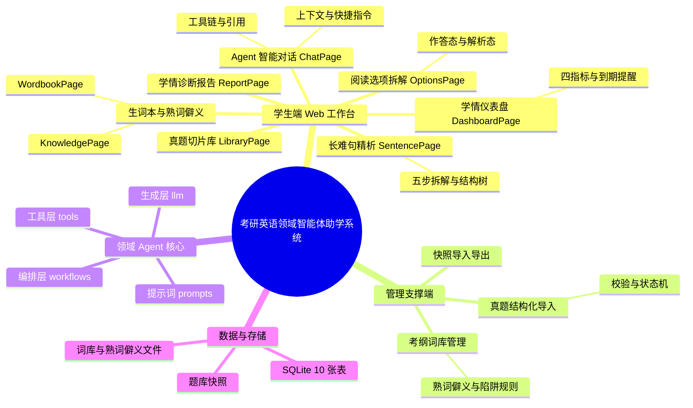
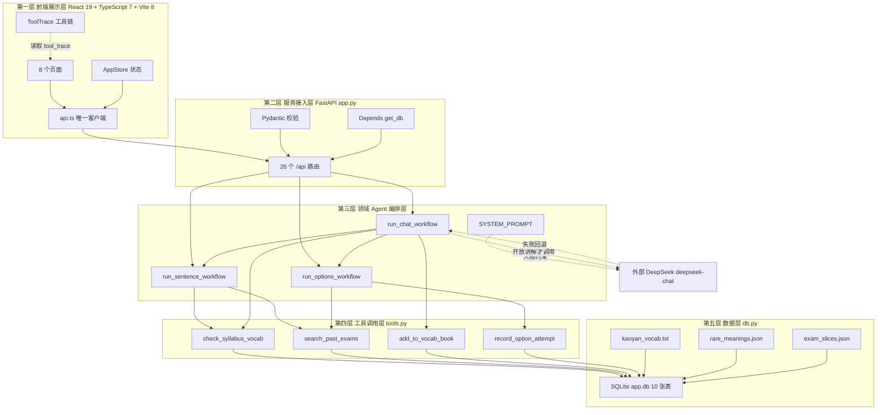
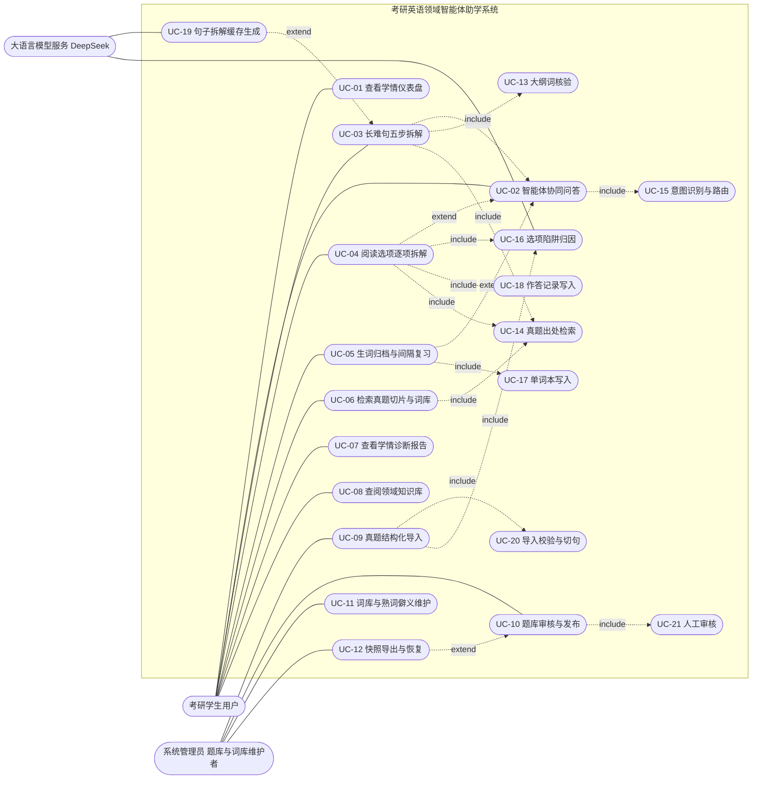
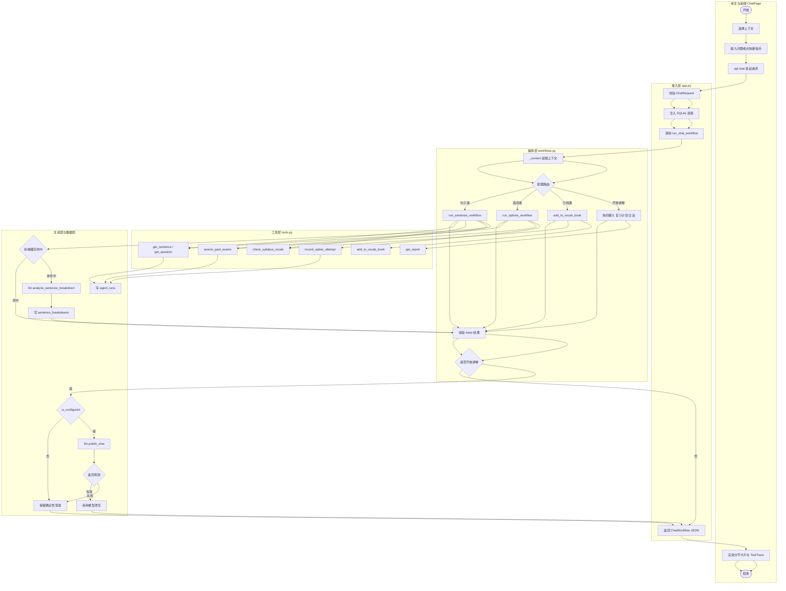
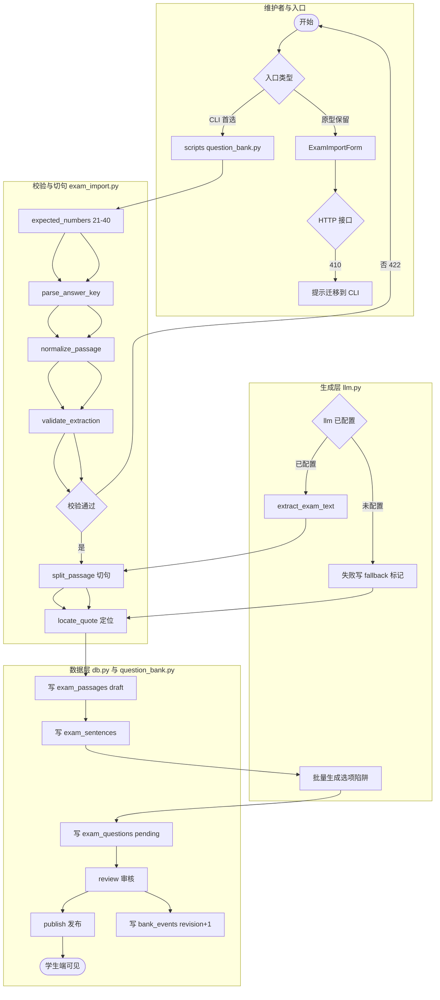
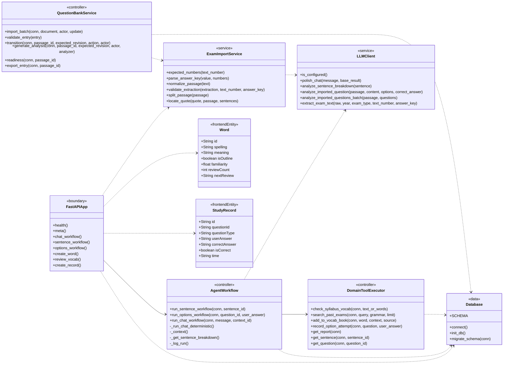
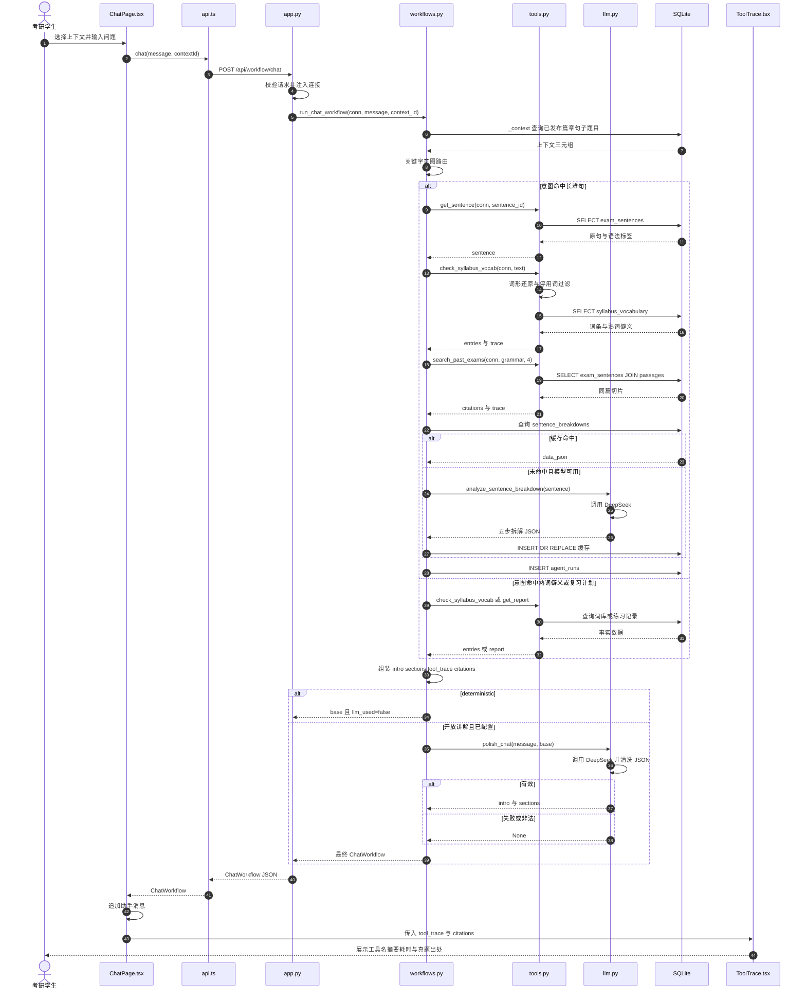
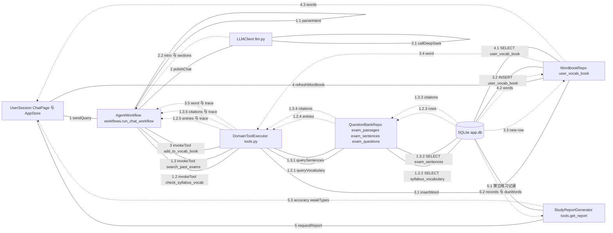
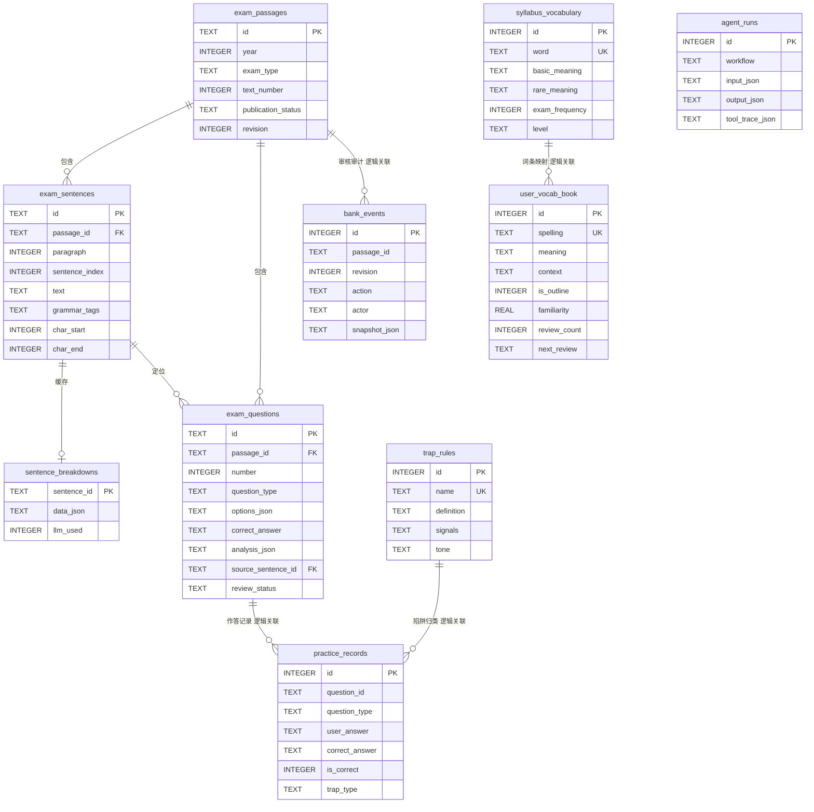

# 2026秋软工实践 福大智联——项目原型设计+概要设计

| 这个作业属于哪个课程 | [2026秋软件工程实践班级链接](請替換班級鏈接) |
| :--- | :--- |
| **这个作业要求在哪里** | [第二次团队作业（原型设计+概要设计）作业要求链接](請替換作業要求鏈接) |
| **这个作业的目标** | 基于第一次团队作业的需求分析，完成考研英语领域智能体系统（Kaoyan English Agent）的用户端与后台管理原型设计、系统总体与分层架构概要设计、UML建模（用例/活动/类/时序/协作图）、领域Agent集成设计以及数据库设计（ER图/关系模型/ORM映射），并制定后续迭代开发计划与团队分工，规范化沉淀《系统设计说明书》与《数据库设计说明书》至GitHub团队仓库。 |
| **团队名称** | 福大智联 |
| **团队成员** | 102402125-黄俊翔、102302113-王泽炜、102402121-陈韦融、102402126-黄炜杰、102402127-金若曦、102402143-越长智、102402124-洪豊幀、102402134-王世豪、102402133-谭段昊、102402132-邱福铭、102402135-王伟浩、102402119-陈封、102402122-邓杰 |

> **写在前面**
>
> 本文是福州大学 2026 秋软件工程实践"福大智联"团队的第二次团队作业博客，对应仓库 `kaoyan-english-agent` 的真实代码基线 `main @ 0688e14`。
>
> 文中所有页面名、工具函数名、表名、字段名、图与文案均取自仓库实际代码；三份配套文档已沉淀到仓库 `docs/`：`福大智联_系统设计说明书.md`、`福大智联_数据库设计说明书.md`、`福大智联_原型设计规约与亮点说明.md`，以及 UML 图集 `概要设计-架构与UML图集.md`。
>
> **阅读约定**：文中原型截图为占位图，发布前请按图注位置替换为墨刀/Axure 导出的真实截图；后台管理端 3 个页面属于本次原型扩展设计，当前代码仅实现了导入校验、状态机与 CLI 入口，博客中已逐项标注，避免把设计稿写成已上线功能。

---

## 目录

- [一、原型设计（40%）](#一原型设计40)
  - [1.1 原型设计工具与在线展示](#11-原型设计工具与在线展示)
  - [1.2 用户端 8 大模块原型与交互规则](#12-用户端-8-大模块原型与交互规则)
  - [1.3 后台管理端 3 个页面原型](#13-后台管理端-3-个页面原型)
  - [1.4 领域 Agent 交互界面与核心任务流程](#14-领域-agent-交互界面与核心任务流程)
  - [1.5 原型设计重要突出特点](#15-原型设计重要突出特点)
- [二、概要设计（40%）](#二概要设计40)
  - [2.1 功能模块思维导图与分层架构](#21-功能模块思维导图与分层架构)
  - [2.2 UML 设计全集](#22-uml-设计全集)
  - [2.3 领域 Agent 集成架构专项说明](#23-领域-agent-集成架构专项说明)
  - [2.4 数据库设计](#24-数据库设计)
  - [2.5 后端设计核心亮点](#25-后端设计核心亮点)
- [三、团队协作记录（20%）](#三团队协作记录20)
  - [3.1 预期开发计划时间安排](#31-预期开发计划时间安排)
  - [3.2 预期开发分工安排](#32-预期开发分工安排)
  - [3.3 本次作业协作过程记录](#33-本次作业协作过程记录)
- [四、附件与仓库链接汇总（5'）](#四附件与仓库链接汇总5)

---

# 一、原型设计（40%）

## 1.1 原型设计工具与在线展示

### 1.1.1 工具选型

| 工具 | 用途 | 选择理由 |
| --- | --- | --- |
| 墨刀 Modao | 用户端 8 页 + 后台 3 页高保真原型 | 支持网页端协作、组件库复用、页面备注面板；团队成员无需安装客户端即可评审 |
| Axure RP | 复杂交互与状态页补充（阅读作答态/解析态、后台审核弹窗） | 动态面板适合表达两阶段状态机与抽屉/弹窗 |
| Figma（辅助） | 视觉稿与图标整理 | 与 Tailwind 色板对照方便，导出切图快 |

原型采用 **1440×900 桌面画布**，另出 **390×844 移动画布**验证响应式。所有页面共用一套母版：240px 左侧栏、深色页头 Banner、白色卡片、语义色标签。交互说明直接写在页面备注面板，模板如下：

```text
【页面】P-Chat 考研 Agent 对话台
【实现状态】已实现 / 部分实现 / 原型扩展
【布局】头栏｜消息区｜输入区
【核心交互】点击快捷胶囊 → 发送 → 三点动画 → 追加助手消息
【校验规则】输入 1–4000 字；Enter 发送，Shift+Enter 换行；请求中禁用
【数据来源】POST /api/workflow/chat
【源码】web/src/pages/ChatPage.tsx、server/workflows.py
```

### 1.1.2 在线展示链接

| 交付项 | 链接 | 可访问性声明 |
| --- | --- | --- |
| 墨刀原型（用户端 8 页） | `[请替换为墨刀分享链接]` | 已开启"公开访问"，无需登录；建议使用 Chrome/Edge 近两个大版本 |
| 墨刀原型（后台 3 页） | `[请替换为墨刀后台分享链接]` | 已开启公开访问，无需登录；仅用于课程评审，不对外传播 |
| Axure 交互原型（备用） | `[请替换为 Axure Cloud 链接]` | 需网络可访问 Axure Cloud；离线评审使用导出的 HTML 包 |
| 原型 PDF 导出版 | `[请替换为云盘链接]` | 永久有效，作为在线链接失效时的兜底 |

> **可访问性说明**：在线原型若出现加载缓慢，通常是首次加载字体与图标资源导致；建议先打开一次预热，再进行答辩演示。原型中的截图与演示数据均为课程教学用途，不包含真实用户隐私。

---

## 1.2 用户端 8 大模块原型与交互规则

### 1.2.1 全局视觉与布局基线

在进入逐页说明前，先统一视觉口径。系统不是"聊天壳子"，而是"学术工作台"，因此配色克制、信息密度偏高、状态色严格区分。

| 角色 | 色值 | 使用位置 |
| --- | --- | --- |
| 画布 | `#F8FAFC` | 页面底色 |
| 卡片 | `#FFFFFF` | 所有内容卡片 |
| 主文字 | `#0F172A` | 标题与指标数字 |
| 深色主色 | `#1E293B` | 页头 Banner、主按钮、用户气泡、导航选中 |
| 边框 | `#E2E8F0` | 卡片、输入框、分隔线 |
| 蓝 | `#3B82F6` | 长难句、定位句 |
| 绿 | `#10B981` | 正确、已连接、大纲词 |
| 青 | `#06B6D4` | 词库、知识核验 |
| 黄 | `#F59E0B` | 到期复习、熟词僻义、提示 |
| 紫 | `#8B5CF6` | Agent、题型、DeepSeek 生成 |
| 红 | `#EF4444` | 错误、薄弱、偷换概念 |

字体采用双栈：界面用 `Inter / Noto Sans SC / PingFang SC / Microsoft YaHei`；英文原句、单词、题干用 `Source Serif 4 / Noto Serif SC / Georgia`，让"读英语"这件事在视觉上被单独强调。

布局为 **240px 固定侧栏 + 最大 1240px 主内容区**，8 项导航依次是：首页、长难句拆解、阅读真题训练、AI 对话、我的单词本、资料库、学习报告、领域知识库。移动端侧栏折叠为抽屉，顶部只保留 Logo 与汉堡按钮。


> 图注：桌面端母版。截图位置：任意页面，侧栏完整展开，浏览器宽度 ≥1280px。

### 1.2.2 八页原型一览

| 页面 | 原型代号 | 一句话定位 | 核心状态 |
| --- | --- | --- | --- |
| 学情总览 | `P-Dashboard` | 5 秒回答"我有什么、该做什么" | 已连接 / 本地模式；有到期词 / 无到期词 |
| 考研 Agent 对话台 | `P-Chat` | 有数据库的辅导老师 | 欢迎态 / 对话中 / 输入中 / 失败兜底 |
| 长难句语法实验室 | `P-Sentence` | 把长句拆到能复述 | 完整拆解 / 工具兜底 / 加载 / 失败 |
| 阅读干扰项显微镜 | `P-Options` | 先做题，再看陷阱 | 作答态 / 解析态 / 基础练习态 |
| 生词与熟词僻义本 | `P-Wordbook` | 训过的词必须能复习 | 全部 / 今日复习 / 添加 / 完成 |
| 考研方法论知识库 | `P-Knowledge` | 把命题规律变成可查资产 | 题型 / 陷阱 / 方法 / 无结果 |
| 历年真题切片库 | `P-Library` | 词库与篇章的统一入口 | 词库 / 篇章 / 分页 / 空态 |
| 多维学情诊断报告 | `P-Report` | 用数据说薄弱在哪 | 有数据 / 样本不足 / 无记录 |

---

### 1.2.3 学情总览 DashboardPage

**界面布局分区**

1. 深色页头：英文小标 `KAOYAN ENGLISH STUDIO`，主标题"把阅读训练，做成可复用的工作流"，右侧"开始拆解""查看学习报告"。
2. 四张指标卡：真题篇章、大纲词汇、我的单词本、已练习。
3. 到期提醒横幅（条件显示）："今天有 N 个单词到期" + "去复习"。
4. 核心功能 2×2：长难句拆解、阅读真题训练、AI 对话、我的单词本。
5. 今日学习任务三行：复习到期单词、拆解 1 个长难句、分析 1 道选项陷阱。
6. 最近练习：最近 5 条，显示题型、作答、正误、相对时间。


> 图注：四指标 + 到期横幅 + 功能卡。截图位置：`/`，后端已连接，单词本存在到期词。

**核心交互动作**

| 触发 | 结果 |
| --- | --- |
| 点"真题篇章"卡 | 跳 `/library?tab=exams` |
| 点"大纲词汇"卡 | 跳 `/library?tab=vocab` |
| 点"我的单词本"卡 | 跳 `/wordbook` |
| 点"已练习"卡 | 跳 `/report` |
| 点到期横幅"去复习" | 跳 `/wordbook`，进入今日复习 |
| 点功能卡 | 分别跳句子、选项、对话、单词本 |
| 悬停卡片 | 上移 2px、阴影加深 |

**文本与校验规则**

- 指标数值来自 `/api/meta`；加载时显示骨架，失败显示"—"并提示"后端未连接 · 启动 FastAPI 后自动恢复"。
- 单词本数字取本地同步的 `words.length`；已练习取 `records.length`。
- 到期数按 `nextReview <= now` 计算；无到期词时整个横幅不渲染，不留空白。
- 功能卡元信息固定为"5 步 · 2 个工具""N 题 · 8 类陷阱""DeepSeek · 4 个工具""N 个词 · M 待复习"。
- 最近练习为空时显示"还没有练习记录，去「阅读真题训练」开始第一题。"

---

### 1.2.4 考研 Agent 对话台 ChatPage

**界面布局分区**

1. 头栏：Agent 头像 + "研英 Agent" + 连接标签；右侧句子数/题目数、上下文下拉、清空。
2. 欢迎态：标题"把阅读训练，拆成可复用的工作流"，当前上下文说明，4 张起步卡片。
3. 对话态：用户气泡右对齐深色；助手气泡左对齐，含导语、分节卡片、Tool Trace 紧凑条、引用标签。
4. 输入区：6 个快捷胶囊 + 自适应输入框 + 发送按钮 + 键盘提示。
5. 输入中：三点跳动动画。


> 图注：4 张起步卡片。截图位置：`/chat` 首次进入、未发送消息。

**核心交互动作**

| 触发 | 结果 |
| --- | --- |
| 点起步卡片或快捷胶囊 | 直接发送内置 prompt，进入输入中 |
| Enter / Shift+Enter | 发送 / 换行 |
| 切换上下文 | Toast"上下文已切换"，后续检索范围变化 |
| 回答含 `add_to_vocab_book` | 自动 `refresh()`，单词本与首页同步 |
| 点"清空" | 回到欢迎语，不删后端记录 |
| 请求失败 | 追加"本地兜底"消息，提示检查 8000 端口 |

**文本与校验规则**

- 输入 1–4000 字符；请求中禁用卡片、胶囊与发送按钮，防止重复提交。
- 助手来源标签三选一：本地兜底（黄）、DeepSeek 生成（紫）、工具直答（绿）。
- 工具条标题固定英文 `Tool trace`；每个工具显示"工具名 · 摘要"，摘要超过 180px 截断，悬停看全文。
- 引用最多展示 3 条，绿色标签，悬停显示原文。
- **当前不持久化会话**，刷新回到欢迎语；原型中不画"历史会话列表"。

---

### 1.2.5 长难句语法实验室 SentencePage

**界面布局分区**

1. 页头 + 右上"去做选项分析"。
2. 选材栏：文章下拉、句子下拉、加载提示；第二行显示年份/试卷/Text/题数/句数/词数/DeepSeek 标签。
3. 原句实验室：长难句/简单句标签 + 出处；衬线大字原句按结构着色；结构标记图例。
4. 五步导航：找主干 → 剥离从句 → 划分修饰 → 逐层翻译 → 标注语法点。
5. 步骤内容卡。
6. Agent 工具链：ToolTrace、大纲词核验、真题溯源。
7. 下部双栏：语法树、规范译文、名师考点、继续问 Agent。


> 图注：五步 Tab + 原句结构着色 + 工具链。截图位置：`/sentence`，选择一篇导入真题的最长句。

**核心交互动作**

| 触发 | 结果 |
| --- | --- |
| 切换文章 | 加载该篇句子，默认选词数最多句 |
| 切换句子 | 重置到第 1 步，刷新拆解与工具链 |
| 点五步圆点 | 切换步骤内容 |
| 第 2–5 步未生成 | 禁用，悬停提示"配置模型后可生成" |
| 点词卡"单词本" | 携带单词、释义、出处、原句写入 |
| 点引用标签 | 悬停查看原文 |
| 点"还有疑问？继续问 Agent" | 跳 `/chat` |

**文本与校验规则**

- 句子下拉格式"第 N 句 · M 词"，`is_long` 追加" · 长难句"。
- 五步名称固定为：找主干、剥离从句、划分修饰、逐层翻译、标注语法点。
- 无从句/无修饰时显示虚线空态，不伪造结构。
- 工具兜底时显示黄色说明："当前句子还没有生成完整拆解…配置 LLM_API_KEY 后重新打开该句即可生成，结果会缓存到数据库。"
- 大纲词卡显示等级、基础释义、熟词僻义、切片频次；命中统计写"命中 N 个大纲词 · 展示前 M 个"。
- 真题引用当前句强制置顶，同篇最多 3 条。
- 页面底部掌握度进度条为示意值，真实掌握度在单词本。

---

### 1.2.6 阅读干扰项显微镜 OptionsPage

**界面布局分区**

1. 筛选栏：年份、试卷、Text 1–4 分段按钮、题数标签。
2. 左栏原文：按 P1/P2 分段，衬线字体，独立滚动；定位句左侧蓝条 + 浅蓝底 + "Q21 定位句"。
3. 右栏题目：题号 Tabs（未做灰点/正确绿点/错误红点）、题型/难度/时间/答案来源/审核状态标签、来源说明、题干、四选项、提交区。
4. 作答态：干净四选项 + "请选择答案/已选择 X" + 提交按钮。
5. 解析态：逐项 4px 陷阱色条 + 反证 + 我的选择/答案标签；结果条；解题路径；ToolTrace；引用。


> 图注：同一道题的两阶段对比。截图位置：`/options`，左为未提交已选 B，右为提交后定位句高亮。

**核心交互动作**

| 触发 | 结果 |
| --- | --- |
| 切换年份/试卷 | 重新计算可用 Text，切换篇章 |
| 点题号 Tab | 切换题目；已作答保持解析态 |
| 点选项 | 单选高亮 |
| 点提交 | 本地镜像 + 请求工作流，进入解析态 |
| 基础练习提交 | 只调 `/api/records`，不生成缺失解析 |
| 提交后 | 左栏滚动到定位句并高亮（仅 `exact_quote`） |
| 请求失败 | 黄条"后端未连接，答案只保存在本地。" |

**文本与校验规则**

- 提交前绝不显示答案、陷阱标签、反证、解题路径、工具链。
- 答案来源：AI 推断 / 用户提供答案序列 / 手工录入 / 未记录。
- 审核状态：已人工复核 / 基础练习可用 / 待人工复核。
- 结果条：正确为绿底"回答正确"；错误为红底"回答错误，正确答案是 X"，副文案"你的答案 X · 已记录"。
- 解题路径最多 6 步；无步骤时提示"解题步骤待完善，当前可依据已保存答案进行练习和判分。"
- 未选择或已提交时按钮禁用。

---

### 1.2.7 生词与熟词僻义本 WordbookPage

**界面布局分区**

1. 四指标：总词汇、大纲词、待复习、平均掌握度。
2. 三页签：全部单词（N）、今日复习（M）、添加单词。
3. 全部单词表：单词/释义、出处、掌握度、下次复习、删除。
4. 今日复习：单词卡（大字、音标、已复习次数、掌握度、显示释义、记住/没记住）+ 艾宾浩斯节奏卡 + 本次进度卡。
5. 添加单词：表单 + 加入后的复习计划（6 档）。
6. 空态：书签图标 + "单词本还是空的" + 添加按钮。


> 图注：显示释义后的复习卡与右侧 6 档节奏。截图位置：`/wordbook` → 点击某词 → 点"显示释义"。

**核心交互动作**

| 触发 | 结果 |
| --- | --- |
| 点单词行 / Enter / Space | 进入指定词复习 |
| 点"显示释义" | 释义出现，自评按钮由禁用变可用 |
| 点"没记住" | 下次 +1 天，掌握度 −10% |
| 点"记住了" | 间隔翻倍（上限 30 天），掌握度 +15% |
| 点删除 | 立即移除并 Toast |
| 提交添加 | 校验非空与重复，成功乐观插入 |
| 无到期词开始复习 | 全部单词随机序列 |

**文本与校验规则**

- 添加校验：单词、释义必填；同名单词（不区分大小写）不可重复；出处可空。
- 成功文案："已添加“xxx”，首次复习安排在明天。"
- 掌握度 0–1，展示为百分比；间隔以后端返回为准，前端只做即时镜像。
- 节奏卡文案："复习间隔随「记住了」逐次加倍、30 天封顶；高亮的是当前单词所处的档位。"
- 复习完成空态区分"今日复习完成""本轮随机复习完成""今天没有待复习单词"。

---

### 1.2.8 考研方法论知识库 KnowledgePage

**界面布局分区**

1. 四指标：大纲词汇、真题篇章、题型分类、陷阱类型。
2. 熟词僻义高频样例卡（最多 6 条）。
3. 三页签 + 搜索框 + 命中条目数。
4. 题型方法论：五类题型，每类含定义、题干信号、三步解法。
5. 陷阱类型：八类，左侧语义色条。
6. 拆解方法：长难句五步法、选项分析五步法。


> 图注：八类陷阱卡片与语义色。截图位置：`/knowledge` → "陷阱类型"页签。

**核心交互动作**

| 触发 | 结果 |
| --- | --- |
| 切换页签 | 题型/陷阱/方法三视图 |
| 输入搜索 | 实时过滤当前页签，显示命中数 |
| 无匹配 | "没有匹配的题型/陷阱类型/方法" |
| 接口失败 | 指标显示"—"，静态题型仍可阅读 |

**文本与校验规则**

- 题型固定五类：主旨、细节、推理、词义、态度。
- 陷阱固定八类：偷换概念、扩大范围、缩小范围、正反混淆、无中生有、过于绝对、过度推理、张冠李戴。
- 熟词僻义只显示 `rare_meaning` 非空的词，带"SQLite"标签；题型与方法来自前端静态内容，不得标数据库来源。

---

### 1.2.9 历年真题切片库 LibraryPage

**界面布局分区**

1. 深色页头 + 右侧"大纲词汇/真题篇章"胶囊页签。
2. 词库工具栏：搜索、等级、排序。
3. 词库统计行："共 N 条 · 匹配「关键词」"与频次口径说明。
4. 词库列表：单词、等级、频次、释义、僻义、加入按钮。
5. 分页栏：上一页/页码/下一页/跳页。
6. 篇章卡片：年份/试卷/Text、预览、词数/句数/题数、去做题/拆解句子。


> 图注：词库检索与"已在单词本"状态。截图位置：`/library?tab=vocab`，搜索 "abandon"。

**核心交互动作**

| 触发 | 结果 |
| --- | --- |
| 切换顶部页签 | 更新 URL `tab`，刷新后保持 |
| 输入搜索 | 300ms 防抖，页码归 1 |
| 切等级/排序 | 重新请求，页码归 1 |
| 点页码/跳转 | 服务端 offset 分页 |
| 点"加入单词本" | 乐观插入，按钮变"已在单词本" |
| 点"去做题" | 跳 `/options?year=&exam=&text=` |
| 点"拆解句子" | 跳 `/sentence` |

**文本与校验规则**

- 频次文案必须写"题库出现 N 次"，旁注"频次 = 当前题库内出现次数，题库扩充后会自动更新"，不得写成"历年考频"。
- 已加词按小写匹配，按钮禁用并显示勾。
- 每页 50 条；页码窗口 5 个；跳到范围 1..总页数。
- 无题目的篇章显示灰色"暂无题目"，不可点击。

---

### 1.2.10 多维学情诊断报告 ReportPage

**界面布局分区**

1. 页头 + "继续练习"。
2. 四指标：总练习题数、正确题数、整体正确率、待复习单词。
3. 各题型正确率（左 2/3）：五条进度条 + 薄弱标签 + 百分比。
4. 薄弱环节（右 1/3）：红色卡片 + 建议 + "去练一道薄弱题型"。
5. 备考建议：编号列表。
6. 近 7 天练习量：柱状图 + 本周合计。
7. 最近练习：最近 8 条。
8. 无记录空态 + "去做第一题"。


> 图注：五类题型正确率与薄弱环节。截图位置：`/report`，记录 ≥30 条时。

**核心交互动作**

| 触发 | 结果 |
| --- | --- |
| 进入页面 | 基于同步记录实时聚合，无需刷新 |
| 提交新题后返回 | 指标与图表自动更新 |
| 点"继续练习" | 跳 `/options` |
| 无记录 | 只显示空态，不显示 0% 图表 |

**文本与校验规则**

- 正确率配色：≥80% 绿、≥70% 蓝、≥50% 黄、<50% 红、未练习灰。
- 薄弱判定：`total > 0 且 accuracy < 0.7`。
- 建议规则：薄弱项前 2 条 + 到期词 + 样本 <30 提醒 + 固定复盘建议。
- 少于 30 题必须提示"样本还不够大"，不得给出确定性结论。
- 页面使用前端聚合；后端 `/api/report` 存在但页面未调用，备注需说明。

---

## 1.3 后台管理端 3 个页面原型

### 1.3.0 先说明真实边界

作业要求后台管理端为强制项。我们先把代码事实摆清楚，避免"原型好看、系统没有"：

| 能力 | 当前状态 |
| --- | --- |
| 导入表单组件 `ExamImportForm.tsx` | 组件存在，但**未挂载到任何页面** |
| HTTP 导入接口 | `/api/exams/import`、`/api/exams/auto-import` 均返回 **410** |
| 实际建库入口 | `server/scripts/question_bank.py`、`setup_team.py` |
| 导入校验与切句 | 已实现：题号映射、答案解析、段落切句、引文定位 |
| 审核发布状态机 | 已实现：`draft → reviewed → published`，可撤回 |
| 词库 CRUD | 未实现，词库只读 |
| Prompt 版本配置 | 未实现，Prompt 为常量 |
| Token 监控 / 工具成功率 | 未实现，`agent_runs` 只记录成功工具链 |

因此 3 个后台页面统一标注为 **○ 原型扩展**，并在每页给出"落地所需改动"。

### 1.3.1 真题试卷与切片结构化导入后台

**页面目标**：把 CLI 的"导入 → 生成解析 → 审核 → 发布"变成可视化三栏工作台。

**布局分区**

| 分区 | 内容 |
| --- | --- |
| 顶部栏 | 面包屑、环境标识、操作人、返回学生端 |
| 左栏 320px | 上传模式（JSON/Markdown/PDF 文本）、拖拽区、年份、试卷、Text、答案序列、来源说明、"开始解析" |
| 中栏 | 文章/句子/题目/选项分析四个预览页签；文章可编辑；句子显示段号、句号、词数、字符偏移；题目卡显示原题号、题型、题干、四选项、答案、定位引文 |
| 右栏 360px | 校验清单：五题齐全、题号映射、四选项、唯一答案、来源说明、切句、引文定位；绿勾/红叉 |
| 底部操作条 | 状态标签 + revision；保存草稿、生成解析、提交审核、发布、撤回 |
| 弹窗 | 审核弹窗（审核人/意见/逐题确认）、发布确认（影响范围） |


> 图注：原型扩展页面。截图位置：墨刀 `A-ExamImport`，解析完成待审核状态。

**核心交互与状态机**

```text
未上传 → 已解析(parsed) → 草稿(draft) → 已审核(reviewed) → 已发布(published)
                                   ↑                              │
                                   └──────── 撤回(withdraw) ──────┘
```

| 触发 | 结果 |
| --- | --- |
| 拖入 JSON | 校验 `kaoyan-question-bank-v1`，填充预览 |
| 点"开始解析" | 校验年份/试卷/Text/答案序列 |
| 点句子行 | 中栏高亮，右栏显示字符区间与定位状态 |
| 编辑答案 | 校验清单实时重算 |
| 保存草稿 | 学生端不可见 |
| 生成解析 | 完成后仍为 `pending`，不自动审核 |
| 提交审核 | `readiness` 不通过则列出 issues |
| 发布 | 必须已审核且审核人非空 |
| 撤回 | 回到草稿，学生端立即不可见 |
| 重复导入 | 提示使用更正流程并填写 `expected_revision` |

**关键校验规则**

- 题号：Text 1→21–25、Text 2→26–30、Text 3→31–35、Text 4→36–40，不得按列表重编。
- 答案序列支持 `ABCDA`、`21-25 ABCDA`、`21:A,22:B`，字母数必须恰好 5。
- 文章 50–20000 字符；四选项齐全；正确答案唯一。
- 正确答案的 `trapType` 必须是"正确"，其他选项落八类陷阱或"待分析"。
- `provided` / `manual` 才可正式发布；`inferred` 只能作为草稿。
- 引文非唯一单句时必须填写 `evidence_note`。
- 发布与撤回必须二次确认。

**落地所需改动**：新增后台路由与鉴权、恢复或新建草稿读写接口、复用现有 `exam_passages/sentences/questions/bank_events`。

### 1.3.2 领域知识库与熟词僻义管理后台

**页面目标**：把"改文本文件 + 重建数据库"升级为可检索、可增删改、可维护词频与 Prompt 版本的管理界面。

**布局分区**：左侧二级导航（大纲词汇、熟词僻义、陷阱规则、Prompt 模板、词库版本）+ 右侧工具条、词条表格、编辑抽屉。

| 分区 | 内容 |
| --- | --- |
| 工具条 | 搜索、等级筛选、频次排序、每页条数、"+ 新增词条" |
| 词条表 | 单词、音标、基础释义、熟词僻义、等级、切片频次、更新时间、编辑/删除 |
| 编辑抽屉 480px | 表单 + 保存/取消；重复词提示；删除需输入单词确认 |
| 熟词僻义视图 | 只列 `rare_meaning` 非空；批量导入/导出 |
| 陷阱规则视图 | 八条规则表格：名称、定义、信号、示例、配色 |
| Prompt 模板视图 | 名称、版本、适用函数、状态、更新时间、版本对比 |
| 词库版本卡 | 版本号、词条数、最近重算时间、差异摘要 |


> 图注：原型扩展页面。截图位置：墨刀 `A-Knowledge`，编辑抽屉打开状态。

**核心交互**

| 触发 | 结果 |
| --- | --- |
| 搜索/筛选/排序 | 服务端分页刷新 |
| 新增词条 | 抽屉表单，保存后插入 |
| 编辑词条 | 预填，保存后更新时间 |
| 删除词条 | 输入单词确认；不级联删除单词本 |
| 批量导入僻义 | 预览新增/更新/跳过数量 |
| 重建词频 | 二次确认，完成后显示更新条数与耗时 |
| 新建 Prompt 版本 | 保存为草稿，不生效 |
| 启用 Prompt 版本 | 旧版自动停用，新请求立即生效 |
| 版本对比 | 左右 diff 高亮 |

**关键校验**

- 单词小写、仅字母与 `'`/`-`，唯一；释义必填；等级三选一。
- 词频口径必须显示"当前题库内出现次数，非历年考频"。
- 删除词条不级联删除单词本，因为单词本保存的是归档时的释义快照。
- 陷阱配色固定：偷换概念红、扩大/缩小黄、正反混淆红、无中生有青、过于绝对红、过度推理紫、张冠李戴紫。
- Prompt 名称+版本唯一；启用前校验变量占位；停用后回退上一启用版本。

**落地所需改动**：新增词库写接口、`prompt_templates` 表、知识变更审计表、词频重算 CLI。

### 1.3.3 Agent 运行监控与学情数据看板后台

**页面目标**：回答"Agent 是否正常、哪个工具慢、哪类失败、模型花了多少 Token、学生练得怎样"。

**布局分区**

| 分区 | 内容 |
| --- | --- |
| 顶部栏 | 时间范围（今天/7 天/30 天/自定义）、刷新 |
| 指标行 | 总调用、工具成功率、平均耗时、LLM 调用、Token 消耗、异常数 |
| 工具趋势 | 按小时/天展示四个工具调用次数 |
| 工具排行 | 调用次数、成功率、P95 耗时 |
| LLM 消耗 | 按函数：`polish_chat`、`analyze_sentence_breakdown`、`analyze_imported_question`、`analyze_imported_questions_batch`、`extract_exam_text` |
| 异常日志 | 时间、工作流、错误类型、关联对象、重试次数、状态 |
| 学情看板 | 练习总量、正确率、薄弱 Top3、到期词、7 天活跃度 |
| 详情抽屉 | 单次运行的输入、输出、完整 Tool Trace、耗时、是否走模型 |


> 图注：原型扩展页面。截图位置：墨刀 `A-AgentOps`，最近 7 天视图。

**核心交互**

| 触发 | 结果 |
| --- | --- |
| 切换时间范围 | 所有指标与图表重算 |
| 点工具排行行 | 趋势图与异常表按该工具过滤 |
| 点指标卡 | 下钻到对应明细 |
| 展开异常行 | 显示脱敏请求摘要与错误类型 |
| 点运行记录 | 打开详情抽屉 |
| 导出 | CSV，文件名含时间范围 |

**指标定义与数据缺口**

| 指标 | 定义 | 当前是否够用 |
| --- | --- | --- |
| 总调用次数 | `agent_runs` 行数（仅句子/选项） | 部分够用，对话未落库 |
| 工具成功率 | 成功 / 总调用 | 不够，只记录成功 |
| 平均耗时 | `duration_ms` 均值 | 够用 |
| Token 消耗 | `usage.prompt_tokens + completion_tokens` | 不够，代码未读取 usage |
| 异常数 | 超时/401/429/JSON 非法 | 不够，仅进程日志 |

**落地所需改动**：扩展 `agent_runs` 的状态、错误类型、Token、耗时字段；新增 `agent_errors`；对话工作流补 `_log_run`；`llm.py` 记录 `usage`；新增管理查询接口与鉴权。

---

## 1.4 领域 Agent 交互界面与核心任务流程

这一节是本次作业的核心评分点，也是我们与"聊天框套壳"最大的区别。

### 1.4.1 用户如何唤醒 Agent

用户可以从四个入口进入 Agent：

| 入口 | 页面 | 唤醒方式 | 适合任务 |
| --- | --- | --- | --- |
| 对话 | `ChatPage` | 快捷卡片/胶囊/自由输入 | 开放提问、连续追问、复习计划 |
| 句子 | `SentencePage` | 选篇章→选句子，自动触发 | 精确拆解某一句 |
| 选项 | `OptionsPage` | 选篇章→选题目→提交 | 精确诊断某道题 |
| 沉淀 | `WordbookPage` / `LibraryPage` | 加词按钮 | 词汇资产与复习 |

设计原则：**对话是入口之一，不是唯一入口**。证据敏感任务优先引导到结构化页面，避免"什么都在聊天框里做"。


> 图注：三入口与同一套工具/数据库的关系。截图位置：可做四宫格拼图（对话、句子、选项、单词本）。

### 1.4.2 一次完整的长难句诊断交互流

以"用户在对话里问'解析这个句子的从句'"为例，真实交互流如下：

1. 用户在 `ChatPage` 选择上下文（例如 2024 英语一 Text 1），点击起步卡片"解析这个句子的从句"。
2. 前端追加用户气泡，清空输入框，进入三点输入中状态，禁用所有发送入口。
3. 请求 `POST /api/workflow/chat`，携带 `message` 与 `context_id`。
4. 后端 `_context` 读取该篇已发布句子与题目；`_run_chat_deterministic` 命中"长难句"意图。
5. 编排层选择该篇最长句，调用 `run_sentence_workflow`：
   - `get_sentence` 读取原句、语法标签、出处；
   - `check_syllabus_vocab` 做词形还原与大纲匹配；
   - `search_past_exams` 检索同篇真题切片；
   - 当前句强制置顶引用，同篇最多 3 条；
   - `_get_sentence_breakdown` 先查缓存，未命中再调用模型并写回缓存；
   - `_log_run` 写入 `agent_runs`。
6. 后端返回 `intro`、`sections`、`tool_trace`、`citations`、`llm_used`。
7. 前端渲染分节卡片、Tool Trace 紧凑条、引用标签；若 `tool_trace` 含 `add_to_vocab_book`，自动 `refresh()`。
8. 用户点某张词卡的"单词本"，词条带着原句语境与出处写入 `user_vocab_book`，首页与单词本同步 +1。
9. 次日首页出现到期横幅，用户进入单词本复习，`next_review` 推进，报告待复习数下降。


> 图注：从提问到写回单词本的 9 步闭环。截图位置：对话回答 + 单词本新词 + 首页指标变化三张拼图。

### 1.4.3 ToolTrace 工具调用可视化

当前 `ToolTrace` 有两种真实形态：

| 位置 | 形态 | 展示内容 |
| --- | --- | --- |
| 句子页 | 卡片 | 标题"本次执行记录"、右上"N 次调用"、每行工具名 + 中文摘要 + 耗时 |
| 选项页 | 卡片 | 标题"本次诊断工具链"；每行显示工具名、中文摘要与耗时 |
| 对话页 | 紧凑条 | 英文标题 `Tool trace`、每个工具一个胶囊：`工具名 · 摘要`，超长截断、悬停看全文 |

轨迹结构固定为：

```json
{
  "tool": "check_syllabus_vocab",
  "args": {"word_count": 19, "preview": ["the", "trajectory"]},
  "summary": "检索 19 个实词，命中 16 个大纲词，其中 2 个含熟词僻义",
  "duration_ms": 1
}
```

**为什么它可信**：`tool_trace` 由后端工具层生成，模型只能改写教学讲解，不能修改工具名、摘要与引用。因此界面上"它查了什么"与实际执行完全一致，不会出现"模型编造工具调用"。


> 图注：左为对话紧凑条，右为句子页工具链卡片。截图位置：同一句在 `/chat` 与 `/sentence` 的结果。

> **原型增强**：当前卡片是平铺的，没有折叠。我们在墨刀中设计了"默认收起一行、点击展开逐条工具与 args"的折叠面板，标注为原型增强，不写成已实现。

### 1.4.4 快捷指令 Quick Prompts

| 形态 | 出现时机 | 数量 | 文案 |
| --- | --- | --- | --- |
| 起步卡片 | 仅有欢迎语 | 4 | 解析这个句子的从句 / 分析这道题的错误选项 / 安排本周复习计划 / 查一个熟词僻义 |
| 常驻胶囊 | 已开始对话 | 6 | 解析这个句子的从句 / 提炼本段核心词 / 分析这道题的错误选项 / 安排本周复习计划 / 总结段落主旨 / 查一个熟词僻义 |

交互规则：

1. 点击即发送，不填充输入框，减少一次操作。
2. 发送中全部禁用，防止重复请求。
3. 胶囊始终在输入区上方，方便连续追问。
4. 文案固定，上下文由顶部下拉控制。
5. 每条胶囊都对齐后端一个明确意图，保证点击后能命中对应工作流。

**与意图路由的对应**

| 快捷指令 | 后端意图 | 处理 | 是否走模型 |
| --- | --- | --- | --- |
| 解析这个句子的从句 | 长难句 | 句子工作流 + 拆解缓存 | 否 |
| 提炼本段核心词 | 核心词 | 当前篇章词库筛选 | 否 |
| 分析这道题的错误选项 | 选项 | 选项工作流 + 错题记录 | 否 |
| 安排本周复习计划 | 复习计划 | `get_report` + 到期词 | 是（开放讲解） |
| 总结段落主旨 | 段落主旨 | 原文首尾与题干定位 | 否 |
| 查一个熟词僻义 | 熟词僻义 | 词库检索 + 陷阱知识 | 是（开放讲解） |

### 1.4.5 一键沉淀闭环

| 路径 | 触发 | 写入 | 用户可见结果 |
| --- | --- | --- | --- |
| 句子页加词 | 词卡"单词本" | `user_vocab_book` | 单词本出现该词，带原句与出处 |
| 对话归档 | "把 X 加入单词本" | `user_vocab_book` | 回答提示已归档，前端刷新 |
| 资料库加词 | 行内"加入单词本" | `user_vocab_book` | 按钮变"已在单词本" |
| 错题沉淀 | 提交答案 | `practice_records` | 报告正确率、薄弱题型更新 |

**边界说明**：当前**没有独立错题本页面**，错题进入 `practice_records` 与报告；原型中若画"错题本"必须标为扩展。

```text
阅读中遇到生词
  → 句子页词卡 / 对话归档 / 资料库加词
  → user_vocab_book 写入
  → 首页单词本 +1、到期横幅
  → 单词本复习（记住/没记住）
  → next_review 推进
  → 报告待复习数下降
```

### 1.4.6 失败与降级交互

| 场景 | 表现 | 文案 |
| --- | --- | --- |
| 后端未连接 | 侧栏黄点"本地模式" | "本地演示数据 · 启动后端后同步" |
| 对话失败 | 助手消息标"本地兜底" | "后端未连接，暂时无法调用词库与真题工具。请确认 FastAPI（8000 端口）运行后重试。" |
| 句子工具链失败 | 黄色内联卡 | "当前无法获取词库核验与真题溯源，请稍后重试。" |
| 拆解未生成 | 第 2–5 步禁用 + 黄色说明 | "当前句子还没有生成完整拆解…配置 LLM_API_KEY 后重新打开该句即可生成" |
| 选项提交失败 | 黄色提示 | "后端未连接，答案只保存在本地。" |
| 词库读取失败 | 红色内联 | "词库读取失败，请确认后端已启动。" |

---

## 1.5 原型设计重要突出特点

### 亮点一：把工具链做成可信度凭证

多数 AI 产品只展示回答；我们把 `check_syllabus_vocab`、`search_past_exams`、`add_to_vocab_book`、`record_trap_mistake` 的真实执行记录直接展示在回答下方。工具链由后端生成，模型无权改写。

### 亮点二：证据敏感路径锁定，回答可逐句核对

长难句、选项分析、单词归档不走模型改写；引用由后端过滤为同篇句子并强制当前句置顶；每道题标注答案来源与审核状态。这套设计直接回应"AI 解析能不能信"。

### 亮点三：作答态与解析态两阶段，拒绝先看答案

提交前只显示干净四选项；提交后才出现逐项陷阱色条、反证、定位句高亮与工具链。练习与复盘被明确分开。

### 亮点四：一次操作改变下一次页面看到的数据

加词写 `user_vocab_book`，答题写 `practice_records`，复习推进 `next_review`；首页、单词本、到期横幅、报告随之变化，形成可见闭环。

### 亮点五：快捷指令把"会提问"的门槛降到一次点击

4 张起步卡片 + 6 个常驻胶囊覆盖六类高频任务，每条都对应明确意图，点击即发送。

### 亮点六（备选）：可降级、可交付的演示体验

后端不可用显示"本地模式"；模型未配置给工具兜底；题库可快照恢复。原型画出加载态、空态、错误态三套页面。

---

# 二、概要设计（40%）

## 2.1 功能模块思维导图与分层架构

### 2.1.1 系统功能模块思维导图



> 如博客平台不支持 Mermaid，请使用仓库图集导出的 `图1-mindmap.png` 替换。

**读图要点**：功能域分四块——学生端 8 页、管理支撑端、Agent 核心、数据存储。学生端页面不是并列的 8 个孤岛，它们共享同一套工具与数据库；管理支撑端没有 Web 入口，当前通过 CLI 执行。

### 2.1.2 分层架构总览



**分层职责**

| 层 | 组成 | 职责 | 明确不做的事 |
| --- | --- | --- | --- |
| 表现层 | `web/src/` | 页面、交互、请求编排、工具链展示 | 不持有领域数据，不拼 SQL，不调模型 |
| 接入层 | `app.py` | 路由、校验、连接注入、错误码 | 不执行业务 SQL |
| 编排层 | `workflows.py`、`prompts.py` | 意图识别、工具编排、回答组装、运行日志 | 不生成工具链与引用 |
| 工具层 | `tools.py` | 四个确定性工具、词库与真题检索 | 不调模型改写事实 |
| 数据层 | `db.py`、`server/data/` | schema、迁移、种子、静态资产 | 不含业务判断 |
| 生成层 | `llm.py` + DeepSeek | 开放讲解、导入结构化、句子拆解 | 不写数据库，不生成证据 |

**一句话概括**：工具负责事实，模型负责表达，数据库负责状态。

## 2.2 UML 设计全集

### 2.2.1 用例图



**解析**：三类参与者——学生、管理员、外部模型。学生端 8 个用例与 8 条路由一一对应；对话是基用例，长难句、选项、单词本是对它的扩展；长难句必经大纲词核验与真题检索，因此是 include；拆解缓存生成只在缓存未命中时发生，因此是 extend。管理员用例当前通过 CLI 触发，不是 Web 界面。

> PlantUML 双版本与逐条关系说明见仓库 `docs/概要设计-架构与UML图集.md` 图 3。

### 2.2.2 活动图：协同解题与长难句诊断（4a）



**解析**：这张图回答了"Agent 到底怎么工作"。它不是模型自主规划，而是规则式意图路由 + 确定性工具 + 可选模型润色。三条关键判断：拆解缓存是否命中、是否需要开放讲解、模型返回是否有效。任何一条失败都不会破坏事实链。

### 2.2.3 活动图：真题导入与切片入库（4b）



**解析**：导入的关键不是"调模型抽题"，而是校验链。题号不得重编、答案序列必须恰好五个字母、四选项齐全、正确答案唯一。写入用 `BEGIN IMMEDIATE` 事务，模型调用在事务之外，避免长事务锁库。发布必须经过审核，快照恢复的内容默认是草稿。

### 2.2.4 类图



**解析**：`AgentWorkflow` 是控制类，负责编排但不执行 SQL；`DomainToolExecutor` 是唯一拼业务 SQL 的组件；`LLMClient` 只接收文本、返回 JSON，不访问数据库；`Database` 是数据访问类。前端 `Word` 与 `StudyRecord` 是逻辑实体，通过 `word_to_dict` 与 `get_state` 的手写转换映射，不是 ORM 类。

### 2.2.5 时序图：一次复杂长难句提问



**解析**：一次长难句提问至少 3 次数据库读取（上下文、词库、真题）；缓存未命中才增加模型调用与缓存写入。模型只被允许改 `intro` 与 `sections`，不能改工具链、引用与答案。未配置 Key、网络失败、JSON 非法三种情况都返回 `llm_used=false`，页面仍能展示确定性解析。

### 2.2.6 协作图/通信图



**解析**：时序图强调时间顺序，协作图强调对象拓扑。`UserSession` 对应 ChatPage 与 AppStore；`QuestionBankRepo` 不是一个 Python 类，而是三张题库表与查询函数的逻辑仓储边界；`WordbookRepo` 对应单词本表与加词/复习/删除函数；`StudyReportGenerator` 对应 `get_report`。

## 2.3 领域 Agent 集成架构专项说明

### 2.3.1 三个领域资产如何协同

| 资产 | 文件 | 内容 | 入库方式 | 运行时角色 |
| --- | --- | --- | --- | --- |
| 考研词库 | `kaoyan_vocab.txt` | 制表符分隔 `word\t释义`，9,602 非空行，按词头去重 5,047 | 初始化导入 `syllabus_vocabulary` | 判断是否大纲词、等级、基础释义、切片频次 |
| 熟词僻义 | `rare_meanings.json` | 27 条 `word: 僻义` | 合并进 `rare_meaning` 列 | 单词卡与对话中的"熟词僻义"提示 |
| 示例真题 | `exam_slices.json` | 2 篇 / 8 句 / 3 题 | 初始化导入三张题库表 | 本地演示与首次运行 |
| 题库快照 | `demo_snapshot.json` | 68 篇 / 1,295 句 / 340 题 / 6 拆解 | `setup_team.py` 恢复 | 新环境交付与灾备 |

**协同机制**：

1. 静态文件只在初始化时读取一次，运行期只查 SQLite，避免每次请求解析大文本。
2. `_count_frequencies` 遍历全部句子文本统计词频，回写 `exam_frequency`；口径是"当前切片语料内出现次数"，不是历年考频。
3. `check_syllabus_vocab` 对句子做词形还原（`ies→y`、`ing` 去尾、`ed` 去尾等 15 类规则），再查词库；未命中返回"超纲"，不报错。
4. `search_past_exams` 只查已发布篇章，按原文片段或语法标签匹配，强制附出处。
5. 熟词僻义不单独建表，而是词条的一个可空列；这样一次查询即可拿到基础释义与僻义。

### 2.3.2 工具层与工作流层的分工

| 层 | 做什么 | 不做什么 |
| --- | --- | --- |
| `tools.py` | 四个确定性工具、词库/真题/单词本/记录读写、报告聚合 | 不调模型，不组装回答，不生成引用过滤 |
| `workflows.py` | 意图路由、上下文装载、工具编排、引用过滤、回答组装、运行日志 | 不拼业务 SQL，不调用模型之外的外部服务 |
| `llm.py` | 提示词组装、模型调用、JSON 清洗、字段校验 | 不访问数据库，不生成工具链与引用 |

**四个工具的真实签名**

| 工具 | 签名 | 返回 | 容错 |
| --- | --- | --- | --- |
| `check_syllabus_vocab` | `(conn, text_or_words)` | `(entries, trace)` | 空文本返回空列表；最多 80 词 |
| `search_past_exams` | `(conn, query="", grammar=None, limit=5)` | `(citations, trace)` | 无匹配返回空数组；limit 收敛 1–20 |
| `add_to_vocab_book` | `(conn, word, context="", source="")` | `(word, trace)` | 空词不写；重复幂等 |
| `record_trap_mistake` | 实现为 `record_option_attempt(conn, question, user_answer)` | `(record, trace)` | 未提交答案不写库 |

### 2.3.3 三条工作流的编排

| 工作流 | 输入 | 步骤 | 输出 |
| --- | --- | --- | --- |
| 句子 | `sentence_id` | 取句 → 词库核验 → 真题检索 → 当前句置顶引用 → 写缓存 → 写日志 | 原句、词表、引用、工具链 |
| 选项 | `question_id`、`user_answer` | 取题 → 取定位句 → 检索 → 写练习记录 → 写日志 | 题目、定位句、引用、正误、陷阱、记录 |
| 对话 | `message`、`context_id` | 上下文 → 意图路由 → 工具/子工作流 → 可选模型润色 | 分节回答、工具链、引用、`llm_used` |

**引用约束**：句子工作流把当前句强制置顶 `citations`，并过滤为同 `passage_id` 最多 3 条。原因是测试中出现过"不同年份句子串篇"的问题，宁可少引用也不允许证据漂移。

### 2.3.4 为什么不做 ReAct / RAG

| 范式 | 是否采用 | 原因 |
| --- | --- | --- |
| ReAct | 未采用 | 项目是规则式意图路由，工具由 `if` 关键字匹配选择，不由模型自主规划；这样更可控、可测试 |
| RAG | 未采用 | 领域检索是 SQL 结构化查询，不建向量索引；证据来自确定性表，不需要语义召回 |
| 模型驱动 Tool Calling | 未采用 | 工具由后端直接调用，模型看不到工具注册表，避免"模型决定查什么"带来的不可控 |

这不是"技术不足"，而是针对证据敏感场景的主动取舍：**可追溯优先于灵活性**。

## 2.4 数据库设计

### 2.4.1 全局 ER 图



**关键读图说明**

| 关系 | 基数 | 物理外键 | 说明 |
| --- | --- | --- | --- |
| 篇章—句子 | 1:N | 有 | 一篇多句 |
| 篇章—题目 | 1:N | 有 | 一篇多题 |
| 句子—拆解缓存 | 1:1 | 有（PK 兼 FK） | 一句最多一份缓存 |
| 句子—题目 | 1:N | 有（可空） | 题目定位到句 |
| 题目—练习记录 | 1:N | **无** | 逻辑关联，保留历史 |
| 词条—单词本 | 1:N | **无** | 按 spelling 逻辑匹配 |
| 陷阱—练习记录 | 1:N | **无** | 按 trap_type 文本归类 |
| 篇章—审计事件 | 1:N | **无** | 审计需保留原快照 |

**概念 M:N 的处理**："词汇—句子"在概念上是 M:N，但系统没有建关联表，只用 `exam_frequency` 做聚合计数。因此无法回答"某词出现在哪些句子"，只能回答"是否在库"与"频次多少"。这是有意的取舍，不是遗漏。

### 2.4.2 关系数据模型（10 张表）

```text
syllabus_vocabulary(
  id, word, basic_meaning, rare_meaning, exam_frequency, level, created_at
)
exam_passages(
  id, year, exam_type, text_number, text, publication_status, revision,
  reviewed_by, reviewed_at, published_at, source_note
)
exam_sentences(
  id, {passage_id}, year, exam_type, text_number, paragraph, sentence_index,
  text, grammar_tags, source_label, char_start, char_end
)
exam_questions(
  id, {passage_id}, year, exam_type, text_number, number, question_type,
  content, options_json, correct_answer, analysis_json, steps_json,
  {source_sentence_id}, answer_source, answer_source_note, review_status,
  source_quote, location_status, evidence_note
)
bank_events(
  id, passage_id, revision, action, actor, created_at, snapshot_json
)
sentence_breakdowns(
  {sentence_id}, data_json, llm_used, created_at
)
trap_rules(
  id, name, definition, signals, example, tone
)
user_vocab_book(
  id, spelling, phonetic, meaning, source, context, is_outline,
  familiarity, review_count, easiness, interval_days, repetition,
  next_review, created_at
)
practice_records(
  id, question_id, question_type, user_answer, correct_answer,
  is_correct, trap_type, agent_feedback, created_at
)
agent_runs(
  id, workflow, input_json, output_json, tool_trace_json, created_at
)
```

**范式说明**：

- `syllabus_vocabulary`、`trap_rules`、`user_vocab_book` 满足 3NF。
- `exam_sentences`、`exam_questions` 冗余年份/试卷/Text，存在传递依赖，是受控反范式；目的是让检索与导出不必 JOIN。
- JSON 列（`options_json`、`analysis_json`、`steps_json`、`data_json`、`tool_trace_json`、`snapshot_json`）有意突破 1NF，因为它们整体读写、不参与条件查询。
- `practice_records` 的题型与正确答案是快照，题目更正不会改写历史。
- `bank_events`、`agent_runs` 是审计/日志，快照不可变，拆表会污染历史。

### 2.4.3 核心表结构

**`exam_passages` 真题篇章**

| 字段 | 类型 | 约束 | 含义 |
| --- | --- | --- | --- |
| `id` | TEXT | PK | `auto_` / `bank_` / `custom_` 前缀 |
| `year` | INTEGER | NOT NULL | 2000–2100 |
| `exam_type` | TEXT | NOT NULL | 英语一/英语二 |
| `text_number` | INTEGER | NOT NULL | 1–4 |
| `text` | TEXT | NOT NULL | 全文 |
| `publication_status` | TEXT | DEFAULT `draft` | draft/reviewed/published |
| `revision` | INTEGER | DEFAULT 1 | 每次状态变更 +1 |
| `reviewed_by` / `reviewed_at` / `published_at` | TEXT | DEFAULT `''` | 审核与发布信息 |
| `source_note` | TEXT | DEFAULT `''` | 来源说明，发布前必填 |

**`exam_questions` 题目与解析**

| 字段 | 类型 | 约束 | 含义 |
| --- | --- | --- | --- |
| `id` | TEXT | PK | `{passage_id}_q{题号}` |
| `passage_id` | TEXT | FK | 所属篇章 |
| `number` | INTEGER | NOT NULL | 原卷题号 21–40 |
| `question_type` | TEXT | NOT NULL | 五类题型 |
| `options_json` | TEXT | NOT NULL | A/B/C/D |
| `correct_answer` | TEXT | NOT NULL | A–D |
| `analysis_json` | TEXT | NOT NULL | 四选项陷阱与反证 |
| `source_sentence_id` | TEXT | FK 可空 | 仅 `exact_quote` 绑定 |
| `answer_source` | TEXT | DEFAULT `unknown` | provided/inferred/manual/unknown |
| `review_status` | TEXT | DEFAULT `pending` | pending/approved/practice |
| `source_quote` | TEXT | DEFAULT `''` | 逐字引文 |
| `location_status` | TEXT | DEFAULT `unverified` | 五种定位状态 |
| `evidence_note` | TEXT | DEFAULT `''` | 跨句证据说明 |

**`user_vocab_book` 单词本**

| 字段 | 类型 | 约束 | 含义 |
| --- | --- | --- | --- |
| `id` | INTEGER | PK | 接口输出 `w{id}` |
| `spelling` | TEXT | UNIQUE | 小写单词 |
| `meaning` | TEXT | NOT NULL | 归档时释义快照 |
| `context` | TEXT | DEFAULT `''` | 原句语境 |
| `is_outline` | INTEGER | DEFAULT 1 | 是否大纲词 |
| `familiarity` | REAL | DEFAULT 0 | 掌握度 0–1 |
| `review_count` | INTEGER | DEFAULT 0 | 复习次数 |
| `interval_days` | INTEGER | DEFAULT 1 | 当前间隔 |
| `next_review` | TEXT | NOT NULL | 下次复习时间 |

**`practice_records` 练习记录**

| 字段 | 类型 | 约束 | 含义 |
| --- | --- | --- | --- |
| `id` | INTEGER | PK | 接口输出 `r{id}` |
| `question_id` | TEXT | NOT NULL | 题目标识 |
| `question_type` | TEXT | NOT NULL | 题型快照 |
| `user_answer` / `correct_answer` | TEXT | NOT NULL | 作答与答案 |
| `is_correct` | INTEGER | NOT NULL | 0/1 |
| `trap_type` | TEXT | 可空 | 八类陷阱或未归类 |
| `agent_feedback` | TEXT | 可空 | 选项分析快照 |

### 2.4.4 ORM 实体类与库表映射

系统**没有使用 ORM 框架**，映射由手写转换函数完成。"实体类"是逻辑模型，对应 Python 字典与前端 TypeScript 接口。

| 物理表 | 后端转换 | 前端接口 | 关键字段转换 |
| --- | --- | --- | --- |
| `user_vocab_book` | `word_to_dict` | `Word` | `is_outline→isOutline`、`review_count→reviewCount`、`next_review→nextReview`、`id→"w"+id` |
| `practice_records` | `get_state` / `record_option_attempt` | `StudyRecord` | `created_at→time`、`is_correct→isCorrect`、`id→"r"+id` |
| `exam_questions` | `get_question` / `_full_question` | `FullQuestion` | `options_json→options`、`analysis_json→analysis`、`steps_json→steps` |
| `exam_sentences` | `get_sentence` | `PassageSentence` | `sentence_index→index`、`source_label→source` |
| `sentence_breakdowns` | `_get_sentence_breakdown` | `SentenceBreakdown` | `data_json` 内部已是 camelCase，`llm_used→llmUsed` |
| `trap_rules` | `get_trap_rules` | `KnowledgeResponse.traps` | 字段名不变 |
| `agent_runs` | `app.agent_runs` | 无前端入口 | 三个 JSON 列分别 `json.loads` |

**序列化规则**：写入统一 `json.dumps(..., ensure_ascii=False)`；读取 `json.loads`；布尔以 0/1 存储、读取转 `bool`；时间以 ISO 字符串透传；前端不反向解析 ID 前缀。

### 2.4.5 领域知识、交互记录与任务结果的专项存储

**（1）领域静态/半静态知识**

| 内容 | 存法 | 更新方式 |
| --- | --- | --- |
| 词库 | `syllabus_vocabulary` | 初始化导入；当前无增量热更新入口 |
| 熟词僻义 | `rare_meaning` 列 | 与词库同时导入 |
| 真题切片 | `exam_passages/sentences/questions` | CLI 导入 → 审核 → 发布，发布后学生端立即可见 |
| 陷阱规则 | `trap_rules` | 初始化写入 8 条 |
| 词频 | `exam_frequency` | 初始化时遍历句子统计；当前无重算入口 |

**（2）用户与 Agent 交互记录**

必须说清楚现状：**系统没有会话表、没有消息表**。对话消息只存在于 `ChatPage` 的 React state，刷新即丢失；`agent_runs` 只记录句子/选项工作流，不记录对话。请求里的 `context_id` 是唯一上下文标识，不落库。当前持久化的是业务状态（单词本、练习记录）与工具轨迹，不是聊天历史。

若后续要做历史会话，建议新增 `conversation` 与 `conversation_message` 两张表（`id`、`title`、`context_passage_id`、`role`、`content`、`intent`、`tool_trace_json`、`citations_json`、`llm_used`、`created_at`）。这是建议，当前数据库中没有。

**（3）Agent 任务执行结果与工具轨迹**

| 结果 | 存放 | 格式 |
| --- | --- | --- |
| 工具调用轨迹 | `agent_runs.tool_trace_json` | 数组，元素含 `tool/args/summary/duration_ms` |
| 工作流输入输出 | `agent_runs.input_json` / `output_json` | 摘要 JSON，不存全文 |
| 五步拆解 | `sentence_breakdowns.data_json` | 嵌套对象，含主干、从句、修饰、译文层、语法点、考点、结构树 |
| 选项精析 | `exam_questions.analysis_json` / `steps_json` | 四选项陷阱对象 + 步骤数组 |
| 作答反馈 | `practice_records.agent_feedback` | 所选选项分析快照 |
| 学情统计 | 不落库，`get_report` 实时聚合 | 正确率、题型、薄弱、到期词、建议 |

**查询策略**：当前在 Python 层 `json.loads` 后聚合，不使用 SQLite JSON1 函数；数据量小、结构可能演进，Python 层更稳。若后续需要按工具统计，可用 `json_each`/`json_extract` 或物化统计表。

## 2.5 后端设计核心亮点

### 2.5.1 事实与表达分层

所有事实来自 SQLite 或确定性规则；模型只改写教学措辞。`tool_trace` 与 `citations` 由后端生成，模型无权修改。即使模型返回幻觉，页面上的证据链仍然真实。

### 2.5.2 证据敏感路径锁定确定性

长难句、选项分析、单词归档三类请求不进入模型改写。这是被测试事故逼出来的设计：曾出现不同年份句子串篇，因此把证据敏感路径锁死，宁可表达生硬也不允许事实漂移。

### 2.5.3 引用有边界

句子工作流当前句强制置顶，同篇最多 3 条；选项工作流优先使用定位句前 70 字检索。引用超出范围时宁可不展示，不拼凑。

### 2.5.4 导入是校验工程，不是模型抽题

题号保留原卷号、答案序列必须恰好五个字母、四选项齐全、唯一正确、引文唯一命中才绑定。模型调用在写事务之外，写入用 `BEGIN IMMEDIATE`，持锁后二次查重，失败整体回滚。

### 2.5.5 状态机保证内容质量

`draft → reviewed → published`，发布必须有审核人；`publish-practice` 可只开放基础练习但标记 `practice`，不声称解析已审核；撤回回草稿并失效缓存；每次变更 `revision+1` 并写 `bank_events`。

### 2.5.6 可降级、可迁移、可交付

未配置模型时走确定性结果；`migrate_schema` 幂等补列，旧库不丢答案与偏移；`demo_snapshot.json` 可重建 68 篇/340 题/1295 句；`setup_team.py` 拒绝覆盖已有数据库并做完整性与外键检查。

### 2.5.7 已知边界

无登录与用户隔离、无会话表、无显式索引、词频无重算入口、时间时区混用、导入 URL 缺 SSRF 防护、CORS 过宽。这些都在设计说明书中列为未解决问题，不在博客中掩盖。

---

# 三、团队协作记录（20%）

## 3.1 预期开发计划时间安排

### 3.1.1 已完成回顾

| 作业 | 时间 | 主要工作 | 交付物 | 状态 |
| --- | --- | --- | --- | --- |
| 第一次团队作业 | 2026.09–2026.10.26 | 团队展示、选题、需求分析、可运行原型、首次答辩 | 团队展示材料、选题报告、需求文档、可运行前后端、答辩 PPT | 已完成（答辩 2026-10-24） |
| 第二次团队作业 | 2026.10.27–2026.11.09 | 原型设计、系统设计、数据库设计、UML 建模、博客 | 3 份设计文档 + UML 图集 + 墨刀原型 + 本博客 | 已完成 |

### 3.1.2 后续迭代计划（2026.11.09 至期末答辩）

> 周次按自然周划分；期末答辩日期以教务通知为准，表中为预期窗口。

| 周次 | 起止日期 | 核心开发任务 | 里程碑 Milestone | 具体交付产出物 |
| --- | --- | --- | --- | --- |
| 第 1 周 | 2026.11.09–11.15 | 第二次作业收尾；设计评审；收集助教反馈；冻结 V1.0 设计基线 | M1 设计基线冻结 | 本博客发布；三份文档 PDF；原型链接；评审问题清单 |
| 第 2 周 | 2026.11.16–11.22 | 后端接口补强：补对话日志、统一错误模型、请求 ID；修复 CORS 白名单配置 | M2 后端可观测性 | `agent_runs` 扩展迁移；错误码表；接口回归报告 |
| 第 3 周 | 2026.11.23–11.29 | 前端 8 页交互完善：骨架屏、错误态、空态、移动端适配；统一产品命名 | M3 前端体验闭环 | 8 页状态页；响应式截图；命名统一提交 |
| 第 4 周 | 2026.11.30–12.06 | 后台管理端最小可用：导入三栏、审核发布、词库只读管理 | M4 后台 MVP | 后台路由与接口；审核操作录屏；权限方案 |
| 第 5 周 | 2026.12.07–12.13 | 数据库治理：新增索引、唯一约束评估、迁移版本表、备份脚本 | M5 数据可靠性 | 索引迁移；备份恢复演练记录；迁移测试 |
| 第 6 周 | 2026.12.14–12.20 | 质量与安全：pytest 覆盖核心工具、导入校验、迁移；SSRF 防护；密钥检查 | M6 质量门禁 | 测试报告；覆盖率；安全检查清单 |
| 第 7 周 | 2026.12.21–12.27 | 联调与性能：题库扩容压测、慢查询优化、长文本与大数据量验证 | M7 性能达标 | 压测报告；优化前后对比；演示脚本 |
| 第 8 周 | 2026.12.28–2027.01.03 | 预答辩：完整演示排练、问题清单、PPT 与演讲稿 | M8 预答辩通过 | 预答辩录屏；答辩 PPT；演讲稿（含翻页提示） |
| 第 9 周 | 2027.01.04–01.10（预期） | 期末正式答辩与最终交付 | M9 期末交付 | 最终仓库 Tag；三份文档终版；演示视频；答辩材料 |

## 3.2 预期开发分工安排

> 分工为**预期计划**，最终以 GitHub Commit、PR 记录与会议纪要为准。角色按"主责 + 备份"设置，避免单点。

| 成员 | 学号 | 角色 | 前端模块 | 后端/Agent 模块 | 数据库/测试/文档 | 预期 Commit 贡献模块 |
| --- | --- | --- | --- | --- | --- | --- |
| 黄俊翔 | 102402125 | 项目经理 / 文档负责人 | 全局整合、首页、报告页 | 接口联调 | 系统设计说明书、数据库设计说明书、博客 | `docs/*`、`README.md`、`web/src/pages/DashboardPage.tsx`、`ReportPage.tsx` |
| 王泽炜 | 102302113 | 后端架构 / Agent 编排 | — | `workflows.py`、`app.py`、意图路由 | 接口测试 | `server/workflows.py`、`server/app.py`、`server/tests/` |
| 陈韦融 | 102402121 | 数据库 / 数据资产 | — | `db.py`、`seed.py` | ER 图、数据字典、迁移 | `server/db.py`、`server/seed.py`、`server/data/*` |
| 黄炜杰 | 102402126 | 前端页面开发 | 长难句页、阅读页 | — | 交互自测 | `web/src/pages/SentencePage.tsx`、`OptionsPage.tsx` |
| 金若曦 | 102402127 | 设计系统 / 组件 | `Layout`、`Tag`、`StatCard`、`ToolTrace` | — | UI 规范、原型母版 | `web/src/components/*`、`web/src/index.css` |
| 越长智 | 102402143 | 题库与内容质量 | 后台导入原型 | `question_bank.py`、`exam_import.py` | 题库校验测试 | `server/question_bank.py`、`server/exam_import.py`、`server/scripts/*` |
| 洪豊幀 | 102402124 | Agent 工具层 | — | `tools.py`、词形还原、引用过滤 | 工具单测 | `server/tools.py`、`server/tests/test_exam_import.py` |
| 王世豪 | 102402134 | LLM / 提示词 / 评测 | — | `llm.py`、`prompts.py` | 提示词评测集 | `server/llm.py`、`server/prompts.py` |
| 谭段昊 | 102402133 | 后端 API / 测试 | — | `app.py` 路由、错误码 | pytest、接口回归 | `server/app.py`、`server/tests/` |
| 邱福铭 | 102402132 | 前端状态 / 联调 | `AppStore`、`api.ts`、单词本页 | — | 联调记录 | `web/src/store/AppStore.tsx`、`web/src/lib/api.ts`、`WordbookPage.tsx` |
| 王伟浩 | 102402135 | 部署 / 运维 | — | 启动脚本、环境变量 | 备份恢复、快照脚本 | `start-local.bat`、`server/scripts/setup_team.py`、`docs/LOCAL-SETUP.md` |
| 陈封 | 102402119 | 内容审核 / 数据标注 | 资料库页 | — | 真题核对、熟词僻义审校 | `web/src/pages/LibraryPage.tsx`、`server/data/rare_meanings.json` |
| 邓杰 | 102402122 | 测试 / 文档校对 | 知识库页 | — | 用例测试、文档核对 | `web/src/pages/KnowledgePage.tsx`、`docs/*` 校对提交 |

## 3.3 本次作业协作过程记录

### 3.3.1 需求与设计研讨纪要

| 时间 | 议题 | 结论 |
| --- | --- | --- |
| 2026.10.28 | 第二次作业拆解 | 确定"原型 + 系统设计 + 数据库设计"三条线并行，文档与代码同步 |
| 2026.10.30 | 原型信息架构评审 | 8 个用户端页面定稿；后台补 3 页；确认"无剧透"两阶段交互 |
| 2026.11.01 | 分层架构评审 | 确定五层结构；工具/模型分层；对话不写数据库 |
| 2026.11.03 | UML 图评审 | 用例、活动、类、时序、协作五类图定稿；PlantUML + Mermaid 双版本 |
| 2026.11.05 | 数据库评审 | 确认 10 张表；JSON 列的使用边界；逻辑外键与物理外键区分 |
| 2026.11.07 | 文档统稿 | 统一产品名、术语表、数据口径；修正历史文档与代码不一致处 |
| 2026.11.09 | 交付检查 | 校验 DDL 与代码一致、图表语法、术语覆盖、无省略表述 |

### 3.3.2 协作工具

| 工具 | 用途 |
| --- | --- |
| GitHub 仓库 | 代码、文档、Issue、PR、Release |
| GitHub Projects | 任务看板：待办 / 进行中 / 评审 / 完成 |
| 飞书文档 | 会议纪要、评审记录、原型链接汇总 |
| 飞书会议 | 每周例会与设计评审 |
| 墨刀协作 | 原型共享、评论、版本历史 |
| Mermaid Live / PlantUML | 图表语法校验与导出 |

### 3.3.3 Commit 规范

采用 Conventional Commits：

```text
feat(scope): 新功能
fix(scope): 缺陷修复
docs(scope): 文档变更
refactor(scope): 重构
test(scope): 测试
chore(scope): 构建与杂项
```

示例：

```text
feat(agent): 增加长难句引用同篇过滤
fix(db): 修复旧库迁移缺失 location_status 默认值
docs(sdd): 补充 26 个 API 接口清单
test(import): 覆盖答案序列非法字符场景
```

**分支策略**：`main` 保护分支；功能分支 `feat/<模块>-<简述>`；文档分支 `docs/<文档名>`；合并前必须 1 人评审并通过本地检查。

### 3.3.4 会议照片/视频占位


> 图注：2026.10.30 原型信息架构评审。拍摄位置：会议室白板前，需拍到原型投屏与讨论场景。


> 图注：2026.11.07 文档统稿。拍摄位置：团队成员围桌，屏幕显示 DDL 与 UML 图。

```text
会议录屏占位：`[请替换为飞书会议回放链接]`
演示视频占位：`[请替换为 3 分钟系统演示视频链接]`
```

---

# 四、附件与仓库链接汇总（5'）

| 附件 | 链接 | 说明 |
| --- | --- | --- |
| GitHub 团队仓库 | [https://github.com/H3HN/kaoyan-english-agent](https://github.com/H3HN/kaoyan-english-agent) | 代码基线 `main @ 0688e14` |
| 《福大智联_系统设计说明书.pdf》 | `[请替换为在线预览链接]` / `[请替换为云盘下载链接]` | 依据 GB/T 8567-2006；含接口清单与模块详细设计 |
| 《福大智联_数据库设计说明书.pdf》 | `[请替换为在线预览链接]` / `[请替换为云盘下载链接]` | 含 4 张 ER 图、10 张数据字典、DDL、迁移与备份设计 |
| 《福大智联_原型设计规约与亮点说明.pdf》 | `[请替换为在线预览链接]` | 8 页用户端 + 3 页后台 + Agent 交互专项 |
| UML 图集 | `docs/概要设计-架构与UML图集.md` | 7 张图，Mermaid + PlantUML 双版本 |
| 墨刀原型（用户端） | `[请替换为墨刀分享链接]` | 8 页高保真，公开访问 |
| 墨刀原型（后台） | `[请替换为墨刀后台链接]` | 3 页原型扩展 |
| 系统演示视频 | `[请替换为视频链接]` | 建议 3 分钟：首页 → 长难句 → 阅读 → 对话 → 单词本 → 报告 |
| 本地启动说明 | `docs/LOCAL-SETUP.md` | Python 3.11/3.12、Node 20+、8000/5173 端口 |

---

## 结语

这次作业我们最想说明的一件事是：**领域 Agent 不是一个更会聊天的搜索框，而是一套把领域知识、确定性工具、业务状态和生成模型分层组装的软件系统**。

在 `kaoyan-english-agent` 里，学生看到的每一句解析都能追溯到真题切片，每一个工具调用都有真实耗时记录，每一次加词与答题都会改变下一次页面看到的数据。原型设计把这条链路画出来，概要设计把这条链路固定下来，数据库设计把这条链路的状态保存下来。

我们也清楚它还有不少边界：没有登录与多用户隔离，没有会话持久化，没有显式索引，后台管理端仍处于原型阶段。这些都已写进设计说明书的问题清单，而不是藏在演示里。

第二次作业到此收尾，第三次迭代继续把"能演示"变成"能长期使用"。


> 图注：福大智联团队合影。拍摄位置：答辩教室或实验室门口，建议横构图。

---

**文档信息**

- 博客版本：V1.0
- 对应代码基线：`main @ 0688e14`（2026-11-08）
- 配套文档：系统设计说明书、数据库设计说明书、原型设计规约与亮点说明、UML 图集
- 数据口径：10 张表；词库 5,047（文件词头去重）/ 5,064（README 实测）；熟词僻义 27 条；题库快照 68 篇 / 1,295 句 / 340 题
- 本文所有"未实现/原型扩展"标注均与代码一致，发布前请勿删除标注