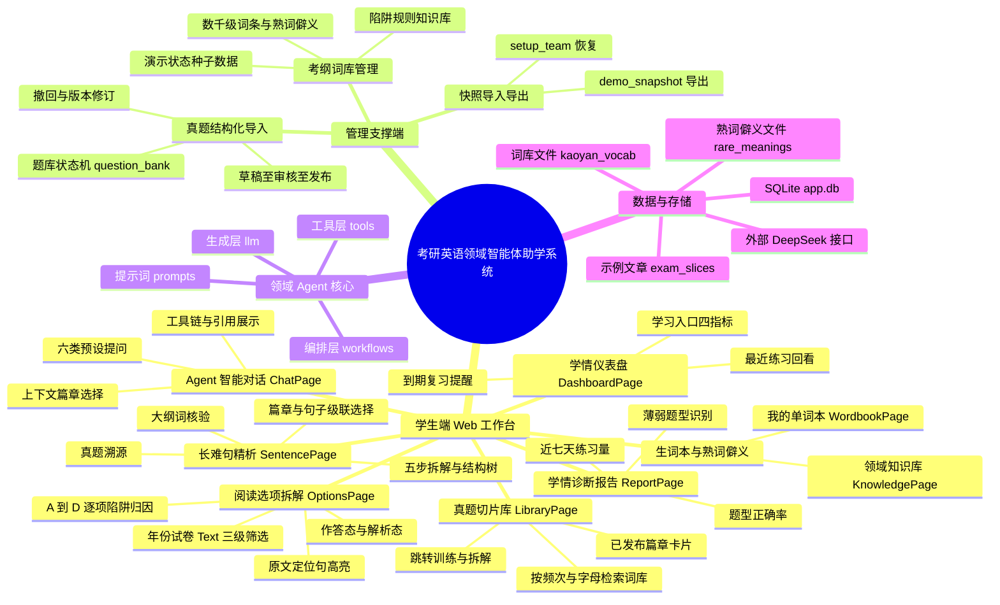
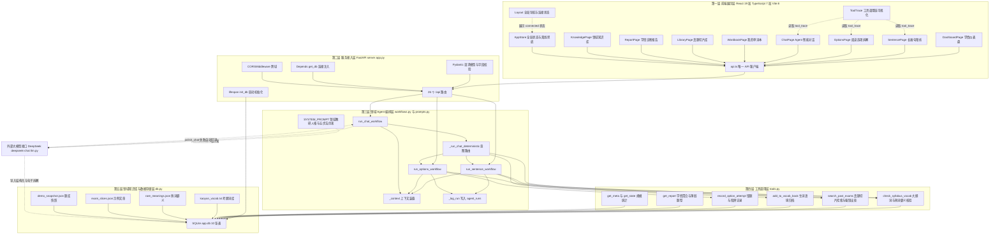
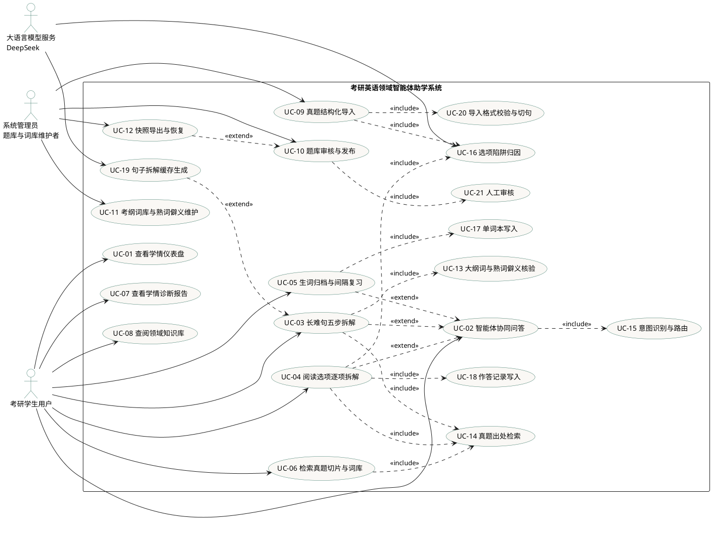
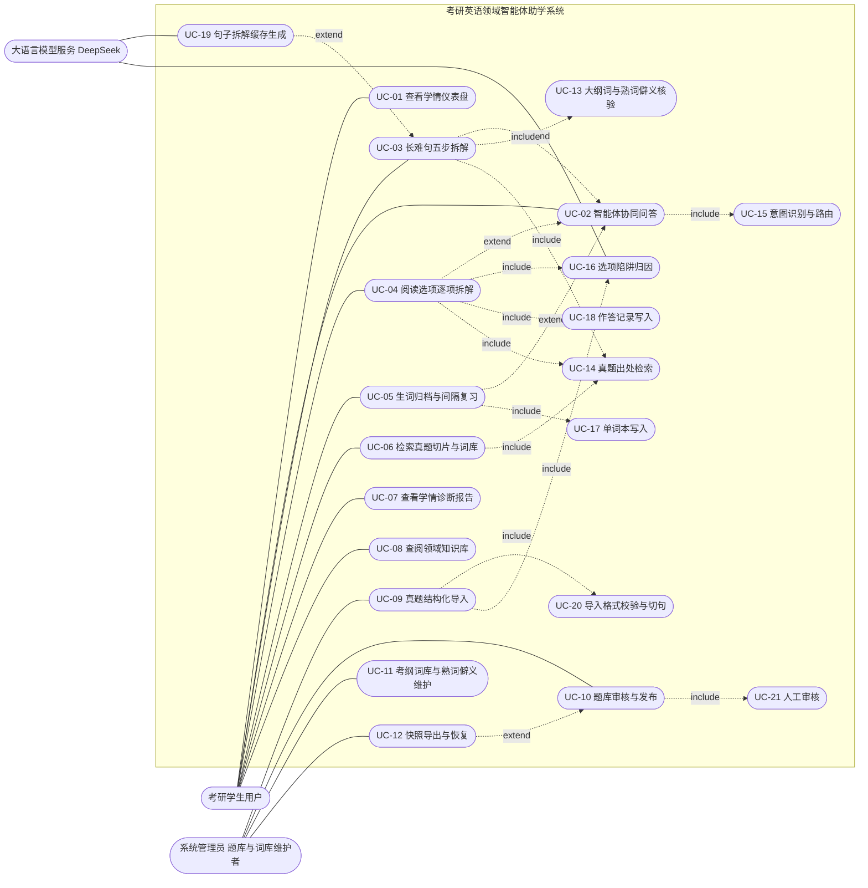
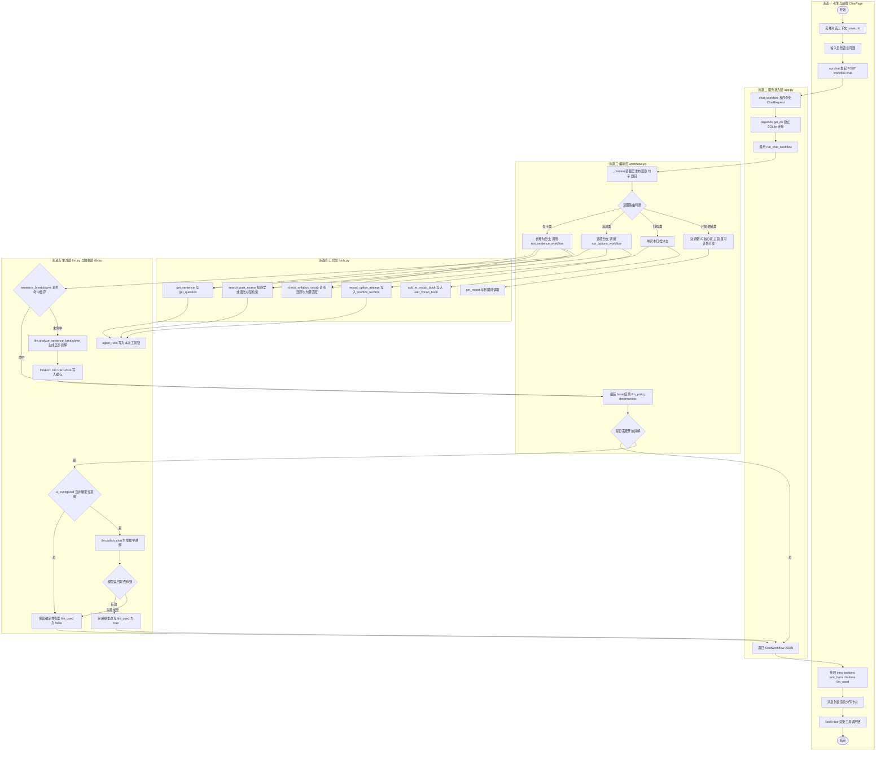
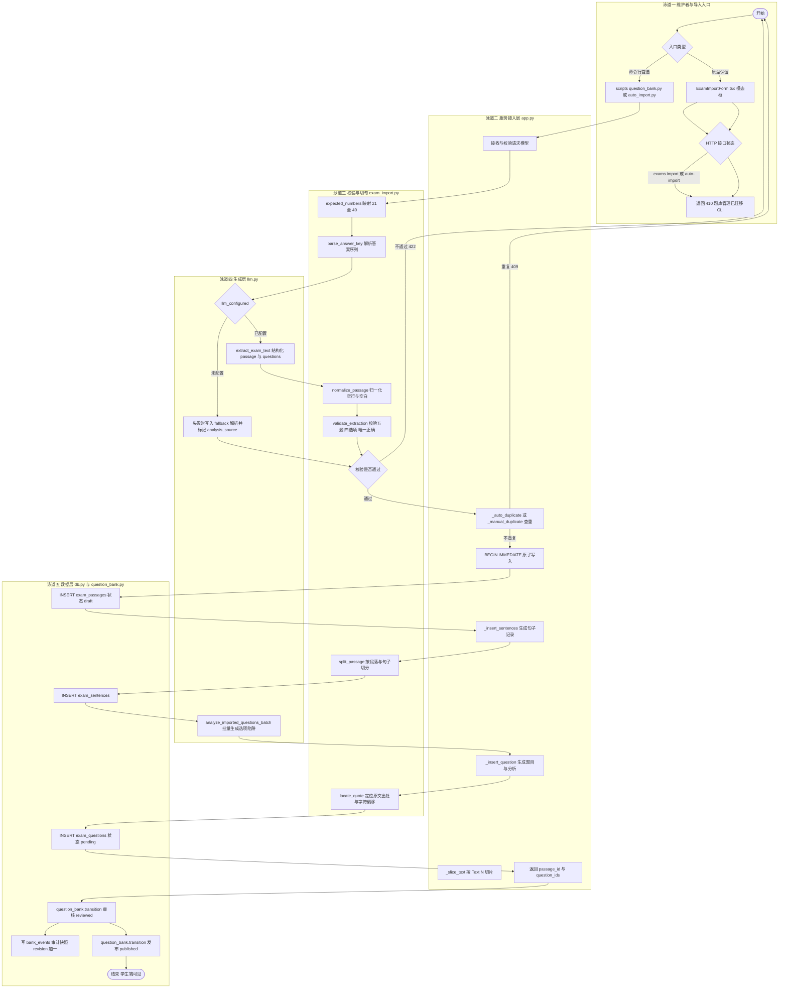
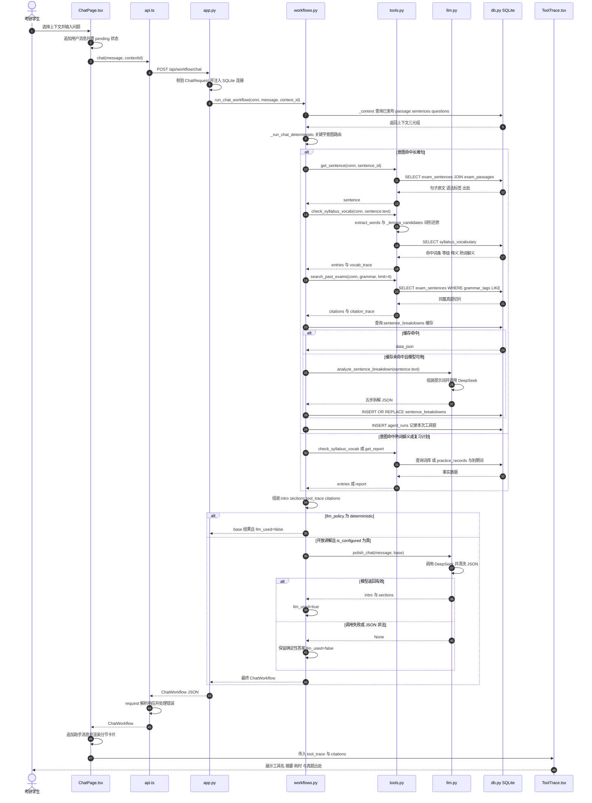
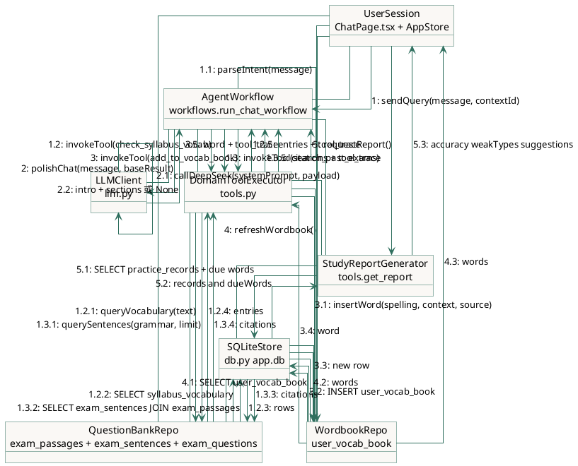
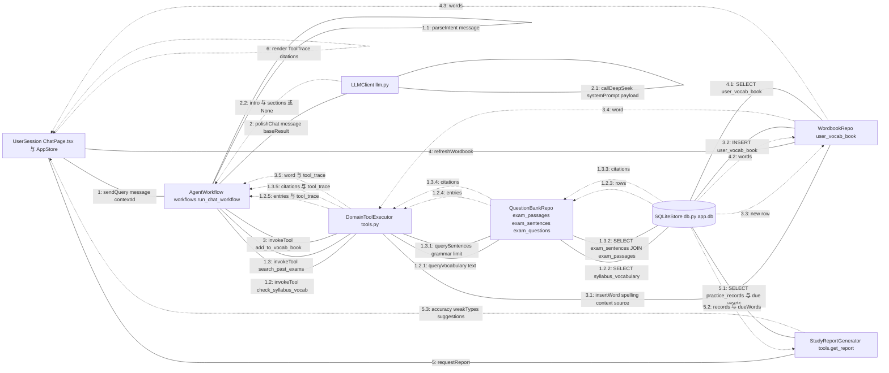

# 概要设计 · 架构图与 UML 图集

| 项目 | 内容 |
| --- | --- |
| 课程名称 | 2026 秋软件工程实践 |
| 项目名称 | 考研英语领域智能体助学系统（Kaoyan English Agent） |
| 代码基线 | `main @ 0688e14`（2026-11-08） |
| 图形总数 | 8 张（图 4 拆为 4a / 4b） |
| 图形语言 | Mermaid 10+ / PlantUML 1.2023+ |
| 编制依据 | GB/T 8567-2006《计算机软件文档编制规范》 |
| 命名原则 | 图中模块名、文件名、函数名、类名、表名均取自仓库真实代码，未出现虚构命名 |

## 0. 阅读与渲染约定

1. 所有 Mermaid 代码块可直接粘贴至支持 Mermaid 10 及以上版本的渲染器（VS Code Markdown Preview Mermaid Support、Typora、Mermaid Live Editor、语雀、飞书文档）。
2. 导出高清 PNG / SVG 建议使用 Mermaid CLI：

```bash
npm install -g @mermaid-js/mermaid-cli
mmdc -i docs/概要设计-架构与UML图集.md -o docs/概要设计-图集.svg -b transparent
mmdc -i docs/概要设计-架构与UML图集.md -o docs/概要设计-图集.png -s 3 -b white
```

3. PlantUML 版本用于图 3、图 7，渲染命令：

```bash
java -jar plantuml.jar docs/概要设计-架构与UML图集.md -tsvg
```

4. 节点文本中的中文括号、斜杠、加号均置于双引号内，避免 Mermaid 解析为图形语法；方法签名不使用泛型尖括号，返回类型以规约表格补充完整。
5. 三处与课堂口头描述的差异已在第 8 节"真实性校正说明"中列明，图形按代码实际实现绘制，未按想象补全函数。

---

## 图 1 系统功能模块思维导图（Mindmap）

### 1.1 Mermaid 源码



### 1.2 图形规约说明

| 规约项 | 内容 |
| --- | --- |
| 图形目的 | 以自顶向下视角说明系统"功能域—页面—支撑能力"的分解关系，作为概要设计总体功能章节的配图。 |
| 根节点 | 考研英语领域智能体助学系统，对应仓库 `kaoyan-english-agent`。 |
| 一级分支 | 学生端 Web 工作台、管理支撑端、领域 Agent 核心、数据与存储，共 4 个功能域。 |
| 学生端分支 | 严格对应 `web/src/App.tsx` 的 8 条路由：`DashboardPage`、`ChatPage`、`SentencePage`、`OptionsPage`、`WordbookPage`、`LibraryPage`、`ReportPage`、`KnowledgePage`。"生词本与熟词僻义"在图中拆为 `WordbookPage` 与 `KnowledgePage` 两个页面，以保持 8 页口径一致。 |
| 管理支撑端分支 | 对应 `server/question_bank.py` 的 `import_batch`、`transition`、`generate_analysis`，`server/scripts/setup_team.py`、`load_demo.py`、`export_demo.py`。管理能力不提供 Web 入口，仅通过离线命令行执行。 |
| 领域 Agent 核心分支 | 对应 `workflows.py`、`tools.py`、`llm.py`、`prompts.py` 四个真实模块，不虚构"RAG 检索服务"等未实现组件。 |
| 数据与存储分支 | 对应 `db.py` 的 `DB_PATH = server/data/app.db`，以及 `server/data/` 下 4 个静态资产文件。 |
| 连线语义 | 思维导图分支表示"包含/分解"关系，不表示调用顺序或数据流向。 |
| 设计约束 | 页面节点使用"中文名 + 组件名"双标注，便于评审对照代码；后续文档引用页面时统一使用组件名。 |

---

## 图 2 系统分层架构与领域 Agent 集成架构图

### 2.1 Mermaid 源码



### 2.2 图形规约说明

| 规约项 | 内容 |
| --- | --- |
| 图形目的 | 说明"表现层—接入层—编排层—工具层—数据层"的五层结构，以及外部 LLM 的集成位置，是概要设计总体架构章节的主图。 |
| 分层依据 | 依据 `README.md` 的"前后端边界"与 `docs/ARCHITECTURE.md` 的分层描述，并按代码目录进一步细化。 |
| 前端层 | 8 个页面组件全部通过 `web/src/lib/api.ts` 访问后端，不存在页面直连 `fetch` 的情况；`ToolTrace` 组件只消费后端返回的 `tool_trace` 字段。 |
| 服务接入层 | `server/app.py` 共 26 个 `/api` 路由，其中 `/api/exams/import`、`/api/exams/auto-import`、`/api/agent/runs` 三个由 `_team_cli_only` 固定返回 410，架构图保留节点但由文字说明其停用状态。 |
| 编排层 | 三条工作流入口为 `run_sentence_workflow`、`run_options_workflow`、`run_chat_workflow`；`_run_chat_deterministic` 承担意图路由，`_log_run` 仅在句子与选项工作流写 `agent_runs`（对话当前不写日志，见 `workflows.py` 与 `docs/PROJECT-DOSSIER.md` 技术债 P0-5）。 |
| 工具层 | 仅列 `tools.py` 真实存在的四个核心工具及其查询/聚合辅助函数。"长难句语法切分"不是 `tools.py` 的函数：首次拆解由 `llm.analyze_sentence_breakdown` 生成，结果缓存在 `sentence_breakdowns` 表；"选项干扰项特征分析"在导入阶段由 `llm.analyze_imported_question` / `analyze_imported_questions_batch` 生成，运行时由 `get_question` 读取 `analysis_json`。图中以虚线示意"生成后落库"，未伪造工具函数。 |
| 数据层 | `app.db` 实际 10 张表（含 `bank_events`），静态资产 4 个文件；`exam_slices.json` 与 `demo_snapshot.json` 在 `seed.py` / `scripts/load_demo.py` 中被读取后写入 SQLite，不在运行时直接被页面读取。 |
| 外部 LLM | `llm.py` 通过 OpenAI 兼容协议调用 DeepSeek；仅在 `is_configured()` 为真且意图属于开放讲解时调用，失败返回 `None` 并回退确定性答案。 |
| 闭环说明 | 前端操作改变 SQLite 状态后，后续 `/api/state`、`/api/meta` 请求会读到新状态，形成"训练—记录—报告—复习"闭环。 |
| 安全边界 | `LLM_API_KEY` 仅存在于 `server/.env`，前端通过 `VITE_API_BASE` 只拿到 API 地址，架构图中外部模型连接线只从后端发出。 |

---

## 图 3 UML 用例图（Use Case Diagram）

### 3.1 PlantUML 版本



### 3.2 Mermaid 版本



### 3.3 图形规约说明

| 规约项 | 内容 |
| --- | --- |
| 图形目的 | 界定系统边界与三类参与者的职责，作为概要设计"需求—设计"追溯依据。 |
| 参与者 1 | 考研学生用户：对应 `web/` 的 8 个页面使用者。 |
| 参与者 2 | 系统管理员（题库/词库维护者）：对应 `server/scripts/question_bank.py`、`setup_team.py`、`load_demo.py`、`export_demo.py` 的命令行操作者。当前**无 Web 管理界面**，`ExamImportForm.tsx` 组件存在但未挂载，两个导入 HTTP 接口返回 410。 |
| 参与者 3 | 大语言模型服务（DeepSeek）：外部系统参与者，仅在开放讲解与句子拆解首次生成时被调用。 |
| UC-01 至 UC-08 | 与 `web/src/App.tsx` 的 8 条路由一一对应，编号可被需求文档 FR-01 至 FR-08 交叉引用。 |
| UC-02 与 UC-03/04/05 | 智能对话在意图命中"从句/长难句/拆解/句子"时复用句子工作流，命中"选项/陷阱"时复用选项工作流，命中"加入单词本"时调用 `add_to_vocab_book`。三者是对话的可选扩展流程，故画为扩展用例指向基用例：`UC-03/04/05 ..> UC-02`。 |
| UC-03 与 UC-13/14 | 句子工作流内部固定调用 `check_syllabus_vocab` 与 `search_past_exams`，属于必经步骤，故为 `<<include>>`。 |
| UC-03 与 UC-19 | 句子五步拆解优先读取 `sentence_breakdowns` 缓存，仅在未命中且模型可用时调用 `llm.analyze_sentence_breakdown` 生成，因此 UC-19 为 UC-03 的可选扩展：`UC-19 ..> UC-03`。 |
| UC-04 与 UC-16/18 | 选项工作流的 `record_option_attempt` 同时完成陷阱归类与 `practice_records` 写入；陷阱文本来自 `exam_questions.analysis_json`，不是运行时模型推断。 |
| UC-09 与 UC-20 | 导入前必须经 `exam_import.validate_extraction`、`parse_answer_key`、`split_passage`、`locate_quote` 校验与切分，任一失败即拒绝入库。 |
| UC-10 与 UC-21 | `question_bank.transition` 规定必须 `draft → reviewed → published`；`publish-practice` 为独立分支，可跳过人工解析审核但仅开放基础练习。 |
| UC-12 与 UC-10 | 快照恢复后内容仍为草稿，需要重新审核发布才对学习者可见，故快照恢复对发布流程构成 `<<extend>>`。 |
| 未纳入用例 | 学生端真题导入、登录鉴权、多用户隔离、消息推送均未实现，图中不绘制，避免与代码不符。 |

---

## 图 4a 活动图：考生与考研英语 Agent 协同解题与长难句诊断业务流程

### 4.1 Mermaid 源码



### 4.2 图形规约说明

| 规约项 | 内容 |
| --- | --- |
| 图形目的 | 描述一次"学生提问—意图识别—工具调用—结构化生成—归档"的完整业务活动，对应 `ChatPage.tsx` → `workflows.run_chat_workflow` 的真实调用路径。 |
| 泳道划分 | 5 条泳道分别对应前端、接入层、编排层、工具层、生成与数据层，与图 2 的分层一致。 |
| 关键判断 1 | `sentence_breakdowns` 缓存命中则直接读取，未命中才调用模型；首次生成约 5–10 秒，命中后秒开。 |
| 关键判断 2 | `llm_policy == "deterministic"` 的长难句、选项、归档分支永不进入模型改写；只有熟词僻义、复习计划等开放讲解才进入 `polish_chat`。 |
| 关键判断 3 | 模型返回非法 JSON 或调用异常时，`polish_chat` 返回 `None`，编排层保留确定性答案并置 `llm_used=false`。 |
| 状态写入点 | 归档分支写 `user_vocab_book`；选项分支写 `practice_records`；句子与选项工作流写 `agent_runs`；拆解写 `sentence_breakdowns`。 |
| 与代码一致 | 图中未画"Agent 自主多轮规划"或"函数自动选择"流程；当前意图路由是 `if` 关键字匹配，属于规则式路由，不是模型驱动的工具选择。 |
| 异常路径 | 无已发布篇章时 `_context` 返回空，编排层直接返回"当前没有已发布的真题篇章"提示，不进入工具调用。 |

---

## 图 4b 活动图：真题导入与切片结构化入库流程

### 4.3 Mermaid 源码



### 4.4 图形规约说明

| 规约项 | 内容 |
| --- | --- |
| 图形目的 | 描述从 PDF/文本到"可被学生端读取的已发布题目"的全链路，对应 `server/app.py` 的 `_insert_sentences`、`_insert_question` 与 `server/exam_import.py` 的校验函数。 |
| 入口现状 | 当前学生端没有导入入口：`ExamImportForm.tsx` 未在任何页面挂载，`POST /api/exams/import`、`POST /api/exams/auto-import` 由 `_team_cli_only` 返回 410。图中保留该分支并明确标注 410，避免文档与代码冲突。 |
| 答案来源 | `answer_source` 取值 `provided / inferred / manual / unknown`；使用答案序列时为 `provided`，模型推断时为 `inferred`，均标记 `review_status=pending`。 |
| 题号映射 | 自动导入仅支持 Part A 的 Text 1–4，`expected_numbers` 生成 21–25、26–30、31–35、36–40，不静默顺延。 |
| 校验失败处理 | 任一校验失败返回 422 并附带 `issues` 列表；模型调用与网络请求期间不持有写事务，避免长事务锁库。 |
| 原子性 | 写入包裹在 `BEGIN IMMEDIATE` 中，并在持锁后再次查重；SQL 失败整体回滚。 |
| 发布门槛 | `question_bank.transition` 要求 `draft → reviewed → published`；`publish-practice` 可在未审核解析的情况下开放基础练习，但题目 `review_status` 标记为 `practice`，不声称已审核。 |
| 审计 | 每次状态变更 `revision + 1` 并写 `bank_events` 快照，供撤回与追溯。 |
| 切句口径 | `split_passage` 使用字符偏移 `[char_start, char_end)`，`locate_quote` 仅在唯一命中时绑定 `source_sentence_id`，否则 `location_status` 为 `unverified`。 |

---

## 图 5 UML 类图（Class Diagram）

### 5.1 Mermaid 源码

```mermaid
classDiagram
  direction LR

  class FastAPIApp {
    <<boundary>>
    +lifespan()
    +get_db()
    +health()
    +meta()
    +state()
    +passages()
    +passage_sentences(passage_id)
    +sentence_breakdown(sentence_id)
    +questions_full()
    +knowledge()
    +chat_workflow(payload)
    +sentence_workflow(payload)
    +options_workflow(payload)
    +create_word(payload)
    +review_vocab(payload)
    +create_record(payload)
    +vocab_browse(q, level, sort, offset, limit)
    +tool_check_vocab(payload)
    +tool_search_exams(q, grammar, limit)
  }

  class AgentWorkflow {
    <<controller>>
    +run_sentence_workflow(conn, sentence_id)
    +run_options_workflow(conn, question_id, user_answer)
    +run_chat_workflow(conn, message, context_id)
    -_run_chat_deterministic(conn, message, context_id)
    -_context(conn, context_id)
    -_get_sentence_breakdown(conn, sentence_id, sentence_text)
    -_log_run(conn, workflow, input_payload, output_payload, tool_trace)
    -_top_vocab(entries, limit)
  }

  class DomainToolExecutor {
    <<controller>>
    +check_syllabus_vocab(conn, text_or_words)
    +search_past_exams(conn, query, grammar, limit)
    +add_to_vocab_book(conn, word, context, source)
    +record_option_attempt(conn, question, user_answer)
    +review_word(conn, spelling, remembered)
    +remove_word(conn, spelling)
    +get_state(conn)
    +get_report(conn)
    +get_meta(conn)
    +get_sentence(conn, sentence_id, include_drafts)
    +get_question(conn, question_id, include_drafts)
    +search_vocab(conn, keyword, limit)
    +list_vocab(conn, keyword, level, sort, offset, limit)
    -extract_words(text)
    -_lemma_candidates(word)
    -_find_vocab(conn, word)
  }

  class LLMClient {
    <<service>>
    +is_configured()
    +status()
    +polish_chat(message, base_result)
    +analyze_imported_question(passage, content, options, correct_answer)
    +analyze_imported_questions_batch(passage, questions)
    +extract_exam_text(raw, year, exam_type, text_number, answer_key)
    +analyze_sentence_breakdown(sentence)
    -_extract_json(content)
    -_sanitize(payload)
  }

  class ExamImportService {
    <<service>>
    +expected_numbers(text_number)
    +parse_answer_key(value, numbers)
    +normalize_passage(text)
    +validate_extraction(extraction, text_number, answer_key)
    +split_passage(passage)
    +locate_quote(quote, passage, sentences)
  }

  class QuestionBankService {
    <<controller>>
    +import_batch(conn, document, actor, update)
    +validate_entry(entry)
    +transition(conn, passage_id, expected_revision, action, actor)
    +generate_analysis(conn, passage_id, expected_revision, actor, analyzer)
    +readiness(conn, passage_id)
    +practice_readiness(conn, passage_id)
    +export_entry(conn, passage_id)
    -_save(conn, data, raw, actor, update)
    -_event(conn, passage_id, action, actor)
  }

  class Database {
    <<data>>
    +String SCHEMA
    +connect()
    +init_db()
    +migrate_schema(conn)
  }

  class SyllabusVocabulary {
    <<entity>>
    +int id
    +String word
    +String basic_meaning
    +String rare_meaning
    +int exam_frequency
    +String level
    +String created_at
  }

  class ExamPassage {
    <<entity>>
    +String id
    +int year
    +String exam_type
    +int text_number
    +String text
    +String publication_status
    +int revision
    +String reviewed_by
    +String reviewed_at
    +String published_at
    +String source_note
  }

  class ExamSentence {
    <<entity>>
    +String id
    +String passage_id
    +int paragraph
    +int sentence_index
    +String text
    +String grammar_tags
    +String source_label
    +int char_start
    +int char_end
  }

  class ExamQuestion {
    <<entity>>
    +String id
    +String passage_id
    +int number
    +String question_type
    +String content
    +String options_json
    +String correct_answer
    +String analysis_json
    +String steps_json
    +String source_sentence_id
    +String answer_source
    +String review_status
    +String source_quote
    +String location_status
  }

  class SentenceBreakdown {
    <<entity>>
    +String sentence_id
    +String data_json
    +int llm_used
    +String created_at
  }

  class TrapRule {
    <<entity>>
    +int id
    +String name
    +String definition
    +String signals
    +String example
    +String tone
  }

  class UserVocabWord {
    <<entity>>
    +int id
    +String spelling
    +String phonetic
    +String meaning
    +String source
    +String context
    +int is_outline
    +float familiarity
    +int review_count
    +float easiness
    +int interval_days
    +int repetition
    +String next_review
  }

  class PracticeRecord {
    <<entity>>
    +int id
    +String question_id
    +String question_type
    +String user_answer
    +String correct_answer
    +int is_correct
    +String trap_type
    +String agent_feedback
    +String created_at
  }

  class AgentRun {
    <<entity>>
    +int id
    +String workflow
    +String input_json
    +String output_json
    +String tool_trace_json
    +String created_at
  }

  class BankEvent {
    <<entity>>
    +int id
    +String passage_id
    +int revision
    +String action
    +String actor
    +String created_at
    +String snapshot_json
  }

  class Word {
    <<frontendEntity>>
    +String id
    +String spelling
    +String phonetic
    +String meaning
    +String source
    +boolean isOutline
    +float familiarity
    +int reviewCount
    +String nextReview
  }

  class StudyRecord {
    <<frontendEntity>>
    +String id
    +String questionId
    +String questionType
    +String userAnswer
    +String correctAnswer
    +boolean isCorrect
    +String time
  }

  class ReactApiClient {
    <<boundary>>
    +request(path, init)
    +getMeta()
    +getState()
    +getKnowledge()
    +getQuestionsFull()
    +getPassages()
    +getPassageSentences(passageId)
    +getSentenceBreakdown(sentenceId)
    +runSentence(sentenceId)
    +runOptions(questionId, userAnswer)
    +chat(message, contextId)
    +addWord(payload)
    +deleteWord(spelling)
    +reviewWord(spelling, remembered)
    +addRecord(payload)
    +browseVocab(params)
    +getReport()
  }

  class ChatPage {
    <<boundary>>
    +messages
    +contextId
    +handleSend(text)
    +renderSections()
  }

  class ToolTrace {
    <<boundary>>
    +tools ToolCall
    +title String
    +render()
  }

  FastAPIApp --> AgentWorkflow : 调用三条工作流
  FastAPIApp ..> Database : 依赖 get_db
  FastAPIApp ..> ExamImportService : 导入校验
  FastAPIApp ..> LLMClient : 句子拆解与导入
  AgentWorkflow --> DomainToolExecutor : 工具编排
  AgentWorkflow ..> LLMClient : 开放讲解与拆解
  AgentWorkflow ..> Database : 读写状态
  DomainToolExecutor ..> Database : SQL 读写
  QuestionBankService ..> Database : 状态机与审计
  QuestionBankService ..> ExamImportService : 校验与切句
  ExamImportService ..> LLMClient : 导入结构化
  ChatPage --> ReactApiClient : 调用
  ChatPage --> ToolTrace : 传入 tool_trace
  ReactApiClient ..> FastAPIApp : HTTP /api
  ReactApiClient ..> Word : 反序列化
  ReactApiClient ..> StudyRecord : 反序列化

  Database o-- SyllabusVocabulary : 1 对多
  Database o-- ExamPassage : 1 对多
  Database o-- TrapRule : 1 对多
  Database o-- AgentRun : 1 对多
  Database o-- BankEvent : 1 对多
  ExamPassage o-- ExamSentence : contains
  ExamPassage o-- ExamQuestion : contains
  ExamSentence o-- SentenceBreakdown : caches
  ExamQuestion ..> ExamSentence : locates
  UserVocabWord ..> SyllabusVocabulary : spelling 逻辑映射
  PracticeRecord ..> ExamQuestion : question_id 逻辑关联
  PracticeRecord ..> TrapRule : trap_type 逻辑归类
```



### 5.2 图形规约说明

| 规约项 | 内容 |
| --- | --- |
| 图形目的 | 将后端 5 个模块与前端类型、边界组件映射为 UML 类，说明控制类、边界类、实体类、服务类的静态关系。 |
| 构造型约定 | `boundary` 边界类：`FastAPIApp`、`ReactApiClient`、`ChatPage`、`ToolTrace`；`controller` 控制类：`AgentWorkflow`、`DomainToolExecutor`、`QuestionBankService`；`service` 服务类：`LLMClient`、`ExamImportService`；`entity` 实体类：10 张表对应类；`data` 数据访问类：`Database`。 |
| 模块到类的映射 | `server/app.py` → `FastAPIApp`；`server/workflows.py` → `AgentWorkflow`；`server/tools.py` → `DomainToolExecutor`；`server/llm.py` → `LLMClient`；`server/exam_import.py` → `ExamImportService`；`server/question_bank.py` → `QuestionBankService`；`server/db.py` → `Database`；`web/src/types.ts` → `Word`、`StudyRecord`；`web/src/lib/api.ts` → `ReactApiClient`；`web/src/pages/ChatPage.tsx` → `ChatPage`；`web/src/components/ToolTrace.tsx` → `ToolTrace`。 |
| 方法签名口径 | 图中省略了 Python 类型注解与默认值，完整签名以 `tools.py`、`workflows.py` 为准，例如 `search_past_exams(conn, query="", grammar=None, limit=5) -> tuple[list[dict], dict]`。 |
| 私有方法 | 以 `-` 前缀标注，对应 Python 下划线前缀函数，如 `_run_chat_deterministic`、`_lemma_candidates`、`_sanitize`。 |
| 关系强度 | 实线箭头 `-->` 表示控制流调用；虚线箭头 `..>` 表示依赖；`o--` 表示聚合。`Database o-- ExamPassage` 表示表由同一数据库统一管理，不代表面向对象聚合语义。 |
| 物理外键与逻辑关联 | `ExamSentence - ExamPassage`、`ExamQuestion - ExamPassage`、`ExamQuestion - ExamSentence`、`SentenceBreakdown - ExamSentence` 在 `db.py` 中有真实 `REFERENCES` 外键；`PracticeRecord.question_id`、`UserVocabWord.spelling`、`PracticeRecord.trap_type`、`BankEvent.passage_id` **没有物理外键**，图中以虚线 `..>` 标注"逻辑关联"。 |
| 前端类型差异 | 后端 `user_vocab_book` 行经 `word_to_dict` 转换为前端 `Word`：字段 `is_outline → isOutline`、`review_count → reviewCount`、`next_review → nextReview`，并拼接 `id = "w" + id`。 |
| 未建模内容 | `kaoyan_agent/` 为早期 Streamlit MVP，不参与当前主链路，类图中不展开，避免与主系统混淆。 |

---

## 图 6 UML 时序图（Sequence Diagram）：一次复杂长难句提问的完整生命周期

### 6.1 Mermaid 源码



### 6.2 图形规约说明

| 规约项 | 内容 |
| --- | --- |
| 图形目的 | 说明一次对话请求从界面到模型再回到界面的完整对象交互，重点体现"工具先于模型""模型只改写表达"的设计原则。 |
| 触发点 | `ChatPage.tsx` 的发送逻辑调用 `api.chat(text, contextId)`，对应 `POST /api/workflow/chat`。 |
| 连接注入 | `app.py` 通过 `Depends(get_db)` 为每个请求创建独立 SQLite 连接，请求结束关闭，对应 `get_db` 生成器。 |
| 上下文装载 | `_context` 只读取 `publication_status='published'` 的篇章、句子与题目；指定 `context_id` 不存在时回退到最近年份的已发布篇章。 |
| 工具调用次数 | 一次长难句提问至少触发 3 次数据库读取：上下文、词库核验、真题切片检索；缓存未命中时增加 1 次模型调用与 1 次缓存写入。 |
| 引用约束 | 句子工作流把当前句强制置顶 `citations`，并过滤为同 `passage_id` 最多 3 条，防止不同年份句子串篇。 |
| 模型调用位置 | `polish_chat` 在确定性结果之后执行，输入包含 `tool_trace` 与 `citations`，输出仅允许 `intro` 与 `sections`；模型无法修改工具链、引用与答案。 |
| 失败回退 | 未配置 Key、网络异常、JSON 非法三种情况均返回 `llm_used=false`，前端仍能展示确定性解析与工具链。 |
| 前端渲染 | `ChatPage` 渲染分节卡片，`ToolTrace` 渲染每个工具的 `tool`、`summary`、`duration_ms`，`citations` 以标签形式展示出处。 |
| 日志边界 | 对话工作流当前不写 `agent_runs`；图中 `INSERT agent_runs` 仅发生在意图命中长难句并调用 `run_sentence_workflow` 时，符合代码现状。 |

---

## 图 7 UML 协作图 / 通信图（Communication Diagram）

### 7.1 PlantUML 版本



### 7.2 Mermaid 等价交互图



### 7.3 图形规约说明

| 规约项 | 内容 |
| --- | --- |
| 图形目的 | 以空间拓扑方式展示核心对象的连接关系与带序号的消息顺序，与图 6 时序图互为补充：时序图强调时间顺序，通信图强调对象协作拓扑。 |
| 对象命名 | `UserSession`、`AgentWorkflow`、`LLMClient`、`DomainToolExecutor`、`QuestionBankRepo`、`WordbookRepo`、`StudyReportGenerator` 为设计层对象名，括注对应真实文件或函数，保证可追溯。 |
| 消息编号规则 | 顶层操作为 `1/2/3/4/5`，其内部调用按 `1.1/1.2/1.3` 递进，数据库访问进一步细化为 `1.2.2/1.3.2/3.2`；实线表示调用，虚线表示返回。 |
| 对象 1 | `UserSession` 对应 `ChatPage.tsx` 的会话状态与 `AppStore` 的 `words`、`records`、`refresh()`。 |
| 对象 2 | `AgentWorkflow` 对应 `workflows.run_chat_workflow` 与 `_run_chat_deterministic`，负责意图解析与编排，不直接执行 SQL。 |
| 对象 3 | `LLMClient` 对应 `llm.py`，只在消息 `2` 被调用；消息 `2.2` 可能返回 `None`，此时 `AgentWorkflow` 保持确定性结果。 |
| 对象 4 | `DomainToolExecutor` 对应 `tools.py` 的四个核心工具，是唯一直接拼装业务 SQL 的组件。 |
| 对象 5 | `QuestionBankRepo` 不是独立 Python 类，而是 `exam_passages`、`exam_sentences`、`exam_questions` 三表与 `app.py` 查询函数的逻辑仓储边界，图中以矩形对象表示。 |
| 对象 6 | `WordbookRepo` 对应 `user_vocab_book` 表与 `add_to_vocab_book`、`review_word`、`remove_word`、`get_state`。 |
| 对象 7 | `StudyReportGenerator` 对应 `tools.get_report`：按 `question_type` 聚合正确率、筛选 `< 0.7` 的 `weak_types`、读取到期词并生成建议。 |
| 状态交互 | 消息 `3` 会改变 `user_vocab_book` 持久化状态；消息 `4` 读取新状态，构成"归档→刷新"的可见反馈。消息 `5` 只读，不改变状态。 |
| 并发说明 | 每次 HTTP 请求通过 `Depends(get_db)` 获取独立连接，`connect()` 使用 `check_same_thread=False`；图中未画线程模型，避免误示并发写入安全。 |

---

## 8. 真实性校正说明（与课堂口头描述的差异）

本节用于向评审说明：下列内容按真实代码绘制，未按题目口头描述虚构函数或组件。

| 编号 | 口头描述 | 代码事实 | 图集处理 |
| --- | --- | --- | --- |
| R1 | `tools.py` 包含"长难句语法切分"工具 | `tools.py` 无此函数；拆解由 `llm.analyze_sentence_breakdown` 生成，结果写入 `sentence_breakdowns` | 图 2、图 5、图 6 将拆解归入生成层，并标注缓存表；未虚构 `split_sentence` 工具 |
| R2 | `tools.py` 包含"选项干扰项特征分析"工具 | 运行时只由 `get_question` 读取 `exam_questions.analysis_json`；分析文本在导入期由 `llm.analyze_imported_question(s_batch)` 生成 | 图 2 以虚线标注"导入期生成后落库"，图 4a 的选项分支调用 `record_option_attempt` 完成归类 |
| R3 | `ExamImportForm.tsx` 为学生端导入入口 | 组件存在但 `web/src` 中无任何页面挂载；`/api/exams/import`、`/api/exams/auto-import` 由 `_team_cli_only` 返回 410 | 图 3 将导入用例归属系统管理员；图 4b 保留入口分支但显式标注 410 与 CLI 首选 |
| R4 | 对话工作流写入 `agent_runs` | `_log_run` 仅在 `run_sentence_workflow`、`run_options_workflow` 调用；对话入口不写日志 | 图 6 仅在长难句分支出现 `INSERT agent_runs` |
| R5 | 数据库 9 张表 | `db.py` 实际定义 10 张，含 `bank_events` | 图 5 建模 10 个实体类 |
| R6 | 前端 8 页不含资料库 | `App.tsx` 实际 8 路由含 `/library`，无 `/comparison` | 图 1、图 3 按 `LibraryPage` 建模 |

---

## 9. 命名一致性自检表

| 检查项 | 图中出现 | 代码位置 | 结论 |
| --- | --- | --- | --- |
| 页面组件名 | DashboardPage / SentencePage / OptionsPage / ChatPage / WordbookPage / LibraryPage / ReportPage / KnowledgePage | `web/src/App.tsx` | 一致 |
| 可视化组件名 | ToolTrace / Layout / ExamImportForm | `web/src/components/` | 一致 |
| 工作流函数 | run_sentence_workflow / run_options_workflow / run_chat_workflow / _run_chat_deterministic | `server/workflows.py` | 一致 |
| 工具函数 | check_syllabus_vocab / search_past_exams / add_to_vocab_book / record_option_attempt | `server/tools.py` | 一致 |
| 工具链显示名 | check_syllabus_vocab / search_past_exams / add_to_vocab_book / record_trap_mistake | `server/tools.py:_trace` | 一致，注意 `record_trap_mistake` 为 trace 名，函数名为 `record_option_attempt` |
| 导入校验函数 | expected_numbers / parse_answer_key / normalize_passage / validate_extraction / split_passage / locate_quote | `server/exam_import.py` | 一致 |
| 建库函数 | import_batch / transition / generate_analysis / readiness / practice_readiness / export_entry | `server/question_bank.py` | 一致 |
| LLM 函数 | polish_chat / analyze_imported_question / analyze_imported_questions_batch / extract_exam_text / analyze_sentence_breakdown / is_configured / status | `server/llm.py` | 一致 |
| 表名 | 10 张表名全称 | `server/db.py` | 一致 |
| 状态取值 | draft / reviewed / published / practice / pending / approved / exact_quote / unverified | `server/question_bank.py`、`server/db.py` | 一致 |
| 外部模型 | deepseek-chat | `server/llm.py`、`docs/ARCHITECTURE.md` | 一致 |