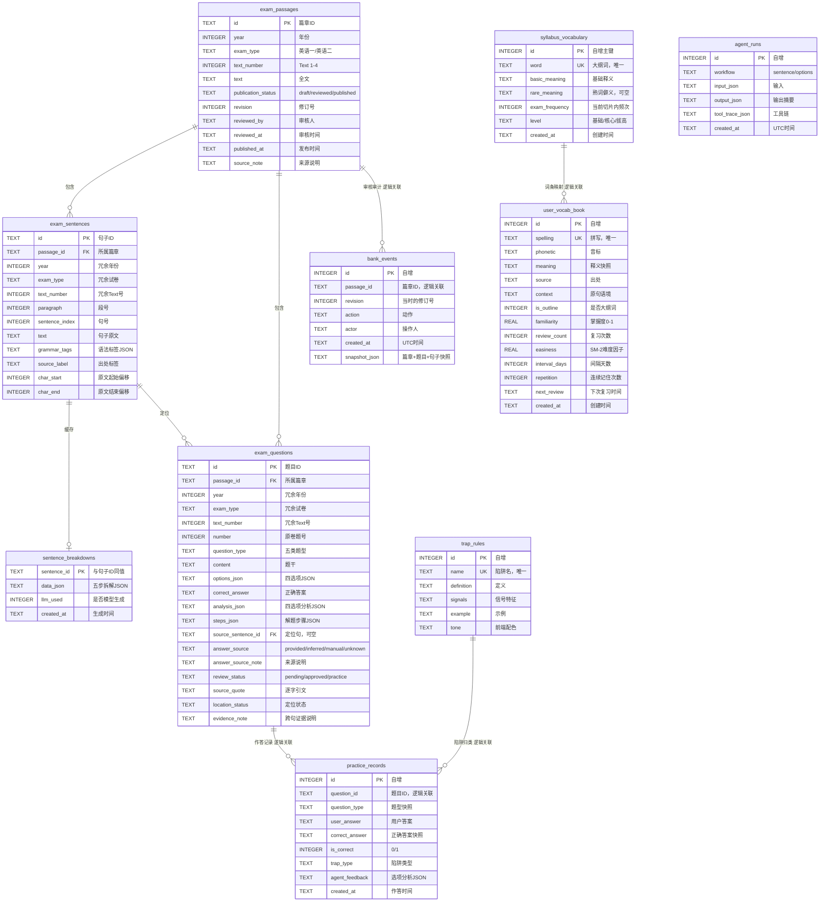
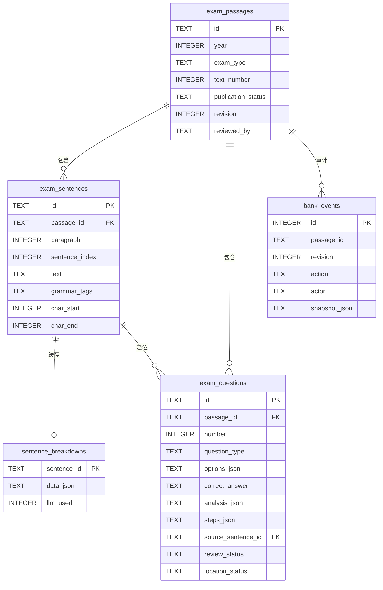
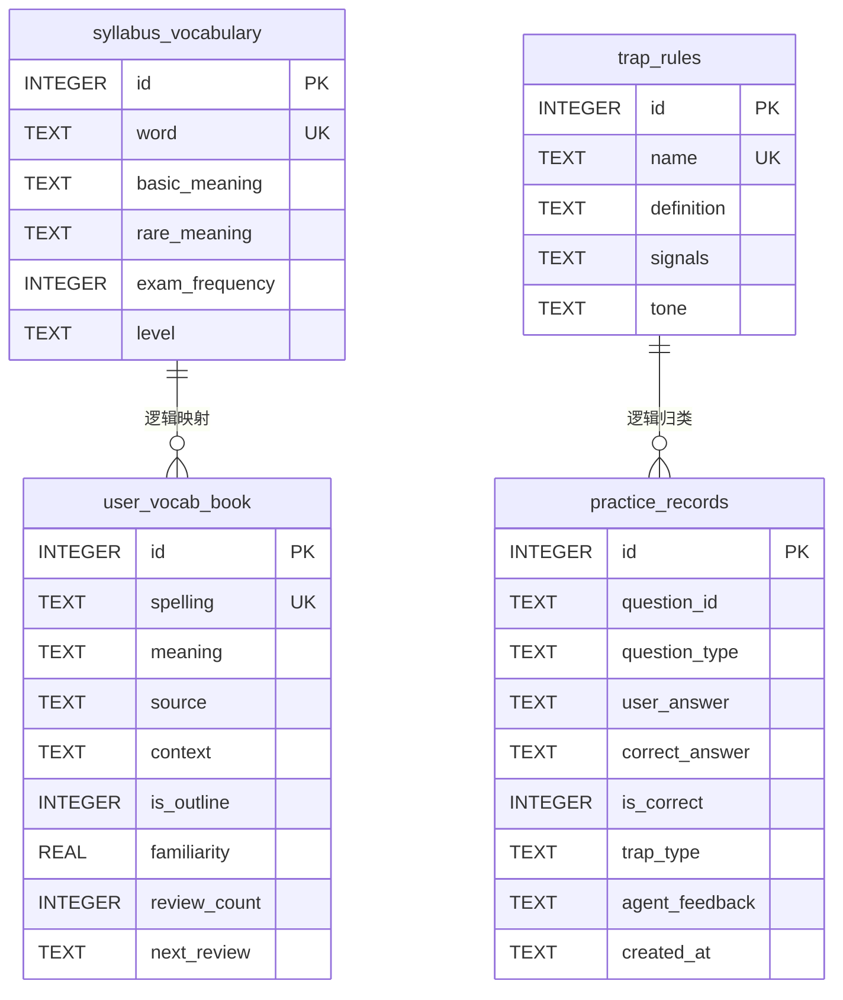
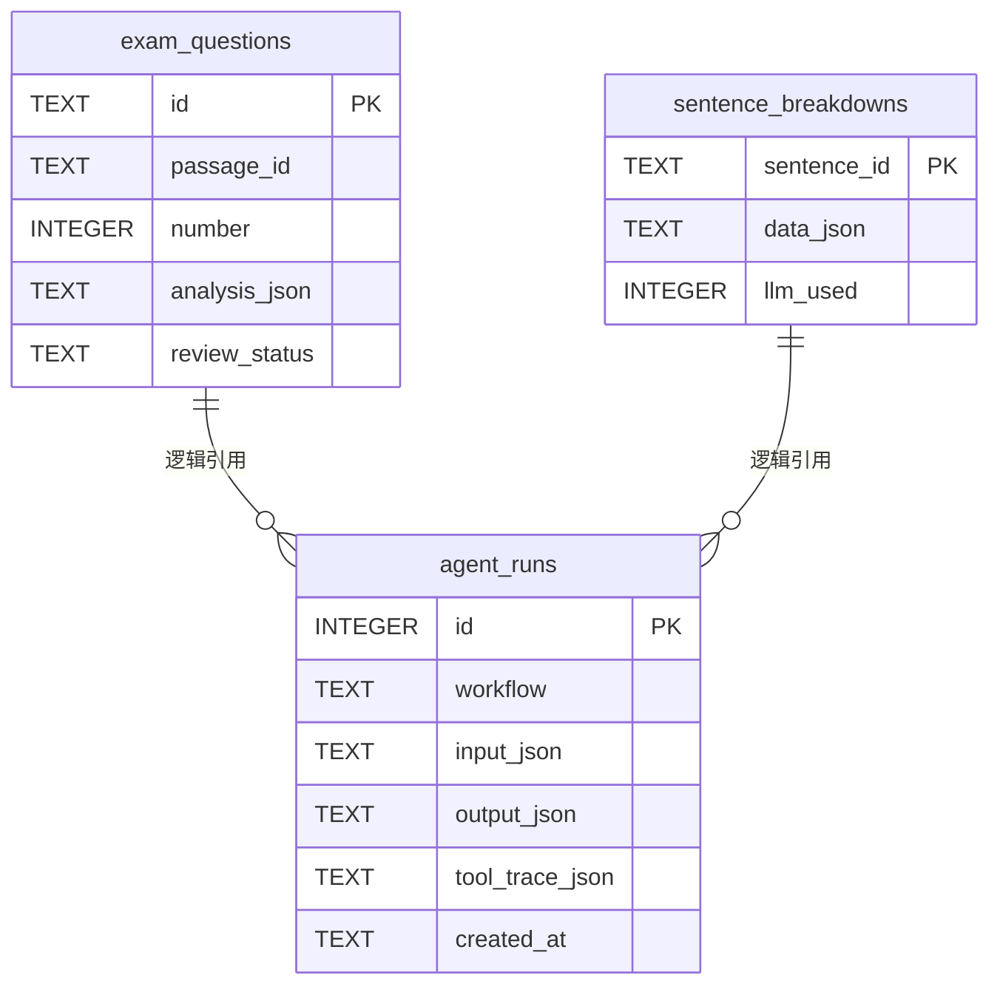

# 福大智联_数据库设计说明书

**项目名称：** 考研英语领域智能体助学系统（Kaoyan English Agent）

**文档编号：** FZU-SE-2026-KEA-DBD-001

**文档版本：** V1.0

**编制日期：** 2026-11-09

**编制单位：** 福大智联团队

**课程名称：** 2026 秋软件工程实践

**代码基线：** `main @ 0688e14`（2026-11-08）

**规范依据：** GB/T 8567-2006《计算机软件文档编制规范》

---

## 目录

- [1 引言](#1-引言)
  - [1.1 编写目的](#11-编写目的)
  - [1.2 背景](#12-背景)
  - [1.3 术语与缩写词定义](#13-术语与缩写词定义)
  - [1.4 参考资料](#14-参考资料)
- [2 外部设计](#2-外部设计)
  - [2.1 标识符和状态](#21-标识符和状态)
  - [2.2 使用它的程序](#22-使用它的程序)
  - [2.3 约定与命名规范](#23-约定与命名规范)
  - [2.4 支持软件](#24-支持软件)
- [3 结构设计](#3-结构设计)
  - [3.1 概念结构设计](#31-概念结构设计er-图)
  - [3.2 逻辑结构设计](#32-逻辑结构设计关系数据模型)
  - [3.3 对象关系映射](#33-对象关系映射实体类与库表映射)
  - [3.4 物理结构设计与索引优化](#34-物理结构设计与索引优化)
- [4 领域知识与 Agent 交互记录专项存储管理](#4-领域知识agent-交互记录与任务执行结果的专项存储管理方案)
  - [4.1 领域静态与半静态知识存储](#41-领域静态半静态知识存储)
  - [4.2 用户与 Agent 交互记录存储](#42-用户与-agent-交互记录存储)
  - [4.3 任务执行结果与工具轨迹存储](#43-agent-任务执行结果与工具轨迹存储)
- [5 运用设计、安全保密与数据迁移设计](#5-运用设计安全保密与数据迁移设计)
  - [5.1 数据库初始化](#51-数据库初始化)
  - [5.2 Schema 迁移升级](#52-schema-迁移升级)
  - [5.3 演示快照导入导出](#53-演示快照导入导出)
  - [5.4 备份与恢复](#54-备份与恢复)
  - [5.5 安全保密设计](#55-安全保密设计)
  - [5.6 数据完整性与容量估算](#56-数据完整性与容量估算)
  - [5.7 尚未解决的问题](#57-尚未解决的问题)
- [附录 A 表清单与记录规模](#附录-a-表清单与记录规模)
- [附录 B 完整 DDL 脚本](#附录-b-完整-ddl-脚本)
- [附录 C 状态取值字典](#附录-c-状态取值字典)
- [附录 D 源码索引](#附录-d-源码索引)

---

# 1 引言

## 1.1 编写目的

本文档是"考研英语领域智能体助学系统（Kaoyan English Agent）"的**数据库设计说明书**，依据 GB/T 8567-2006 的外部设计、结构设计、运用设计三部分组织，说明系统数据库的标识、使用程序、命名约定、概念模型、逻辑模型、物理实现、对象映射、领域知识与 Agent 运行数据的专项存储方案，以及迁移、备份与安全设计。

本文档的预期读者与用途：

| 读者 | 用途 |
| --- | --- |
| 课程评审教师与助教 | 核查数据库设计是否覆盖全部业务实体、是否符合范式、是否与代码完全一致 |
| 后端开发成员 | 以字段字典与 DDL 作为改表、写查询、排查数据问题的唯一依据 |
| 前端开发成员 | 通过 3.3 的映射矩阵理解 JSON 字段与 TypeScript 接口的对应关系 |
| 题库维护者 | 通过 5.3 理解快照导入导出对发布状态的影响 |
| 后续接手者 | 通过附录 A、B、C、D 快速定位表、DDL、状态取值与源码 |

编写原则：**字段名、类型、默认值、约束、状态取值、脚本行为全部取自 `server/db.py`、`server/seed.py`、`server/exam_import.py`、`server/question_bank.py`、`server/scripts/` 与 `server/data/` 的真实内容**。凡历史文档（如 `docs/PROJECT-DOSSIER.md` 写"9 张表"）与代码不一致，以当前代码基线为准并在正文标注。

## 1.2 背景

### 1.2.1 项目名称与开发者

- 中文名称：考研英语领域智能体助学系统
- 英文名称：Kaoyan English Agent
- 代码仓库：`kaoyan-english-agent`（`https://github.com/H3HN/kaoyan-english-agent.git`）
- 开发者：福州大学 2026 秋软件工程实践"福大智联"团队，共 13 人（黄俊翔、黄炜杰、金若曦、越长智、洪豊幀、王世豪、谭段昊、邱福铭、王伟浩、陈封、陈韦融、邓杰、王泽炜）
- 数据库设计文档编制：黄俊翔

### 1.2.2 数据库在系统中的位置

本系统是"前端 React 工作台 + FastAPI 服务 + SQLite 单文件数据库 + 可选 LLM 生成层"的结构。数据库承担三类职责：

1. **领域知识承载**：5,000 余条考研大纲词、68 篇真题篇章、1,295 个句子切片、340 道题目、8 条陷阱规则。
2. **学习状态承载**：用户单词本、复习间隔、练习记录。
3. **Agent 运行留痕**：句子/选项工作流的输入输出与工具调用链、句子五步拆解缓存、题库审核审计。

前端不直接持有领域数据，所有读写都经 `/api` 到后端；数据库是系统唯一的事实来源。

### 1.2.3 数据库文件与运行方式

| 项目 | 内容 |
| --- | --- |
| 数据库类型 | SQLite 3（嵌入式关系型数据库） |
| 文件路径 | `server/data/app.db` |
| 连接方式 | Python 标准库 `sqlite3.connect(DB_PATH, check_same_thread=False)` |
| 日志模式 | WAL（`PRAGMA journal_mode = WAL`） |
| 外键 | 开启（`PRAGMA foreign_keys = ON`） |
| 行工厂 | `sqlite3.Row`，支持按列名访问 |
| 提交方式 | 写操作显式 `commit()`；导入使用 `BEGIN IMMEDIATE` 事务 |
| 部署形态 | 单用户本地演示库，无并发多用户写入 |

## 1.3 术语与缩写词定义

### 1.3.1 数据库基础术语

| 缩写 / 术语 | 英文全称 | 中文含义 | 本项目采用情况 |
| --- | --- | --- | --- |
| DB | Database | 数据库 | 采用 |
| DBMS | Database Management System | 数据库管理系统 | 采用（SQLite） |
| SQLite | SQLite | 嵌入式关系型数据库，单文件、零运维 | 采用 |
| SQL | Structured Query Language | 结构化查询语言 | 采用（手写 SQL） |
| DDL | Data Definition Language | 数据定义语言，如 `CREATE TABLE` / `CREATE INDEX` | 采用 |
| DML | Data Manipulation Language | 数据操纵语言，如 `INSERT` / `UPDATE` / `DELETE` / `SELECT` | 采用 |
| DQL | Data Query Language | 数据查询语言，通常归入 DML | 采用 |
| DCL | Data Control Language | 数据控制语言，如 `GRANT` | **未采用**（单用户文件库无权限体系） |
| TCL | Transaction Control Language | 事务控制语言，如 `BEGIN` / `COMMIT` / `ROLLBACK` | 采用 |
| ER | Entity-Relationship | 实体—关系模型 | 采用 |
| E-R 图 | Entity-Relationship Diagram | 实体—关系图 | 采用 |
| PK | Primary Key | 主键 | 采用 |
| FK | Foreign Key | 外键 | 部分采用（详见 3.1） |
| UK | Unique Key | 唯一键 | 采用 |
| ORM | Object-Relational Mapping | 对象关系映射 | **未采用**。项目使用原生 `sqlite3` 与手写 SQL，3.3 所述"映射"是手写的字典转换，不是 ORM 框架 |
| DAO | Data Access Object | 数据访问对象 | 概念近似，项目以函数集合承担该职责，无独立 DAO 类 |
| CRUD | Create Read Update Delete | 增删改查 | 采用 |
| ACID | Atomicity Consistency Isolation Durability | 事务的原子性、一致性、隔离性、持久性 | 采用（SQLite 事务保证） |
| WAL | Write-Ahead Logging | 预写式日志，SQLite 并发读写模式 | 采用 |
| 3NF | Third Normal Form | 第三范式 | 部分满足，详见 3.2.2 |
| 1NF | First Normal Form | 第一范式，属性原子性 | 主数据表满足；JSON 列有意突破 |
| 反范式 | Denormalization | 为提高读性能或保留快照而引入冗余 | 采用（详见 3.2.2） |
| Schema | Schema | 数据库模式/表结构定义 | 采用 |
| Migration | Schema Migration | 模式迁移升级 | 采用（轻量幂等迁移） |
| Snapshot | Snapshot | 某一时刻的数据快照 | 采用（`demo_snapshot.json`） |
| Checkpoint | WAL Checkpoint | 把 WAL 日志写回主数据库文件 | 运维概念，未在代码中显式调用 |
| Integrity Check | Integrity Check | SQLite 完整性检查（`PRAGMA integrity_check`） | 采用（`setup_team.py`） |
| Foreign Key Check | Foreign Key Check | 外键一致性检查（`PRAGMA foreign_key_check`） | 采用（`setup_team.py`） |
| FTS | Full-Text Search | 全文检索扩展（SQLite FTS5） | **未采用**，当前使用 `LIKE` |

### 1.3.2 数据格式与编码术语

| 缩写 / 术语 | 英文全称 | 中文含义 | 本项目采用情况 |
| --- | --- | --- | --- |
| JSON | JavaScript Object Notation | JavaScript 对象表示法 | 采用（JSON 列与接口） |
| JSON1 | SQLite JSON1 Extension | SQLite 的 JSON 函数扩展 | **未在 SQL 中使用**；JSON 解析在 Python 层 |
| UTF-8 | Unicode Transformation Format 8-bit | 8 位 Unicode 编码 | 采用（所有文本文件与数据库） |
| ISO 8601 | International Organization for Standardization 8601 | 日期时间国际标准格式 | 采用（`YYYY-MM-DDTHH:MM:SS`） |
| UTC | Coordinated Universal Time | 协调世界时 | 部分采用（`bank_events` 使用 UTC，其余使用本地时间） |
| CSV | Comma-Separated Values | 逗号分隔值 | 未采用 |
| TSV | Tab-Separated Values | 制表符分隔值 | 采用（`kaoyan_vocab.txt` 为制表符分隔） |
| BLOB | Binary Large Object | 二进制大对象 | 未采用（无二进制列） |
| NULL | Null | 空值 | 采用 |
| Boolean | Boolean | 布尔值 | SQLite 无原生布尔，以 `INTEGER 0/1` 表示 |
| UUID | Universally Unique Identifier | 通用唯一识别码 | 采用（`uuid.uuid4().hex` 生成 `auto_` / `custom_` 前缀 ID） |

### 1.3.3 项目业务术语

| 术语 | 中文含义 | 项目对应 |
| --- | --- | --- |
| Passage | 阅读篇章 | `exam_passages` |
| Sentence Slice | 句子切片 | `exam_sentences` |
| Question | 题目 | `exam_questions` |
| Trap Rule | 陷阱规则 | `trap_rules` |
| Vocabulary | 大纲词汇 | `syllabus_vocabulary` |
| Rare Meaning | 熟词僻义 | `syllabus_vocabulary.rare_meaning` |
| Wordbook | 单词本 | `user_vocab_book` |
| Practice Record | 练习记录 | `practice_records` |
| Agent Run | Agent 运行记录 | `agent_runs` |
| Sentence Breakdown | 句子五步拆解缓存 | `sentence_breakdowns` |
| Bank Event | 题库审核审计事件 | `bank_events` |
| Publish Status | 发布状态 | `publication_status` |
| Review Status | 解析审核状态 | `review_status` |
| Answer Source | 答案来源 | `answer_source` |
| Location Status | 引文定位状态 | `location_status` |
| Tool Trace | 工具调用轨迹 | `tool_trace` / `tool_trace_json` |
| Demo Snapshot | 共享题库快照 | `server/data/demo_snapshot.json` |
| Exam Slice | 内置示例文章切片 | `server/data/exam_slices.json` |

### 1.3.4 框架与语言术语

| 缩写 / 术语 | 英文全称 | 中文含义 | 本项目采用情况 |
| --- | --- | --- | --- |
| Python | Python | 后端编程语言 | 采用 |
| FastAPI | FastAPI | Python Web 框架 | 采用（接口层，不在本说明书展开） |
| Pydantic | Pydantic | Python 数据校验库 | 采用（请求模型） |
| TS | TypeScript | 前端强类型脚本语言 | 采用 |
| TSX | TypeScript XML | TypeScript 的 JSX 文件 | 采用 |
| React | React | 前端 UI 库 | 采用 |
| API | Application Programming Interface | 应用程序编程接口 | 采用 |
| HTTP | HyperText Transfer Protocol | 超文本传输协议 | 采用 |
| JSON Schema | JSON Schema | 描述 JSON 结构的规范 | 概念引用，项目未引入校验库 |

### 1.3.5 运行、接口与安全术语

| 缩写 / 术语 | 英文全称 | 中文含义 | 本项目采用情况 |
| --- | --- | --- | --- |
| LLM | Large Language Model | 大语言模型，本项目指 DeepSeek `deepseek-chat` | 采用（可选生成层，不直接访问数据库） |
| RAG | Retrieval-Augmented Generation | 检索增强生成，通常指向量检索后注入提示词 | **未采用**。本项目使用 SQL 结构化检索，无向量表、无向量索引 |
| CLI | Command Line Interface | 命令行界面 | 采用（`server/scripts/` 题库与快照操作） |
| PDF | Portable Document Format | 便携式文档格式，真题原始载体 | 采用（导入来源；原始 PDF 不随仓库分发） |
| SM-2 | SuperMemo 2 | 一种间隔重复记忆算法 | **部分采用**（仅用间隔倍增，未实现质量评分与 easiness 更新） |
| CORS | Cross-Origin Resource Sharing | 跨域资源共享 | 采用（后端 `CORSMiddleware`） |
| SQLCipher | SQLCipher | SQLite 的加密扩展 | **未采用**，列为数据库加密的可能方向 |

## 1.4 参考资料

| 编号 | 名称 | 位置 / 版本 | 用途 |
| --- | --- | --- | --- |
| REF-01 | GB/T 8567-2006《计算机软件文档编制规范》 | 国家标准 | 章节结构依据 |
| REF-02 | GB/T 9385-2008《计算机软件需求规格说明规范》 | 国家标准 | 需求追溯参考 |
| REF-03 | 项目仓库 `README.md` | 代码基线 `0688e14` | 项目形态与数据资产说明 |
| REF-04 | `docs/ARCHITECTURE.md` | 仓库文档 | 四工具、三工作流、数据表概览 |
| REF-05 | `docs/PROJECT-DOSSIER.md` | 仓库文档 | 数据模型与已知技术债 |
| REF-06 | `docs/需求文档.md` v0.2 | 仓库文档 | 功能与数据需求 |
| REF-07 | 《福大智联_系统设计说明书》 | `docs/福大智联_系统设计说明书.md` | 模块与接口设计上游依据 |
| REF-08 | 《概要设计-架构与UML图集》 | `docs/概要设计-架构与UML图集.md` | 图 2、图 5、图 7 的类与对象关系 |
| REF-09 | SQLite 官方文档：WAL、外键、`PRAGMA` | `https://www.sqlite.org/docs.html` | 物理设计与运维 |
| REF-10 | SQLite 数据类型与亲和性 | `https://www.sqlite.org/datatype3.html` | 字段类型选择 |
| REF-11 | Python `sqlite3` 模块文档 | `https://docs.python.org/3/library/sqlite3.html` | 连接、行工厂、事务 |
| REF-12 | 公共考研词库 KyleBing/english-vocabulary | `https://github.com/KyleBing/english-vocabulary`，BSD-3-Clause | 词库来源 |
| REF-13 | `server/tests/test_db_migrations.py` | 仓库测试 | 迁移与快照往返验证依据 |
| REF-14 | `docs/题库建库与发布操作说明.md` | 仓库文档 | 状态机操作流程 |

---

# 2 外部设计

## 2.1 标识符和状态

### 2.1.1 数据库标识

| 标识项 | 值 | 说明 |
| --- | --- | --- |
| 数据库名称 | `app.db` | SQLite 单文件数据库 |
| 文件路径 | `server/data/app.db` | 由 `db.py:BASE_DIR / "data"` 计算 |
| 数据库类型标识 | SQLite 3 | `get_meta()` 返回 `"database": "SQLite"` |
| 知识库版本 | `2026.10` | `get_meta()` 返回 `knowledge_version`，硬编码常量 |
| 字符编码 | UTF-8 | 文本文件与连接均使用 UTF-8 |
| 文件忽略规则 | `.gitignore` 中 `*.db`、`*.db-*` | 数据库与 WAL 边车文件不提交 |

### 2.1.2 表标识符

系统共 **10 张表**，全部使用小写蛇形命名、单数名词：

| 序号 | 表标识 | 中文名 | 域 |
| --- | --- | --- | --- |
| T-01 | `syllabus_vocabulary` | 大纲词汇表 | 知识域 |
| T-02 | `exam_passages` | 真题篇章表 | 题库域 |
| T-03 | `exam_sentences` | 句子切片表 | 题库域 |
| T-04 | `exam_questions` | 题目与解析表 | 题库域 |
| T-05 | `bank_events` | 题库审核审计表 | 题库域 |
| T-06 | `sentence_breakdowns` | 句子拆解缓存表 | Agent 域 |
| T-07 | `trap_rules` | 陷阱规则表 | 知识域 |
| T-08 | `user_vocab_book` | 用户单词本表 | 学习状态域 |
| T-09 | `practice_records` | 练习记录表 | 学习状态域 |
| T-10 | `agent_runs` | Agent 运行记录表 | Agent 域 |

> 口径差异：`docs/PROJECT-DOSSIER.md`、`server/README.md` 仍写"9 张表/8 张表"，遗漏了 `bank_events`。以 `db.py` 的 `SCHEMA` 为准，实际 10 张。

### 2.1.3 记录标识规则

| 表 | 主键类型 | 生成规则 | 示例 |
| --- | --- | --- | --- |
| `syllabus_vocabulary` | 自增整数 | `AUTOINCREMENT` | `1`、`2` |
| `exam_passages` | 文本 | 自动导入 `auto_{uuid4hex}`；命令行建库 `bank_{year}_{1或2}_{text_number}`；手工单题 `custom_{uuid4hex}`；内置示例 `2023_en1_t1` / `2024_en1_t1` | `auto_366f70fa` |
| `exam_sentences` | 文本 | `{passage_id}_s{全局序号}`（导入）或 `{passage_id}_r{revision}_s{序号}`（建库/更正） | `auto_366f70fa_s1` |
| `exam_questions` | 文本 | `{passage_id}_q{原卷题号}` | `auto_366f70fa_q31` |
| `bank_events` | 自增整数 | `AUTOINCREMENT` | `12` |
| `sentence_breakdowns` | 文本 | 直接使用 `sentence_id`，与外键同值 | `auto_51732c82_s8` |
| `trap_rules` | 自增整数 | `AUTOINCREMENT` | `1` |
| `user_vocab_book` | 自增整数 | `AUTOINCREMENT`；接口输出时加前缀 `w` | `w7` |
| `practice_records` | 自增整数 | `AUTOINCREMENT`；接口输出时加前缀 `r` | `r22` |
| `agent_runs` | 自增整数 | `AUTOINCREMENT` | `35` |

**ID 前缀的语义（重要）**：

- `auto_`：通过 PDF/文本自动抽取导入的篇章。
- `bank_`：通过 `scripts/question_bank.py` 从 JSON 草稿批量建库的篇章。
- `custom_`：旧 HTTP 手工单题导入创建的篇章（接口现已 410，历史数据可能仍存在）。
- `2023_en1_t1` / `2024_en1_t1`：`seed.py` 内置示例篇章，使用真实年份与 Text 标签但题号为本地 1–3，`_save` 中作为占位符特殊处理，不占用真实 Text 位。
- `seed-q{n}`：`seed.py` 生成的演示练习记录，`question_id` 不对应真实题目。

### 2.1.4 状态字段取值

| 字段 | 所属表 | 取值 | 含义 |
| --- | --- | --- | --- |
| `publication_status` | `exam_passages` | `draft` | 草稿，学生端不可见 |
| | | `reviewed` | 已人工审核，尚未发布 |
| | | `published` | 已发布，学生端可见 |
| `review_status` | `exam_questions` | `pending` | 解析待审核 |
| | | `approved` | 审核通过（`review` 动作批量设置） |
| | | `practice` | 仅开放基础练习，解析未审核（`publish-practice` 设置） |
| `answer_source` | `exam_questions` | `provided` | 用户提供答案序列 |
| | | `inferred` | 模型根据文章推断 |
| | | `manual` | 人工录入 |
| | | `unknown` | 历史数据缺省 |
| `location_status` | `exam_questions` | `exact_quote` | 引文唯一命中单句，已绑定 `source_sentence_id` |
| | | `pending` | 引文过短或缺失，未定位 |
| | | `ambiguous` | 引文在原文出现多次 |
| | | `multi_sentence` | 引文跨多个句子 |
| | | `unverified` | 历史数据缺省/待人工定位 |
| `trap_type` | `practice_records` | `正确` | 作答正确 |
| | | 八类陷阱名 | 偷换概念、扩大范围、缩小范围、正反混淆、无中生有、过于绝对、过度推理、张冠李戴 |
| | | `未归类` | 题目分析缺失 |
| `workflow` | `agent_runs` | `sentence` | 句子工作流 |
| | | `options` | 选项工作流 |
| `action` | `bank_events` | `imported` / `updated` / `before_update` / `review` / `publish` / `publish-practice` / `withdraw` / `analysis_generated` | 审计动作 |
| `level` | `syllabus_vocabulary` | `基础` / `核心` / `拔高` | 词汇等级 |
| `tone` | `trap_rules` | `red` / `amber` / `cyan` / `violet` | 前端标签配色 |

## 2.2 使用它的程序

### 2.2.1 模块与表的读写矩阵

图例：`R` 读取，`W` 写入，`R/W` 读写，`—` 不访问。

| 程序文件 | syllabus_vocabulary | exam_passages | exam_sentences | exam_questions | bank_events | sentence_breakdowns | trap_rules | user_vocab_book | practice_records | agent_runs |
| --- | --- | --- | --- | --- | --- | --- | --- | --- | --- | --- |
| `server/db.py` | 建表/迁移 | 建表/迁移 | 建表/迁移 | 建表/迁移 | 建表 | 建表 | 建表 | 建表 | 建表 | 建表 |
| `server/seed.py` | W | W | W | W | — | — | W | W | W | — |
| `server/tools.py` | R | R | R | R | — | — | R | R/W | R/W | — |
| `server/workflows.py` | R（经工具） | R | R | R | — | R/W | R | R/W | R/W | W |
| `server/app.py` | R（经工具） | R/W | W | W | — | R/W | R | R/W | R/W | R |
| `server/llm.py` | — | — | — | — | — | — | — | — | — | — |
| `server/exam_import.py` | — | — | — | — | — | — | — | — | — | — |
| `server/question_bank.py` | — | R/W | R/W | R/W | W | R/W | — | — | — | — |
| `server/scripts/load_demo.py` | — | W | W | W | — | W | — | — | — | — |
| `server/scripts/export_demo.py` | — | R | R | R | — | R | — | — | — | — |
| `server/scripts/setup_team.py` | — | R/W | R | R | — | R | — | — | — | — |

补充说明：

1. `llm.py` 直接访问数据库的行为**不存在**；它只接收文本并返回 JSON，落库由调用方完成。这是"生成层不碰事实"的结构保证。
2. `exam_import.py` 是纯函数模块，不建立连接、不执行 SQL，只做校验、切句与定位计算。
3. `app.py` 的写入集中在 `/api/workflow/options`、`/api/records`、`/api/wordbook*` 与句子拆解缓存。
4. `seed.py` 只在初始化时写入，业务运行期不再调用。

### 2.2.2 典型程序调用序列

**初始化序列**：

```text
FastAPI lifespan
  → db.init_db()
      → db.connect()
      → conn.executescript(SCHEMA)
      → db.migrate_schema(conn)
      → seed.seed_database(conn)
          → _seed_vocabulary
          → _seed_exams
          → _count_frequencies
          → _seed_traps
          → _seed_demo_state
      → conn.commit()
```

**选项提交序列**：

```text
app.options_workflow
  → workflows.run_options_workflow
      → tools.get_question        (R exam_questions)
      → tools.get_sentence        (R exam_sentences)
      → tools.search_past_exams   (R exam_sentences + exam_passages)
      → tools.record_option_attempt (W practice_records)
      → workflows._log_run        (W agent_runs)
```

**建库发布序列**：

```text
scripts/question_bank.py
  → question_bank.import_batch
      → validate_entry
      → _save (BEGIN IMMEDIATE)
          → W exam_passages / exam_sentences / exam_questions
          → W bank_events (imported)
  → question_bank.transition(review)
      → readiness 检查
      → W exam_passages.publication_status = reviewed
      → W exam_questions.review_status = approved
      → W bank_events (review)
  → question_bank.transition(publish)
      → W exam_passages.publication_status = published
      → W bank_events (publish)
```

## 2.3 约定与命名规范

### 2.3.1 命名规则

| 对象 | 规则 | 示例 | 反例 |
| --- | --- | --- | --- |
| 表名 | 小写蛇形、单数名词 | `exam_questions` | `Questions`、`examQuestion` |
| 字段名 | 小写蛇形 | `source_sentence_id` | `sourceSentenceId` |
| 主键 | 自增表用 `id`；实体表用语义 ID | `id`、`sentence_id` | `pk`、`key` |
| 外键 | `{被引用实体}_id` | `passage_id`、`sentence_id` | `pid` |
| 布尔字段 | `is_` 前缀或语义名 | `is_outline`、`is_correct` | `flag` |
| 时间字段 | `{动作}_at` 或 `created_at` | `published_at`、`created_at` | `time` |
| JSON 列 | `{语义}_json` | `options_json`、`analysis_json` | `options` |
| 状态字段 | `{对象}_status` | `publication_status` | `state` |
| 统计字段 | 语义 + 单位 | `exam_frequency`、`interval_days` | `n` |
| 接口字段 | 小驼峰（前端消费） | `nextReview`、`isCorrect` | `next_review` |

### 2.3.2 数据类型约定

| 语义 | SQLite 类型 | 说明 |
| --- | --- | --- |
| 自增主键 | `INTEGER PRIMARY KEY AUTOINCREMENT` | 保证单调递增，不复用已删除 ID |
| 文本主键 | `TEXT PRIMARY KEY` | 语义化 ID，可读性优于随机整数 |
| 布尔 | `INTEGER NOT NULL DEFAULT 0/1` | 0 假 1 真，读取时转 `bool()` |
| 计数 | `INTEGER NOT NULL DEFAULT 0` | 非负 |
| 比例/掌握度 | `REAL` | `familiarity` 0–1，`easiness` 默认 2.5 |
| 时间 | `TEXT` ISO 8601 | `YYYY-MM-DDTHH:MM:SS` |
| 结构化数据 | `TEXT` JSON | `json.dumps(..., ensure_ascii=False)` 写入；`json.loads` 读取 |
| 枚举 | `TEXT` + 应用层校验 | SQLite 无原生 ENUM |
| 空值 | 可空列不加 `NOT NULL` | 明确区分"空字符串"与"未知" |

### 2.3.3 时间与时区约定

| 表 | 时间来源 | 时区 |
| --- | --- | --- |
| `syllabus_vocabulary.created_at` | `datetime('now')` | UTC（SQLite 内置函数） |
| `exam_passages.reviewed_at` / `published_at` | `datetime.now(timezone.utc).isoformat()` | UTC |
| `bank_events.created_at` | `datetime.now(timezone.utc).isoformat()` | UTC |
| `sentence_breakdowns.created_at` | `datetime('now')` | UTC |
| `user_vocab_book.next_review` / `created_at` | `datetime.now().isoformat()` / `datetime('now')` | 本地时间（`next_review`）与 UTC（`created_at`）混用 |
| `practice_records.created_at` | `datetime('now')` | UTC |
| `agent_runs.created_at` | `datetime('now')` | UTC |

**已知问题**：`next_review` 由 `_now_iso()` 使用本地时间生成，而 `created_at` 使用 SQLite 的 UTC；同一库内存在两种时区口径。当前单机演示不受影响，但跨时区或做时间统计时会产生偏移。该问题在 5.7 列为 D-07，不宣称已解决。

### 2.3.4 JSON 列约定

| 列 | JSON 顶层类型 | 结构 |
| --- | --- | --- |
| `options_json` | object | `{"A": "...", "B": "...", "C": "...", "D": "..."}` |
| `analysis_json` | object | `{"A": {"trapType": "...", "explanation": "..."}, "B": ..., "C": ..., "D": ...}` |
| `steps_json` | array | `["步骤1", "步骤2", ...]` |
| `grammar_tags` | array | `["定语从句", "分词短语"]`，默认 `[]` |
| `data_json` | object | 五步拆解结构，字段为小驼峰（`isLong`、`mainNote`、`translationLayers`、`examPoints`、`tree`、`segments`、`llmUsed`） |
| `input_json` | object | `{"sentence_id": "..."}` 或 `{"question_id": "...", "user_answer": "B"}` |
| `output_json` | object | 工作流输出摘要 |
| `tool_trace_json` | array | `[{"tool": "...", "args": {}, "summary": "...", "duration_ms": 1}]` |
| `snapshot_json` | object | `{"passage": {}, "questions": [], "sentences": []}` |
| `agent_feedback` | object 或 NULL | 所选选项的分析对象；正确时为 `null` |

**序列化规则**：

1. 写入统一使用 `json.dumps(value, ensure_ascii=False)`，保证中文不转义。
2. 读取使用 `json.loads(...)`；对可能为空的列使用 `json.loads(row["grammar_tags"] or "[]")`。
3. 不允许把 JSON 作为字符串二次编码（避免 `"{\"A\":...}"` 嵌套）。
4. 读取失败时按业务语义兜底为空数组/空对象，不抛出到接口层。

## 2.4 支持软件

### 2.4.1 数据库引擎

| 项目 | 内容 |
| --- | --- |
| 引擎 | SQLite 3（Python 3.11/3.12 内置版本） |
| 驱动 | Python 标准库 `sqlite3` |
| 连接参数 | `check_same_thread=False`，允许跨线程使用同一连接（单请求内） |
| 行工厂 | `sqlite3.Row` |
| 事务模式 | 默认自动提交关闭；写操作显式 `commit()`；导入 `BEGIN IMMEDIATE` |
| 并发模型 | WAL 允许一写多读；本项目为单用户，无写并发压力 |
| 外键执行 | 连接建立后 `PRAGMA foreign_keys = ON`（每个连接单独设置） |
| 字符编码 | UTF-8 |
| 扩展依赖 | 无（未依赖 FTS5、JSON1、数学函数等可选扩展） |

### 2.4.2 混合存储引擎

系统实际上采用"**SQLite 结构化存储 + 文本/JSON 静态资产**"的混合存储：

| 存储介质 | 内容 | 是否入库 | 运行时读取方式 |
| --- | --- | --- | --- |
| `kaoyan_vocab.txt` | 考研词库，制表符分隔（`word\t释义`） | 初始化时导入 `syllabus_vocabulary` | 运行时不直接读取文件，只查表 |
| `rare_meanings.json` | 熟词僻义字典（`word: 僻义`） | 初始化时合并进 `syllabus_vocabulary.rare_meaning` | 间接查表 |
| `exam_slices.json` | 2 篇示例文章、8 句、3 题 | 初始化时导入三张题库表 | 运行时不直接读取文件 |
| `demo_snapshot.json` | 68 篇/1,295 句/340 题/6 份拆解的共享题库快照 | 由 `load_demo.py` / `setup_team.py` 恢复 | 仅部署与迁移时读取 |
| `app.db` | 全部业务数据 | 是 | 所有 API 与工具 |

这种混合设计的原因：

1. 静态资产可版本化、可审阅、可对比 diff，适合课程交付。
2. 运行期只查 SQLite，避免每次请求解析大文本。
3. 快照 JSON 可移植，不依赖数据库二进制格式。

---

# 3 结构设计

## 3.1 概念结构设计（ER 图）

### 3.1.1 全局 ER 图



**关系基数说明**：

| 联系 | 基数 | 物理实现 | 说明 |
| --- | --- | --- | --- |
| `exam_passages` — `exam_sentences` | 1:N | 物理外键 `passage_id REFERENCES exam_passages(id)` | 一篇多句 |
| `exam_passages` — `exam_questions` | 1:N | 物理外键 `passage_id REFERENCES exam_passages(id)` | 一篇多题 |
| `exam_sentences` — `sentence_breakdowns` | 1:1（0 或 1） | `sentence_id` 既是 PK 又是 FK | 一句最多一份缓存 |
| `exam_sentences` — `exam_questions` | 1:N（0 或 1 条主定位） | `source_sentence_id REFERENCES exam_sentences(id)`，可空 | 一题定位到一句；一句可被多题引用 |
| `exam_questions` — `practice_records` | 1:N | **无物理外键**，仅 `question_id` 文本列 | 一题多次作答 |
| `syllabus_vocabulary` — `user_vocab_book` | 1:N | **无物理外键**，仅 `spelling` 文本匹配 | 一词条可被归档 |
| `trap_rules` — `practice_records` | 1:N | **无物理外键**，仅 `trap_type` 文本匹配 | 一陷阱可出现在多条记录 |
| `exam_passages` — `bank_events` | 1:N | **无物理外键**，仅 `passage_id` 文本列 | 一篇多次审核动作 |

**概念上的 M:N 及其处理**：

- "词汇—句子"在概念上是 M:N（一个词出现在多个句子，一个句子包含多个词）。系统**没有**建立 `sentence_vocabulary` 关联表，而是用 `syllabus_vocabulary.exam_frequency` 存储"该词在当前切片语料中的出现次数"作为聚合近似。因此无法回答"某词具体出现在哪些句子"，只能回答"是否在库"与"频次多少"。这一限制在 4.1 与 5.7 中明确披露。
- "陷阱—题型"概念上也是 M:N，系统未建模，仅在 `analysis_json` 中以文本标签出现。

### 3.1.2 局部 ER 图一：题库与发布域



**局部规约**：

1. 篇章是题库的**原子单元**：`question_bank` 的所有导入、审核、发布、撤回均以 `passage_id` 为单位。
2. 句子与题目都冗余 `year`、`exam_type`、`text_number`，目的是让 `search_past_exams` 与 `list_sentences` 不必 JOIN 篇章即可按年份排序，属于受控反范式。
3. `sentence_breakdowns` 通过 `sentence_id` 与句子保持 1:1，删除句子时必须先删缓存，否则外键阻止删除；`_save` 与 `load_demo --reset` 都显式先删缓存。
4. `bank_events` 没有物理外键，是因为撤回/更正时篇章可能被重建，审计需要保留原作快照。

### 3.1.3 局部 ER 图二：学习状态域



**局部规约**：

1. `user_vocab_book.meaning` 是**归档时刻的释义快照**，不随词库更新而自动变化，保证用户复习时看到的是当初记录的内容。
2. `practice_records.question_type` 与 `correct_answer` 同样是快照，题目后续更正不会改写历史记录，报告统计反映"当时做的题"。
3. 两条逻辑关联均无物理外键：单词本允许记录词库中不存在的词（`is_outline=0`），练习记录允许保留已删除题目的历史。

### 3.1.4 局部 ER 图三：Agent 运行域



**局部规约**：

1. `agent_runs` 不保存外键，只保存输入输出 JSON；`input_json` 中的 `sentence_id` / `question_id` 是逻辑引用，题目删除后日志仍保留。
2. 当前只有句子与选项工作流写 `agent_runs`，**对话工作流不写**（技术债 P-05），因此"Agent 运行域"实际只覆盖两类工作流。
3. `sentence_breakdowns` 既是缓存也是生成结果存储，`llm_used=1` 表示由模型生成，`0` 表示工具兜底。

## 3.2 逻辑结构设计（关系数据模型）

### 3.2.1 关系模式表示

记法：下划线为主键，`{}` 为外键，`[]` 为可空属性。

```text
syllabus_vocabulary(
  id, word, basic_meaning, rare_meaning, exam_frequency, level, created_at
)

exam_passages(
  id, year, exam_type, text_number, text,
  publication_status, revision, reviewed_by, reviewed_at, published_at, source_note
)

exam_sentences(
  id, {passage_id}, year, exam_type, text_number,
  paragraph, sentence_index, text, grammar_tags, source_label, char_start, char_end
)

exam_questions(
  id, {passage_id}, year, exam_type, text_number, number, question_type,
  content, options_json, correct_answer, analysis_json, steps_json,
  {source_sentence_id}, answer_source, answer_source_note,
  review_status, source_quote, location_status, evidence_note
)

bank_events(
  id, passage_id, revision, action, actor, created_at, snapshot_json
)

sentence_breakdowns(
  {sentence_id}, data_json, llm_used, created_at
)

trap_rules(
  id, name, definition, signals, example, tone
)

user_vocab_book(
  id, spelling, phonetic, meaning, source, context, is_outline,
  familiarity, review_count, easiness, interval_days, repetition,
  next_review, created_at
)

practice_records(
  id, question_id, question_type, user_answer, correct_answer,
  is_correct, trap_type, agent_feedback, created_at
)

agent_runs(
  id, workflow, input_json, output_json, tool_trace_json, created_at
)
```

### 3.2.2 范式分析与反范式说明

**结论先行**：主数据表基本满足第三范式；题库明细表存在受控冗余；日志与缓存表有意反范式。不能笼统宣称"全部满足 3NF"。

| 表 | 范式判定 | 分析与理由 |
| --- | --- | --- |
| `syllabus_vocabulary` | 满足 1NF/2NF/3NF | 主键 `id` 或候选键 `word` 决定全部非主属性；`rare_meaning`、`level`、`exam_frequency` 均直接依赖词，无传递依赖。 |
| `exam_passages` | 满足 3NF（未建候选键约束） | `id` 决定全部属性。`(year, exam_type, text_number)` 本应是候选键，但因历史占位示例与重复导入可能，未建唯一约束，属于完整性缺口而非范式问题。 |
| `exam_sentences` | 存在传递依赖，受控反范式 | `id → passage_id → (year, exam_type, text_number)`，违反 3NF。保留冗余是为让句子检索、排序与导出不必 JOIN `exam_passages`，并保证快照可独立恢复。代价是篇章年份更正时必须同步更新句子。 |
| `exam_questions` | 存在传递依赖 + JSON 复合属性 | 与 `exam_sentences` 相同，冗余年份/试卷/Text；`options_json`、`analysis_json`、`steps_json` 不是原子属性，严格说违反 1NF。理由是这些结构天然嵌套、整体读写、不参与条件查询，拆表会带来 4 倍连接成本。 |
| `bank_events` | 有意反范式 | `snapshot_json` 是审计快照，要求不可变、可完整回放；若拆成关联表，历史会被后续修改污染。 |
| `sentence_breakdowns` | 有意反范式 | `data_json` 是模型输出的嵌套结构，字段随提示词演进可能增加；整体取用，无按字段检索需求。 |
| `trap_rules` | 满足 3NF | `name` 唯一，其余属性直接依赖主键。 |
| `user_vocab_book` | 满足 3NF | `spelling` 唯一；`meaning` 是归档快照而非词库的实时副本，语义上独立，不构成传递依赖。 |
| `practice_records` | 快照式冗余 | `question_type`、`correct_answer` 冗余自题目，用于保留"作答当时"的事实，避免题目更正后历史统计漂移。属于合理的快照冗余。 |
| `agent_runs` | 有意反范式 | `input_json` / `output_json` / `tool_trace_json` 是运行日志，结构随工作流变化，拆表会显著增加写入复杂度。 |

**JSON 列的设计原则**：

1. 只用于"整体读取、整体展示、不需要按内部字段做 WHERE/ORDER BY"的数据。
2. 内部字段一旦需要高频查询或聚合，应拆为独立列或关联表，而不是依赖 `json_extract`。
3. JSON 写入前必须由 Python 校验结构（`_sanitize`、`_analysis`、`_steps`）。
4. JSON 列不参与外键，内部 ID 只是逻辑引用。

### 3.2.3 数据字典：`syllabus_vocabulary`（大纲词汇表）

| 字段名 | 数据类型 | 长度/精度 | 主键 | 非空 | 默认值 | 约束说明 | 业务含义 |
| --- | --- | --- | --- | --- | --- | --- | --- |
| `id` | INTEGER | 64 位 | 是 | 是 | 自增 | `PRIMARY KEY AUTOINCREMENT` | 代理主键 |
| `word` | TEXT | 建议 ≤ 64 | 否 | 是 | 无 | `UNIQUE`；应用层限制 `[a-z][a-z'\-]*` | 小写化后的单词 |
| `basic_meaning` | TEXT | 建议 ≤ 500 | 否 | 是 | 无 | 无 | 基础中文释义 |
| `rare_meaning` | TEXT | 建议 ≤ 500 | 否 | 否 | NULL | 无 | 熟词僻义；NULL 表示无 |
| `exam_frequency` | INTEGER | 64 位 | 否 | 是 | 0 | 非负 | 当前切片语料内出现次数 |
| `level` | TEXT | 4 | 否 | 是 | `'基础'` | 应用层取 `基础/核心/拔高` | 词汇等级 |
| `created_at` | TEXT | 19 | 否 | 是 | `datetime('now')` | ISO 8601，UTC | 入库时间 |

**业务规则**：

- `word` 唯一，重复导入使用 `INSERT OR IGNORE`。
- `level` 由 `seed.py` 规则决定：有熟词僻义或属核心词表 → `核心`；长度 ≥ 10 → `拔高`；否则 `基础`。
- `exam_frequency` 由 `_count_frequencies` 遍历 `exam_sentences.text` 统计后回写，初始为 0。

### 3.2.4 数据字典：`exam_passages`（真题篇章表）

| 字段名 | 数据类型 | 长度/精度 | 主键 | 非空 | 默认值 | 约束说明 | 业务含义 |
| --- | --- | --- | --- | --- | --- | --- | --- |
| `id` | TEXT | ≤ 64 | 是 | 是 | 无 | `PRIMARY KEY` | 篇章标识，带前缀 |
| `year` | INTEGER | 4 | 否 | 是 | 无 | 应用层 2000–2100 | 真题年份 |
| `exam_type` | TEXT | 6 | 否 | 是 | 无 | 应用层限 `英语一/英语二` | 试卷类型 |
| `text_number` | INTEGER | 1 | 否 | 是 | 无 | 应用层 1–4（Part A） | Text 编号 |
| `text` | TEXT | ≤ 20000 | 否 | 是 | 无 | 应用层 50–20000 字符 | 归一化后的全文 |
| `publication_status` | TEXT | 9 | 否 | 是 | `'draft'` | 应用层枚举 | 发布状态 |
| `revision` | INTEGER | 64 位 | 否 | 是 | 1 | ≥ 1 | 修订号，每次状态变更 +1 |
| `reviewed_by` | TEXT | ≤ 100 | 否 | 是 | `''` | 空串表示未审核 | 审核人 |
| `reviewed_at` | TEXT | 19 | 否 | 是 | `''` | ISO 8601，UTC | 审核时间 |
| `published_at` | TEXT | 19 | 否 | 是 | `''` | ISO 8601，UTC | 发布时间 |
| `source_note` | TEXT | ≤ 2000 | 否 | 是 | `''` | 发布前必须非空（`readiness` 检查） | 文章来源说明 |

### 3.2.5 数据字典：`exam_sentences`（句子切片表）

| 字段名 | 数据类型 | 长度/精度 | 主键 | 非空 | 默认值 | 约束说明 | 业务含义 |
| --- | --- | --- | --- | --- | --- | --- | --- |
| `id` | TEXT | ≤ 80 | 是 | 是 | 无 | `PRIMARY KEY` | 句子标识 |
| `passage_id` | TEXT | ≤ 64 | 否 | 是 | 无 | `REFERENCES exam_passages(id)` | 所属篇章 |
| `year` | INTEGER | 4 | 否 | 是 | 无 | 冗余 | 年份 |
| `exam_type` | TEXT | 6 | 否 | 是 | 无 | 冗余 | 试卷类型 |
| `text_number` | INTEGER | 1 | 否 | 是 | 无 | 冗余 | Text 编号 |
| `paragraph` | INTEGER | 64 位 | 否 | 是 | 1 | ≥ 1 | 段号（从 1 开始） |
| `sentence_index` | INTEGER | 64 位 | 否 | 是 | 无 | ≥ 1，段内从 1 开始 | 段内句号 |
| `text` | TEXT | ≤ 2000 | 否 | 是 | 无 | 无 | 句子原文 |
| `grammar_tags` | TEXT | JSON | 否 | 是 | `'[]'` | 合法 JSON 数组 | 语法标签 |
| `source_label` | TEXT | ≤ 200 | 否 | 是 | 无 | 无 | 出处标签，前端直接展示 |
| `char_start` | INTEGER | 64 位 | 否 | 否 | NULL | 半开区间起点 | 在 `passage.text` 中的起始字符偏移 |
| `char_end` | INTEGER | 64 位 | 否 | 否 | NULL | 半开区间终点 | 结束字符偏移（不含） |

**约束说明**：

- `char_start`/`char_end` 是 Python 字符串的字符索引（不是字节索引），用于 `locate_quote` 判断引文落在哪一句。
- 历史快照中的 `char_start`/`char_end` 可能为 `NULL`（旧版导入未记录偏移），迁移测试要求保留 `NULL`，不得伪造。
- `sentence_index` 在全篇内不唯一，唯一性由 `(passage_id, paragraph, sentence_index)` 共同保证，但数据库未建唯一约束。

### 3.2.6 数据字典：`exam_questions`（题目与解析表）

| 字段名 | 数据类型 | 长度/精度 | 主键 | 非空 | 默认值 | 约束说明 | 业务含义 |
| --- | --- | --- | --- | --- | --- | --- | --- |
| `id` | TEXT | ≤ 80 | 是 | 是 | 无 | `PRIMARY KEY` | 题目标识 |
| `passage_id` | TEXT | ≤ 64 | 否 | 是 | 无 | `REFERENCES exam_passages(id)` | 所属篇章 |
| `year` | INTEGER | 4 | 否 | 是 | 无 | 冗余 | 年份 |
| `exam_type` | TEXT | 6 | 否 | 是 | 无 | 冗余 | 试卷类型 |
| `text_number` | INTEGER | 1 | 否 | 是 | 无 | 冗余 | Text 编号 |
| `number` | INTEGER | 64 位 | 否 | 是 | 无 | 原卷题号 21–40 | 题号，不按列表重编 |
| `question_type` | TEXT | 6 | 否 | 是 | 无 | 五类题型白名单 | 题型 |
| `content` | TEXT | ≤ 2000 | 否 | 是 | 无 | 应用层 ≥ 5 字符 | 题干 |
| `options_json` | TEXT | JSON | 否 | 是 | 无 | 必须含 A/B/C/D | 四选项 |
| `correct_answer` | TEXT | 1 | 否 | 是 | 无 | 应用层 A–D | 正确答案 |
| `analysis_json` | TEXT | JSON | 否 | 是 | 无 | 四键对象，每键含 `trapType`/`explanation` | 选项分析 |
| `steps_json` | TEXT | JSON | 否 | 是 | 无 | 非空字符串数组（审核时要求） | 解题步骤 |
| `source_sentence_id` | TEXT | ≤ 80 | 否 | 否 | NULL | `REFERENCES exam_sentences(id)` | 定位句，仅 `exact_quote` 时绑定 |
| `answer_source` | TEXT | 9 | 否 | 是 | `'unknown'` | `provided/inferred/manual/unknown` | 答案来源 |
| `answer_source_note` | TEXT | ≤ 2000 | 否 | 是 | `''` | 审核要求非空 | 来源说明 |
| `review_status` | TEXT | 9 | 否 | 是 | `'pending'` | `pending/approved/practice` | 解析审核状态 |
| `source_quote` | TEXT | ≤ 2000 | 否 | 是 | `''` | 逐字引文 | 支持答案的原文 |
| `location_status` | TEXT | 14 | 否 | 是 | `'unverified'` | 五种状态 | 引文定位结果 |
| `evidence_note` | TEXT | ≤ 2000 | 否 | 是 | `''` | 非单句证据时必填 | 人工证据说明 |

### 3.2.7 数据字典：`bank_events`（题库审核审计表）

| 字段名 | 数据类型 | 长度/精度 | 主键 | 非空 | 默认值 | 约束说明 | 业务含义 |
| --- | --- | --- | --- | --- | --- | --- | --- |
| `id` | INTEGER | 64 位 | 是 | 是 | 自增 | `PRIMARY KEY AUTOINCREMENT` | 事件序号 |
| `passage_id` | TEXT | ≤ 64 | 否 | 是 | 无 | 无物理外键 | 篇章标识 |
| `revision` | INTEGER | 64 位 | 否 | 是 | 无 | 事件发生时篇章的修订号 | 版本锚点 |
| `action` | TEXT | ≤ 32 | 否 | 是 | 无 | 八种动作 | 动作类型 |
| `actor` | TEXT | ≤ 100 | 否 | 是 | 无 | 1–100 字符 | 操作人 |
| `created_at` | TEXT | 19 | 否 | 是 | 无 | ISO 8601，UTC | 事件时间 |
| `snapshot_json` | TEXT | JSON | 否 | 是 | 无 | 含 passage/questions/sentences | 变更后完整快照 |

### 3.2.8 数据字典：`sentence_breakdowns`（句子拆解缓存表）

| 字段名 | 数据类型 | 长度/精度 | 主键 | 非空 | 默认值 | 约束说明 | 业务含义 |
| --- | --- | --- | --- | --- | --- | --- | --- |
| `sentence_id` | TEXT | ≤ 80 | 是 | 是 | 无 | `PRIMARY KEY REFERENCES exam_sentences(id)` | 与句子 1:1 |
| `data_json` | TEXT | JSON | 否 | 是 | 无 | 五步拆解对象 | 结构化拆解 |
| `llm_used` | INTEGER | 1 | 否 | 是 | 0 | 0/1 | 是否模型生成 |
| `created_at` | TEXT | 19 | 否 | 是 | `datetime('now')` | UTC | 生成时间 |

### 3.2.9 数据字典：`trap_rules`（陷阱规则表）

| 字段名 | 数据类型 | 长度/精度 | 主键 | 非空 | 默认值 | 约束说明 | 业务含义 |
| --- | --- | --- | --- | --- | --- | --- | --- |
| `id` | INTEGER | 64 位 | 是 | 是 | 自增 | `PRIMARY KEY AUTOINCREMENT` | 代理主键 |
| `name` | TEXT | ≤ 20 | 否 | 是 | 无 | `UNIQUE` | 陷阱名称 |
| `definition` | TEXT | ≤ 200 | 否 | 是 | 无 | 无 | 定义 |
| `signals` | TEXT | ≤ 200 | 否 | 是 | 无 | 无 | 信号特征 |
| `example` | TEXT | ≤ 500 | 否 | 是 | 无 | 无 | 示例 |
| `tone` | TEXT | 8 | 否 | 是 | `'red'` | 四色枚举 | 前端配色 |

**八条内置规则**（`seed.py:TRAP_RULES`，顺序即 `id`）：

1. 偷换概念（tone `red`）
2. 扩大范围（`amber`）
3. 缩小范围（`amber`）
4. 正反混淆（`red`）
5. 无中生有（`cyan`）
6. 过于绝对（`red`）
7. 过度推理（`violet`）
8. 张冠李戴（`violet`）

### 3.2.10 数据字典：`user_vocab_book`（用户单词本表）

| 字段名 | 数据类型 | 长度/精度 | 主键 | 非空 | 默认值 | 约束说明 | 业务含义 |
| --- | --- | --- | --- | --- | --- | --- | --- |
| `id` | INTEGER | 64 位 | 是 | 是 | 自增 | `PRIMARY KEY AUTOINCREMENT` | 代理主键；接口输出 `w{id}` |
| `spelling` | TEXT | ≤ 80 | 否 | 是 | 无 | `UNIQUE`，小写 | 单词拼写 |
| `phonetic` | TEXT | ≤ 80 | 否 | 是 | `''` | 无 | 音标，当前多为空 |
| `meaning` | TEXT | ≤ 500 | 否 | 是 | 无 | 无 | 释义快照 |
| `source` | TEXT | ≤ 200 | 否 | 是 | `''` | 无 | 出处 |
| `context` | TEXT | ≤ 500 | 否 | 是 | `''` | 入库截断 500 | 原句语境 |
| `is_outline` | INTEGER | 1 | 否 | 是 | 1 | 0/1 | 是否大纲词 |
| `familiarity` | REAL | 0–1 | 否 | 是 | 0 | 应用层截断 | 掌握度 |
| `review_count` | INTEGER | 64 位 | 否 | 是 | 0 | ≥ 0 | 复习次数 |
| `easiness` | REAL | 2.5 基准 | 否 | 是 | 2.5 | 预留 SM-2 | 难度因子 |
| `interval_days` | INTEGER | 64 位 | 否 | 是 | 1 | 1–30 | 当前间隔天数 |
| `repetition` | INTEGER | 64 位 | 否 | 是 | 0 | ≥ 0 | 连续记住次数 |
| `next_review` | TEXT | 19 | 否 | 是 | 无 | ISO 8601 | 下次复习时间 |
| `created_at` | TEXT | 19 | 否 | 是 | `datetime('now')` | UTC | 创建时间 |

**复习算法对应字段变化**：

| 动作 | `familiarity` | `interval_days` | `repetition` | `review_count` | `next_review` |
| --- | --- | --- | --- | --- | --- |
| 记住 | +0.15，上限 1 | `min(30, interval_days × 2)` | +1 | +1 | `now + interval_days` |
| 忘记 | −0.1，下限 0 | 1 | 0 | +1 | `now + 1 天` |

### 3.2.11 数据字典：`practice_records`（练习记录表）

| 字段名 | 数据类型 | 长度/精度 | 主键 | 非空 | 默认值 | 约束说明 | 业务含义 |
| --- | --- | --- | --- | --- | --- | --- | --- |
| `id` | INTEGER | 64 位 | 是 | 是 | 自增 | `PRIMARY KEY AUTOINCREMENT` | 代理主键；接口输出 `r{id}` |
| `question_id` | TEXT | ≤ 80 | 否 | 是 | 无 | 无物理外键 | 题目标识 |
| `question_type` | TEXT | 6 | 否 | 是 | 无 | 五类题型 | 题型快照 |
| `user_answer` | TEXT | 1 | 否 | 是 | 无 | 应用层 A–D | 用户答案 |
| `correct_answer` | TEXT | 1 | 否 | 是 | 无 | A–D | 正确答案快照 |
| `is_correct` | INTEGER | 1 | 否 | 是 | 无 | 0/1 | 是否正确 |
| `trap_type` | TEXT | ≤ 20 | 否 | 否 | NULL | 八类陷阱或"未归类" | 所选陷阱 |
| `agent_feedback` | TEXT | JSON | 否 | 否 | NULL | 选项分析对象 | 反馈快照 |
| `created_at` | TEXT | 19 | 否 | 是 | `datetime('now')` | UTC | 作答时间 |

### 3.2.12 数据字典：`agent_runs`（Agent 运行记录表）

| 字段名 | 数据类型 | 长度/精度 | 主键 | 非空 | 默认值 | 约束说明 | 业务含义 |
| --- | --- | --- | --- | --- | --- | --- | --- |
| `id` | INTEGER | 64 位 | 是 | 是 | 自增 | `PRIMARY KEY AUTOINCREMENT` | 运行序号 |
| `workflow` | TEXT | ≤ 16 | 否 | 是 | 无 | `sentence`/`options` | 工作流类型 |
| `input_json` | TEXT | JSON | 否 | 是 | 无 | 合法 JSON 对象 | 输入参数 |
| `output_json` | TEXT | JSON | 否 | 是 | 无 | 合法 JSON 对象 | 输出摘要 |
| `tool_trace_json` | TEXT | JSON | 否 | 是 | 无 | 工具链数组 | 完整轨迹 |
| `created_at` | TEXT | 19 | 否 | 是 | `datetime('now')` | UTC | 执行时间 |

## 3.3 对象关系映射（实体类与库表映射）

### 3.3.1 映射总览

系统**没有使用 ORM 框架**。映射由三部分组成：

1. 后端查询结果 `sqlite3.Row` → Python `dict`（手写转换函数）。
2. Python `dict` → JSON 响应（FastAPI 自动序列化）。
3. JSON 响应 → 前端 TypeScript 接口（`web/src/lib/api.ts` 声明类型）。

因此下表的"实体类"是**逻辑模型**，对应 Python 字典或 TS 接口，而不是 ORM 生成的类。

| 物理表 | 后端转换函数 | Python 逻辑对象 | 前端接口 | 关键命名转换 |
| --- | --- | --- | --- | --- |
| `syllabus_vocabulary` | `_vocab_entry`、`list_vocab`、`search_vocab` | `VocabEntry` dict / `VocabRow` dict | `VocabEntry`、`VocabRow` | 字段保持 snake_case |
| `exam_passages` | `app.passages` 内联查询 | `PassageSummary` dict | `PassageSummary` | `char_count`、`sentence_count` 为 SQL 计算列 |
| `exam_sentences` | `get_sentence`、`passage_sentences` | `Sentence` dict / `PassageSentence` dict | `PassageSentence` | `source_label → source`、`sentence_index → index`、`word_count` 由 Python 计算 |
| `exam_questions` | `get_question`、`_full_question` | `Question` dict / `FullQuestion` dict | `FullQuestion` | 基本字段 camelCase，`options_json` → `options` 对象 |
| `bank_events` | `question_bank._snapshot`、`_event` | 审计 dict | 无前端接口 | 仅 CLI 内部使用 |
| `sentence_breakdowns` | `app.sentence_breakdown`、`workflows._get_sentence_breakdown` | `SentenceBreakdown` dict | `SentenceBreakdown` | JSON 内部已是 camelCase |
| `trap_rules` | `get_trap_rules` | `TrapRule` dict | `KnowledgeResponse.traps[]` | 字段保持 snake_case |
| `user_vocab_book` | `word_to_dict` | `Word` dict | `Word` | `is_outline → isOutline`、`review_count → reviewCount`、`next_review → nextReview` |
| `practice_records` | `get_state`、`record_option_attempt` | `StudyRecord` dict | `StudyRecord` | `created_at → time`、`is_correct → isCorrect` |
| `agent_runs` | `app.agent_runs`（已 410） | `AgentRun` dict | 无前端接口 | JSON 三列分别解析 |

### 3.3.2 字段级映射矩阵

**A. `user_vocab_book` ↔ Python `word_to_dict` ↔ TS `Word`**

| 表字段 | SQLite 类型 | Python 处理 | 响应键 | TS 字段 | TS 类型 | 序列化/反序列化规则 |
| --- | --- | --- | --- | --- | --- | --- |
| `id` | INTEGER | `f"w{row['id']}"` | `id` | `id` | `string` | 整数加前缀转字符串 |
| `spelling` | TEXT | 原值 | `spelling` | `spelling` | `string` | 直接映射 |
| `phonetic` | TEXT | 原值 | `phonetic` | `phonetic` | `string` | 空串保留 |
| `meaning` | TEXT | 原值 | `meaning` | `meaning` | `string` | 直接映射 |
| `source` | TEXT | 原值 | `source` | `source` | `string` | 直接映射 |
| `context` | TEXT | 原值 | `context` | 未声明 | — | 前端类型未包含，但响应中存在，TS 结构类型允许忽略 |
| `is_outline` | INTEGER | `bool(...)` | `isOutline` | `isOutline` | `boolean` | 0/1 → false/true，键名转驼峰 |
| `familiarity` | REAL | 原值 | `familiarity` | `familiarity` | `number` | 直接映射 |
| `review_count` | INTEGER | 原值 | `reviewCount` | `reviewCount` | `number` | 键名转驼峰 |
| `next_review` | TEXT | 原值 | `nextReview` | `nextReview` | `string` | 键名转驼峰，ISO 字符串不解析为 Date |
| `easiness` | REAL | 不输出 | — | — | — | 后端内部保留，前端不消费 |
| `interval_days` | INTEGER | 不输出 | — | — | — | 后端内部保留，前端不消费 |
| `repetition` | INTEGER | 不输出 | — | — | — | 后端内部保留，前端不消费 |
| `created_at` | TEXT | 不输出 | — | — | — | 不参与前端展示 |

**B. `practice_records` ↔ `StudyRecord`**

| 表字段 | Python 处理 | 响应键 | TS 字段 | TS 类型 | 规则 |
| --- | --- | --- | --- | --- | --- |
| `id` | `f"r{row['id']}"` | `id` | `id` | `string` | 整数加前缀 |
| `question_id` | 原值 | `questionId` | `questionId` | `string` | 转驼峰 |
| `question_type` | 原值 | `questionType` | `questionType` | `QuestionType` 联合类型 | 必须是五类之一 |
| `user_answer` | 原值 | `userAnswer` | `userAnswer` | `string` | 直接映射 |
| `correct_answer` | 原值 | `correctAnswer` | `correctAnswer` | `string` | 直接映射 |
| `is_correct` | `bool(...)` | `isCorrect` | `isCorrect` | `boolean` | 0/1 → 布尔 |
| `created_at` | 原值 | `time` | `time` | `string` | 键名重命名，不叫 `createdAt` |
| `trap_type` | 原值 | `trapType` | 未声明 | — | 响应中存在，前端可选消费 |
| `agent_feedback` | 不输出 | — | — | — | 仅内部审计 |

**C. `exam_questions` ↔ `FullQuestion`**

| 表字段 | Python 处理 | 响应键 | TS 类型 | 规则 |
| --- | --- | --- | --- | --- |
| `id` | 原值 | `id` | `string` | 直接 |
| `number` | 原值 | `number` | `number` | 直接 |
| `question_type` | 原值 | `questionType` | `string` | 转驼峰 |
| `content` | 原值 | `content` | `string` | 直接 |
| `options_json` | `json.loads` | `options` | `Record<string, string>` | JSON 字符串 → 对象 |
| `correct_answer` | 原值 | `correctAnswer` | `string` | 转驼峰 |
| `analysis_json` | `json.loads` | `analysis` | `Partial<Record<A-D, {trapType, explanation}>>` | JSON → 嵌套对象 |
| `steps_json` | `json.loads` | `steps` | `string[]` | JSON → 数组 |
| `source_sentence_id` | 条件输出 | `sourceSentenceId` | `string \| null` | 仅 `exact_quote` 时非空 |
| `answer_source` | 原值 | `answerSource` | 联合类型 | 转驼峰 |
| `answer_source_note` | 原值 | `answerSourceNote` | `string` | 转驼峰 |
| `review_status` | 原值 | `reviewStatus` | `string` | 转驼峰 |
| `location_status` | 原值 | `locationStatus` | `string` | 转驼峰 |
| `source_quote` | 原值 | `sourceQuote` | `string` | 转驼峰 |
| `evidence_note` | 不输出到前端 | — | — | 仅审核 CLI 使用 |
| `passage_id` | 原值 | `passageId` | `string` | 转驼峰 |
| `year` / `exam_type` / `text_number` | 原值 | `year` / `examType` / `textNumber` | 数字/字符串/数字 | 转驼峰 |

**D. `exam_sentences` ↔ `PassageSentence`**

| 表字段 | Python 处理 | 响应键 | TS 类型 | 规则 |
| --- | --- | --- | --- | --- |
| `id` | 原值 | `id` | `string` | 直接 |
| `sentence_index` | 原值 | `index` | `number` | 重命名 |
| `paragraph` | 原值 | `paragraph` | `number` | 直接 |
| `text` | 原值 | `text` | `string` | 直接 |
| `source_label` | 原值 | `source` | `string` | 重命名 |
| （无） | `len(re.split(r"\s+", text))` | `word_count` | `number` | 运行时计算，不落库 |
| （无） | `word_count >= 25` | `is_long` | `boolean` | 运行时计算，不落库 |
| `grammar_tags` | 工作流中 `json.loads` | `grammar_tags` | `string[]` | `/api/sentences` 与工作流返回；`/api/passages/{id}/sentences` 不返回该字段 |

**E. `sentence_breakdowns` ↔ `SentenceBreakdown`**

| 存储位置 | 结构 | 前端字段 | 规则 |
| --- | --- | --- | --- |
| `data_json` 内部 | `{isLong, main, mainNote, clauseNote, clauses[], modifiers[], translation, translationLayers[], grammar[], examPoints[], tree[], segments[]}` | 同名 | JSON 内部已经是 camelCase，**不做键名转换** |
| `llm_used` | INTEGER | `llmUsed` | 读取时 `data["llmUsed"] = bool(cached["llm_used"])` |
| `sentence_id` | TEXT | `id` | 返回时 `data["id"] = row["id"]` |
| （来自句子表） | — | `index`、`source`、`original`、`wordCount` | 返回时从 `exam_sentences` 补全 |

**F. `trap_rules` ↔ `KnowledgeResponse.traps[]`**

| 表字段 | 响应键 | TS 类型 | 规则 |
| --- | --- | --- | --- |
| `name` | `name` | `string` | 直接 |
| `definition` | `definition` | `string` | 直接 |
| `signals` | `signals` | `string` | 直接 |
| `example` | `example` | `string` | 直接 |
| `tone` | `tone` | `string` | 直接 |
| `id` | 不输出 | — | 前端不需要 |

**G. `agent_runs` ↔ 日志对象**

| 表字段 | 解析方式 | 响应键 |
| --- | --- | --- |
| `id` | 原值 | `id` |
| `workflow` | 原值 | `workflow` |
| `input_json` | `json.loads` | `input` |
| `output_json` | `json.loads` | `output` |
| `tool_trace_json` | `json.loads` | `tool_trace` |
| `created_at` | 原值 | `created_at` |

### 3.3.3 序列化与反序列化规则总结

| 场景 | 写入规则 | 读取规则 | 失败处理 |
| --- | --- | --- | --- |
| 字符串数组（`grammar_tags`、`steps_json`） | `json.dumps(list, ensure_ascii=False)` | `json.loads(value or "[]")` | 解析失败返回 `[]` |
| 字典（`options_json`、`analysis_json`） | `json.dumps(dict, ensure_ascii=False)` | `json.loads(value)` | 解析失败返回 `{}` |
| 嵌套对象（`data_json`、`snapshot_json`） | `json.dumps(dict, ensure_ascii=False)` | `json.loads(value)` | 解析失败返回 `None` 或兜底结构 |
| 布尔 | `1 if cond else 0` | `bool(value)` | 0/1 以外按真值处理 |
| 时间 | `isoformat(timespec="seconds")` | 作为字符串透传，前端 `new Date()` 解析 | 解析失败不排序 |
| ID 前缀 | `f"w{id}"`、`f"r{id}"` | 前端不反向解析，仅作 key | — |
| `NULL` | 不写或写 `None` | 前端可选字段 | 显示为"待人工定位"等占位文案 |

**重要边界**：`web/src/types.ts` 的 `Word` 接口**没有声明 `context` 字段**，但后端响应确实包含它；TypeScript 的结构类型允许额外字段，页面可从响应中读取但类型未覆盖。这是类型定义滞后于实现的真实情况，不虚构为"已完整建模"。

## 3.4 物理结构设计与索引优化

### 3.4.1 与 `db.py` 完全一致的建表 DDL

```sql
PRAGMA journal_mode = WAL;
PRAGMA foreign_keys = ON;

CREATE TABLE IF NOT EXISTS syllabus_vocabulary (
    id INTEGER PRIMARY KEY AUTOINCREMENT,
    word TEXT NOT NULL UNIQUE,
    basic_meaning TEXT NOT NULL,
    rare_meaning TEXT,
    exam_frequency INTEGER NOT NULL DEFAULT 0,
    level TEXT NOT NULL DEFAULT '基础',
    created_at TEXT NOT NULL DEFAULT (datetime('now'))
);

CREATE TABLE IF NOT EXISTS exam_passages (
    id TEXT PRIMARY KEY,
    year INTEGER NOT NULL,
    exam_type TEXT NOT NULL,
    text_number INTEGER NOT NULL,
    text TEXT NOT NULL,
    publication_status TEXT NOT NULL DEFAULT 'draft',
    revision INTEGER NOT NULL DEFAULT 1,
    reviewed_by TEXT NOT NULL DEFAULT '',
    reviewed_at TEXT NOT NULL DEFAULT '',
    published_at TEXT NOT NULL DEFAULT '',
    source_note TEXT NOT NULL DEFAULT ''
);

CREATE TABLE IF NOT EXISTS exam_sentences (
    id TEXT PRIMARY KEY,
    passage_id TEXT NOT NULL REFERENCES exam_passages(id),
    year INTEGER NOT NULL,
    exam_type TEXT NOT NULL,
    text_number INTEGER NOT NULL,
    paragraph INTEGER NOT NULL DEFAULT 1,
    sentence_index INTEGER NOT NULL,
    text TEXT NOT NULL,
    grammar_tags TEXT NOT NULL DEFAULT '[]',
    source_label TEXT NOT NULL,
    char_start INTEGER,
    char_end INTEGER
);

CREATE TABLE IF NOT EXISTS exam_questions (
    id TEXT PRIMARY KEY,
    passage_id TEXT NOT NULL REFERENCES exam_passages(id),
    year INTEGER NOT NULL,
    exam_type TEXT NOT NULL,
    text_number INTEGER NOT NULL,
    number INTEGER NOT NULL,
    question_type TEXT NOT NULL,
    content TEXT NOT NULL,
    options_json TEXT NOT NULL,
    correct_answer TEXT NOT NULL,
    analysis_json TEXT NOT NULL,
    steps_json TEXT NOT NULL,
    source_sentence_id TEXT REFERENCES exam_sentences(id),
    answer_source TEXT NOT NULL DEFAULT 'unknown',
    answer_source_note TEXT NOT NULL DEFAULT '',
    review_status TEXT NOT NULL DEFAULT 'pending',
    source_quote TEXT NOT NULL DEFAULT '',
    location_status TEXT NOT NULL DEFAULT 'unverified',
    evidence_note TEXT NOT NULL DEFAULT ''
);

CREATE TABLE IF NOT EXISTS bank_events (
    id INTEGER PRIMARY KEY AUTOINCREMENT,
    passage_id TEXT NOT NULL,
    revision INTEGER NOT NULL,
    action TEXT NOT NULL,
    actor TEXT NOT NULL,
    created_at TEXT NOT NULL,
    snapshot_json TEXT NOT NULL
);

CREATE TABLE IF NOT EXISTS sentence_breakdowns (
    sentence_id TEXT PRIMARY KEY REFERENCES exam_sentences(id),
    data_json TEXT NOT NULL,
    llm_used INTEGER NOT NULL DEFAULT 0,
    created_at TEXT NOT NULL DEFAULT (datetime('now'))
);

CREATE TABLE IF NOT EXISTS trap_rules (
    id INTEGER PRIMARY KEY AUTOINCREMENT,
    name TEXT NOT NULL UNIQUE,
    definition TEXT NOT NULL,
    signals TEXT NOT NULL,
    example TEXT NOT NULL,
    tone TEXT NOT NULL DEFAULT 'red'
);

CREATE TABLE IF NOT EXISTS user_vocab_book (
    id INTEGER PRIMARY KEY AUTOINCREMENT,
    spelling TEXT NOT NULL UNIQUE,
    phonetic TEXT NOT NULL DEFAULT '',
    meaning TEXT NOT NULL,
    source TEXT NOT NULL DEFAULT '',
    context TEXT NOT NULL DEFAULT '',
    is_outline INTEGER NOT NULL DEFAULT 1,
    familiarity REAL NOT NULL DEFAULT 0,
    review_count INTEGER NOT NULL DEFAULT 0,
    easiness REAL NOT NULL DEFAULT 2.5,
    interval_days INTEGER NOT NULL DEFAULT 1,
    repetition INTEGER NOT NULL DEFAULT 0,
    next_review TEXT NOT NULL,
    created_at TEXT NOT NULL DEFAULT (datetime('now'))
);

CREATE TABLE IF NOT EXISTS practice_records (
    id INTEGER PRIMARY KEY AUTOINCREMENT,
    question_id TEXT NOT NULL,
    question_type TEXT NOT NULL,
    user_answer TEXT NOT NULL,
    correct_answer TEXT NOT NULL,
    is_correct INTEGER NOT NULL,
    trap_type TEXT,
    agent_feedback TEXT,
    created_at TEXT NOT NULL DEFAULT (datetime('now'))
);

CREATE TABLE IF NOT EXISTS agent_runs (
    id INTEGER PRIMARY KEY AUTOINCREMENT,
    workflow TEXT NOT NULL,
    input_json TEXT NOT NULL,
    output_json TEXT NOT NULL,
    tool_trace_json TEXT NOT NULL,
    created_at TEXT NOT NULL DEFAULT (datetime('now'))
);
```

### 3.4.2 迁移补充列 DDL

```sql
-- migrate_schema 在表已存在但缺列时执行，幂等
ALTER TABLE exam_passages ADD COLUMN publication_status TEXT NOT NULL DEFAULT 'draft';
ALTER TABLE exam_passages ADD COLUMN revision INTEGER NOT NULL DEFAULT 1;
ALTER TABLE exam_passages ADD COLUMN reviewed_by TEXT NOT NULL DEFAULT '';
ALTER TABLE exam_passages ADD COLUMN reviewed_at TEXT NOT NULL DEFAULT '';
ALTER TABLE exam_passages ADD COLUMN published_at TEXT NOT NULL DEFAULT '';
ALTER TABLE exam_passages ADD COLUMN source_note TEXT NOT NULL DEFAULT '';

ALTER TABLE exam_sentences ADD COLUMN char_start INTEGER;
ALTER TABLE exam_sentences ADD COLUMN char_end INTEGER;

ALTER TABLE exam_questions ADD COLUMN answer_source TEXT NOT NULL DEFAULT 'unknown';
ALTER TABLE exam_questions ADD COLUMN answer_source_note TEXT NOT NULL DEFAULT '';
ALTER TABLE exam_questions ADD COLUMN review_status TEXT NOT NULL DEFAULT 'pending';
ALTER TABLE exam_questions ADD COLUMN source_quote TEXT NOT NULL DEFAULT '';
ALTER TABLE exam_questions ADD COLUMN location_status TEXT NOT NULL DEFAULT 'unverified';
ALTER TABLE exam_questions ADD COLUMN evidence_note TEXT NOT NULL DEFAULT '';
```

> 说明：以上 `ALTER` 语句由 `migrate_schema` 按 `PRAGMA table_info` 判断后逐条执行，不会重复添加。直接手工执行全量脚本会报"duplicate column"，因此完整初始化只需执行 3.4.1。

### 3.4.3 当前索引现状

`db.py` **没有显式创建任何索引**。当前可用索引仅来自：

| 索引 | 来源 | 覆盖查询 |
| --- | --- | --- |
| `syllabus_vocabulary.word` 唯一索引 | `UNIQUE` 约束 | `_find_vocab` 精确匹配 |
| `user_vocab_book.spelling` 唯一索引 | `UNIQUE` 约束 | 加词查重、复习、删除 |
| `trap_rules.name` 唯一索引 | `UNIQUE` 约束 | 知识库按名查询 |
| 各表主键索引 | `PRIMARY KEY` | 按 ID 读取 |
| `exam_sentences.passage_id` 等外键 | **无自动索引**（SQLite 不自动为 FK 建索引） | 按篇章查询句子时全表扫描 |

### 3.4.4 建议新增索引（当前未实施）

以下索引**尚未在代码中创建**，属于性能优化建议。部署时需评估写入放大与磁盘占用后再决定是否执行。

```sql
-- 题库域：按篇章取句子（句子页、导入导出、删除级联）
CREATE INDEX IF NOT EXISTS idx_sentences_passage
    ON exam_sentences(passage_id, paragraph, sentence_index);

-- 题库域：按篇章取题目（选项页、建库就绪检查）
CREATE INDEX IF NOT EXISTS idx_questions_passage
    ON exam_questions(passage_id, number);

-- 题库域：按定位句反查题目
CREATE INDEX IF NOT EXISTS idx_questions_source_sentence
    ON exam_questions(source_sentence_id);

-- 题库域：发布状态过滤（passages / tools 列表）
CREATE INDEX IF NOT EXISTS idx_passages_status_year
    ON exam_passages(publication_status, year DESC, text_number);

-- 词库域：按频次排序分页（/api/vocab 默认 sort=freq）
CREATE INDEX IF NOT EXISTS idx_vocab_frequency
    ON syllabus_vocabulary(exam_frequency DESC, word ASC);

-- 词库域：按等级筛选
CREATE INDEX IF NOT EXISTS idx_vocab_level
    ON syllabus_vocabulary(level, exam_frequency DESC);

-- 学习状态域：到期复习队列（next_review <= now）
CREATE INDEX IF NOT EXISTS idx_wordbook_next_review
    ON user_vocab_book(next_review);

-- 学习状态域：报告按时间倒序取最近记录
CREATE INDEX IF NOT EXISTS idx_records_created
    ON practice_records(created_at DESC);

-- 学习状态域：按题型聚合正确率
CREATE INDEX IF NOT EXISTS idx_records_type
    ON practice_records(question_type, is_correct);

-- Agent 域：按工作流与时间检索运行日志
CREATE INDEX IF NOT EXISTS idx_runs_workflow_created
    ON agent_runs(workflow, created_at DESC);

-- 审计域：按篇章查看审核历史
CREATE INDEX IF NOT EXISTS idx_bank_events_passage
    ON bank_events(passage_id, revision);
```

**不建议立即创建的唯一索引**：

```sql
-- 期望的唯一约束：同一 Text 只允许一篇
-- CREATE UNIQUE INDEX uk_passages_text
--     ON exam_passages(year, exam_type, text_number);
```

原因：当前存在内置示例 `2023_en1_t1` / `2024_en1_t1` 与真实导入篇章同年同 Text 的并存情况，直接创建会失败。应用层通过 `_auto_duplicate`、`_manual_duplicate`、`_save` 的 `existing` 检查兜底。若要启用唯一索引，须先清理历史重复数据，属于 5.7 的 D-03。

### 3.4.5 索引使用情况分析

| 查询 | 位置 | 现状 | 建议索引 | 备注 |
| --- | --- | --- | --- | --- |
| `WHERE word = ?` | `_find_vocab` | 走唯一索引，快 | 无需新增 | 每句最多 80 词 × 候选词形 |
| `WHERE word LIKE ? OR basic_meaning LIKE ? OR rare_meaning LIKE ?` | `search_vocab`、`list_vocab` | `%keyword%` 前后通配，**无法走索引**，全表扫描 | 若检索频繁，引入 FTS5 | 当前 5,000 级别可接受 |
| `WHERE lower(s.text) LIKE ?` | `search_past_exams` | 全表扫描 + JOIN | 无普通索引可用 | 若题库扩大需 FTS5 |
| `WHERE passage_id = ?` | 句子/题目查询、删除 | 全表扫描（无 FK 索引） | `idx_sentences_passage`、`idx_questions_passage` | 建议优先创建这两条 |
| `WHERE next_review <= ?` | `get_report`、到期词 | 全表扫描 | `idx_wordbook_next_review` | 单词本规模小，收益有限 |
| `ORDER BY created_at DESC` | `get_state`、报告 | 排序临时表 | `idx_records_created` | 记录量大时收益明显 |
| `ORDER BY exam_frequency DESC, word` | 词库分页 | 排序临时表 | `idx_vocab_frequency` | 每页 50 条，排序 5,000 行可接受 |

**结论**：当前数据规模（词库 5 千、句子 1.3 千、题目 340、记录数十）下，全表扫描的性能足以满足本地秒级响应，因此未建索引是**可接受的现状**，不是遗漏。文档同时给出索引方案，供题库扩大后按需启用。

---

# 4 领域知识、Agent 交互记录与任务执行结果的专项存储管理方案

## 4.1 领域静态/半静态知识存储

### 4.1.1 三类知识资产

| 资产 | 文件 | 格式 | 原始规模 | 入库表 |
| --- | --- | --- | --- | --- |
| 考研大纲词汇 | `server/data/kaoyan_vocab.txt` | UTF-8 文本，制表符分隔 `word\t释义` | 9,602 非空行，按词头去重 5,047 | `syllabus_vocabulary` |
| 熟词僻义 | `server/data/rare_meanings.json` | JSON 对象 `{"word": "僻义说明"}` | 27 条 | 合并进 `syllabus_vocabulary.rare_meaning` |
| 真题切片（示例） | `server/data/exam_slices.json` | JSON，含 `passages`、`sentences`、`questions` 三个数组 | 2 篇 / 8 句 / 3 题 | `exam_passages`、`exam_sentences`、`exam_questions` |
| 共享题库快照 | `server/data/demo_snapshot.json` | JSON，含 68 篇 / 1,295 句 / 340 题 / 6 拆解 | 约 2.0 MB | 由快照脚本恢复 |

### 4.1.2 词库加载流程

`seed.py:_seed_vocabulary` 的执行逻辑：

1. 若 `syllabus_vocabulary` 已有记录，直接返回，**不重复导入**。
2. 逐行读取 `kaoyan_vocab.txt`；不含制表符的行跳过。
3. 按第一个制表符拆分为 `word` 与 `meaning`。
4. 单词小写化并去空白；释义压缩连续空白为单空格。
5. 用 `re.fullmatch(r"[a-z][a-z'\-]*", word)` 过滤非法词头（排除数字、短语、带标点条目）。
6. 等级判定：
   - 若词在 `RARE_MEANINGS` 或 `CORE_WORDS` → `核心`
   - 否则若长度 ≥ 10 → `拔高`
   - 否则 → `基础`
7. 组装 `(word, meaning, rare_meaning, 0, level)`，`RARE_MEANINGS.get(word)` 直接写入僻义。
8. 对词库中缺失但考研常考的词，从 `SUPPLEMENTAL` 补充，等级固定 `核心`。
9. 使用 `INSERT OR IGNORE` 批量写入，`word` 唯一约束兜底。

### 4.1.3 词频统计与更新

`_count_frequencies` 是"半静态知识"的更新入口：

1. 读取全部 `exam_sentences.text`，以空格连接并小写。
2. 用 `[a-z][a-z'-]*` 提取 token，统计出现次数。
3. 仅对 `syllabus_vocabulary` 中已存在的词执行 `UPDATE exam_frequency = ?`。
4. 未在词库中的词不新增。

**口径限制**：`exam_frequency` 是**当前已导入句子语料内**的出现次数，不是 2010—2026 历年全量考频。这是为了避免伪造数据。导入新真题后需重新执行统计，但当前**没有提供 HTTP 或 CLI 的重算入口**，只能在初始化流程或手工脚本中调用 `_count_frequencies`。这一点在 5.7 列为 D-05。

### 4.1.4 熟词僻义合并策略

`rare_meanings.json` 不是一个独立表，而是在词库导入时合并：

| 场景 | 处理 |
| --- | --- |
| 词在词库文件中且僻义 JSON 中有记录 | `basic_meaning` 取词库释义，`rare_meaning` 取 JSON 值 |
| 词只在僻义 JSON 中、词库文件缺失 | 由 `SUPPLEMENTAL` 补充基础释义与僻义，等级 `核心` |
| 词在词库中但僻义 JSON 无记录 | `rare_meaning = NULL` |

查询侧重：

- `get_rare_words(limit=6)` 取 `rare_meaning IS NOT NULL` 的词，按 `exam_frequency DESC` 排序。
- `check_syllabus_vocab` 返回每个词的 `rare_meaning`，前端在大纲词卡片中展示。
- `add_to_vocab_book` 将僻义拼接到释义后，保证单词本带上下文。

### 4.1.5 真题切片的加载与检索

**加载（示例文章）**：`_seed_exams` 读取 `exam_slices.json`，三张表分别 `INSERT OR REPLACE`：

| 源字段 | 目标列 | 转换 |
| --- | --- | --- |
| `passages[].id` | `exam_passages.id` | 直接 |
| `passages[].text` | `exam_passages.text` | 直接；`publication_status` 使用默认 `draft` |
| `sentences[].grammar_tags` | `exam_sentences.grammar_tags` | `json.dumps(..., ensure_ascii=False)` |
| `questions[].options` | `exam_questions.options_json` | `json.dumps` |
| `questions[].analysis` | `analysis_json` | `json.dumps` |
| `questions[].steps` | `steps_json` | `json.dumps` |

注意：`_seed_exams` 不写入 `char_start`/`char_end`，示例句子的偏移为 `NULL`。

**检索**：`search_past_exams` 使用 `LIKE` 对句子原文与出处标签做模糊匹配，可叠加最多 4 个语法标签的 `OR` 条件，结果按年份倒序、篇章、段、句排序，`limit` 收敛到 1–20。检索只覆盖 `publication_status='published'` 的篇章。

### 4.1.6 热更新能力与限制

**现状**：

| 更新对象 | 当前方式 | 是否热更新 |
| --- | --- | --- |
| 词库文件 | 删除 `app.db` 重新初始化，或手工写 SQL 导入 | 否 |
| 熟词僻义 | 删除 `app.db` 重新初始化，或手工写 SQL 导入 | 否 |
| 示例文章 | 重新执行 `seed`（`INSERT OR REPLACE`） | 需重启或手工脚本 |
| 真题题库 | `scripts/question_bank.py` 导入 → 审核 → 发布 | 是（发布后学生端立即可见） |
| 词频 | 重新执行 `_count_frequencies` | 无正式入口 |

**建议（未实现）**：

1. 增加词库增量导入 CLI，按 `word` 做 upsert，并记录词库版本。
2. 增加 `exam_frequency` 重算命令，输出重算前后差异。
3. 词库版本与 `knowledge_version` 关联，前端可显示"知识库版本 2026.10"。
4. 若引入 RAG/向量检索，需新建向量表；当前**未引入**，不虚构。

## 4.2 用户与 Agent 交互记录存储

### 4.2.1 当前实现：会话不持久化

必须明确的事实：**系统没有会话表、没有消息表**。具体表现：

| 交互数据 | 存储位置 | 生命周期 | 刷新页面后 |
| --- | --- | --- | --- |
| 对话消息列表 | `ChatPage.tsx` 的 React state | 页面会话内 | **丢失**，恢复为欢迎语 |
| 对话上下文选择 | `ChatPage` 的 `contextId` state | 页面会话内 | 丢失，回到默认篇章 |
| 用户提问文本 | 随请求发送，不落库 | 请求周期 | 不保留 |
| 意图判定结果 | `_run_chat_deterministic` 的局部变量 | 请求周期 | 不保留 |
| 对话的 `tool_trace` | 仅随响应返回，不落库 | 响应周期 | 不保留 |
| 对话的 `citations` | 仅随响应返回，不落库 | 响应周期 | 不保留 |

**为什么没有会话表**：

1. 当前 `agent_runs` 只在 `run_sentence_workflow` 与 `run_options_workflow` 中调用 `_log_run`，`run_chat_workflow` 未调用（技术债 P-05）。
2. 单用户演示场景下，对话上下文由前端 `context_id` 每次显式传入，后端不需要恢复历史。
3. 需求文档未把"对话历史"列为验收项。

**因此不能声称"系统持久化了会话历史"**。任何对外表述都应说明：对话是即时问答，结构化训练记录才是持久化资产。

### 4.2.2 当前"上下文"的实际结构

对话上下文的真实来源是 `workflows._context(conn, context_id)`：

| 返回项 | 来源表 | 内容 |
| --- | --- | --- |
| `passage` | `exam_passages` | 指定 `id` 且 `published`；找不到则回退到最新年份第一篇 |
| `sentences` | `exam_sentences` | 该篇全部句子，按 `paragraph, sentence_index` 排序，只取 `id` 与 `text` |
| `questions` | `exam_questions` | 该篇全部题目，按 `number` 排序，只取 `id` |

请求体中的 `context_id` 是唯一"上下文标识"，**不落库**。切换上下文只影响本次请求的检索范围。

### 4.2.3 建议的会话持久化设计（未实施）

若后续要支持"历史对话""继续上次对话""对话审计"，建议新增两张表。以下为**设计建议，当前数据库中没有这两张表**，不得写入附录 B 的现状 DDL。

```sql
-- 建议表 1：会话
CREATE TABLE conversation (
    id TEXT PRIMARY KEY,                 -- conv_{uuid4hex}
    title TEXT NOT NULL DEFAULT '',      -- 首条问题摘要
    context_passage_id TEXT,             -- 逻辑关联 exam_passages.id，可空
    created_at TEXT NOT NULL,
    updated_at TEXT NOT NULL
);

-- 建议表 2：会话消息
CREATE TABLE conversation_message (
    id INTEGER PRIMARY KEY AUTOINCREMENT,
    conversation_id TEXT NOT NULL REFERENCES conversation(id),
    role TEXT NOT NULL,                  -- user / assistant
    content TEXT NOT NULL,
    intent TEXT NOT NULL DEFAULT '',      -- 记录路由命中的意图，便于审计
    tool_trace_json TEXT NOT NULL DEFAULT '[]',
    citations_json TEXT NOT NULL DEFAULT '[]',
    llm_used INTEGER NOT NULL DEFAULT 0,
    created_at TEXT NOT NULL
);
```

配套改动：

1. `ChatRequest` 增加 `conversation_id`。
2. `run_chat_workflow` 在返回前写入 `conversation_message`，并更新 `conversation.updated_at`。
3. 新增 `GET /api/conversations` 与 `GET /api/conversations/{id}/messages`。
4. `agent_runs` 增加 `conversation_id` 列，或在 `input_json` 中记录。
5. 删除会话时先删消息（外键），或使用 `ON DELETE CASCADE`。

### 4.2.4 意图的存储价值

当前意图是运行时关键字匹配的结果，不落库。若将来落库，建议在 `conversation_message.intent` 中保存枚举值（`vocab_archive`、`sentence`、`options`、`rare_meaning`、`core_words`、`study_plan`、`main_idea`、`default`），用于：

- 统计用户最常问的问题类型；
- 评估意图路由命中率与误判；
- 为提示词优化提供样本。

当前**没有这些统计**，文档不虚构。

## 4.3 Agent 任务执行结果与工具轨迹存储

### 4.3.1 四类执行结果的存放位置

| 执行结果 | 表 / 列 | 产生者 | 读取者 | 生命周期 |
| --- | --- | --- | --- | --- |
| 工具调用轨迹 | `agent_runs.tool_trace_json` | `workflows._log_run`（句子/选项） | 无前端入口（`/api/agent/runs` 已 410） | 永久，逐次追加 |
| 工作流输入输出摘要 | `agent_runs.input_json` / `output_json` | `workflows._log_run`（句子/选项） | 无前端入口（`/api/agent/runs` 已 410） | 永久 |
| 长难句五步拆解 | `sentence_breakdowns.data_json` | `llm.analyze_sentence_breakdown` 或工具兜底 | `SentencePage`、`ChatPage`、`_get_sentence_breakdown` | 缓存，可重建 |
| 选项精析 | `exam_questions.analysis_json` / `steps_json` | 导入期 `llm` 生成或人工录入 | `get_question`、`OptionsPage` | 随题目版本 |
| 作答时的选项反馈 | `practice_records.agent_feedback` | `record_option_attempt` | 内部审计 | 随记录永久 |
| 学情统计 | 不落库，运行时聚合 | `get_report`、`ReportPage` | 前端 | 每次请求重算 |

### 4.3.2 `agent_runs` 的存储格式

一行示例（`workflow=sentence`）：

```json
{
  "id": 35,
  "workflow": "sentence",
  "input_json": "{\"sentence_id\": \"auto_51732c82_s8\"}",
  "output_json": "{\"sentence_id\": \"auto_51732c82_s8\", \"vocab_count\": 12, \"citation_count\": 4}",
  "tool_trace_json": "[{\"tool\":\"check_syllabus_vocab\",\"args\":{\"word_count\":19,\"preview\":[\"the\",\"trajectory\"]},\"summary\":\"检索 19 个实词，命中 16 个大纲词\",\"duration_ms\":1},{\"tool\":\"search_past_exams\",\"args\":{\"query\":\"\",\"grammar\":[\"定语从句\"],\"limit\":4},\"summary\":\"定位到当前篇 4 条真题切片\",\"duration_ms\":2}]",
  "created_at": "2026-11-09 21:10:00"
}
```

**存储约定**：

1. 三列均为合法 JSON 字符串，写入前 `json.dumps(..., ensure_ascii=False)`。
2. `tool_trace_json` 必须是数组，元素结构固定为 `{tool, args, summary, duration_ms}`。
3. `duration_ms` 由 `_trace` 计算，最小值为 1。
4. `input_json` 只存标识与必要参数，不存完整原文，避免日志膨胀。
5. `output_json` 只存摘要计数，不存完整回答，避免与缓存重复。
6. 一次工作流追加一行，不做更新。

### 4.3.3 拆解缓存的存储格式

`sentence_breakdowns.data_json` 是 `SentenceBreakdown` 对象（内部 camelCase）：

| 字段 | 类型 | 来源 | 说明 |
| --- | --- | --- | --- |
| `isLong` | boolean | 模型或词数 ≥ 25 | 是否长难句 |
| `main` | string | 模型 | 主句原文 |
| `mainNote` | string | 模型 | 主干中文说明 |
| `clauseNote` | string | 模型或默认文案 | 从句剥离方法 |
| `clauses` | array | 模型 | `[{text,label,note}]`，最多 6 条 |
| `modifiers` | array | 模型 | `[{text,label,note}]`，最多 6 条 |
| `translation` | string | 模型 | 整句翻译 |
| `translationLayers` | array | 模型 | 2–4 条分层翻译 |
| `grammar` | array | 模型 | `[{name,note}]` |
| `examPoints` | array | 模型 | 2–4 条考点 |
| `tree` | array | 模型 | 递归节点 `{role,label,children}` |
| `segments` | array | 模型或兜底 | `[{text,tone,label}]`，用于原句着色 |
| `llmUsed` | boolean | 读取时注入 | 不对应存储列，来自 `llm_used` |

**读取补全**：`app.sentence_breakdown` 在返回前补充 `id`、`index`、`source`、`original`、`wordCount`、`isLong` 六个字段，这些字段不存储在 `data_json` 中，而是每次从 `exam_sentences` 读出。因此缓存只缓存"拆解内容"，不缓存句子元数据。

**写入时机**：

- `GET /api/sentences/{id}/breakdown` 未命中缓存时生成并写入，`llm_used` 取决于是否模型生成。
- `run_sentence_workflow` 内部的 `_get_sentence_breakdown` 同样会写缓存，供对话复用。

### 4.3.4 选项精析的存储格式

`exam_questions.analysis_json`：

```json
{
  "A": {"trapType": "偷换概念", "explanation": "原文说局部，选项扩大为全部。"},
  "B": {"trapType": "正反混淆", "explanation": "原文态度为担忧，选项说充分。"},
  "C": {"trapType": "正确", "explanation": "与原文同义替换。"},
  "D": {"trapType": "无中生有", "explanation": "原文未提成本。"}
}
```

`steps_json`：

```json
["识别题型与题干关键词。", "回到原文定位对应句。", "逐项比对，标注陷阱类型。", "排除干扰项，确认正确答案。"]
```

**一致性约束**（在 Python 层校验，不在数据库层）：

1. 必须恰好包含 A/B/C/D 四键。
2. 每个键必须有非空 `trapType` 与 `explanation`。
3. 正确答案的 `trapType` 必须为"正确"，且只有一个选项标"正确"。
4. 其他选项必须落在八类陷阱或"待分析"内。
5. `steps` 必须是非空字符串列表。

### 4.3.5 工具轨迹的查询与聚合策略

**当前策略：Python 层解析 + 内存聚合。**

| 需求 | 当前做法 | 复杂度 |
| --- | --- | --- |
| 查看某次运行的工具链 | `app.agent_runs` 读出 `tool_trace_json` 后 `json.loads` | 单行解析 |
| 统计工具调用次数 | 需遍历所有行并在 Python 中计数；当前**无此接口** | O(n) |
| 统计平均耗时 | 需遍历所有行并在 Python 中累加后求平均；当前无此接口 | O(n) |
| 按工作流筛选 | SQL `WHERE workflow = ?` | 可走索引（若建） |
| 学情统计 | `get_report` 遍历 `practice_records`，在 Python 中按 `question_type` 聚合 | O(n) |

**为什么不在 SQL 内解析 JSON**：

1. 项目未启用/未使用 SQLite JSON1 函数，保持对旧版 SQLite 的兼容。
2. 数据量小，Python 解析更直观，且能复用业务类型。
3. JSON 内部结构可能随提示词演进变化，SQL 硬编码 `json_extract` 路径会脆弱。

**可选的优化方案（未实施）**：

```sql
-- 若启用 JSON1，可按工具名统计调用次数
SELECT json_extract(j.value, '$.tool') AS tool, COUNT(*) AS calls
FROM agent_runs, json_each(agent_runs.tool_trace_json) AS j
GROUP BY tool;

-- 平均耗时
SELECT json_extract(j.value, '$.tool') AS tool,
       AVG(json_extract(j.value, '$.duration_ms')) AS avg_ms
FROM agent_runs, json_each(agent_runs.tool_trace_json) AS j
GROUP BY tool;
```

或建立物化统计表 `tool_usage_daily(tool, day, calls, avg_ms)`，在工作流结束时增量更新。

### 4.3.6 学情统计指标的存储策略

学情指标**不落库**，每次由 `get_report` 或前端从记录实时计算：

| 指标 | 计算方式 | 是否持久化 |
| --- | --- | --- |
| 总题数 | `COUNT(practice_records)` | 否，实时 |
| 正确数 | `SUM(is_correct)` | 否，实时 |
| 总正确率 | `correct / total` | 否，实时 |
| 分题型正确率 | 按 `question_type` 分组 | 否，实时 |
| 薄弱题型 | `accuracy < 0.7` 且 `total > 0` | 否，实时 |
| 陷阱分布 | 错误记录的 `trap_type` 计数 | 否，实时 |
| 到期词数 | `next_review <= now` 计数 | 否，实时 |
| 近 7 天练习量 | 按 `created_at` 日期分桶 | 否，前端计算 |

**设计理由**：记录规模小（演示库 20 条），实时聚合成本低；避免引入统计表后出现"记录与统计不一致"的问题。若记录量增大，建议增加按日聚合表并提供重算命令。

---

# 5 运用设计、安全保密与数据迁移设计

## 5.1 数据库初始化

### 5.1.1 初始化入口

| 入口 | 触发方式 | 行为 |
| --- | --- | --- |
| FastAPI 启动 | `lifespan` 回调 | `init_db()`：建表 → 迁移 → seed |
| `scripts/setup_team.py` | 手工命令 | 新建数据库 → 恢复快照 → 校验 → 开放基础练习 |
| `scripts/load_demo.py` | 手工命令 | `init_db()` → 恢复快照为草稿 |
| 测试 | `unittest` | 临时数据库，验证 schema 与迁移 |

### 5.1.2 `init_db()` 的执行顺序

```text
init_db()
  ├── connect()                     建立连接、设置 row_factory、开启外键
  ├── conn.executescript(SCHEMA)    建 10 张表（IF NOT EXISTS）
  ├── migrate_schema(conn)          按 PRAGMA table_info 幂等补列
  ├── seed_database(conn)
  │     ├── _seed_vocabulary        词库为空时才导入
  │     ├── _seed_exams             示例文章 INSERT OR REPLACE
  │     ├── _count_frequencies      重算词频
  │     ├── _seed_traps             陷阱为空时才导入
  │     └── _seed_demo_state        单词本/记录为空时才写入
  └── conn.commit()
```

**顺序保证**：迁移必须在 seed 之前完成，否则 seed 写入的查询会引用尚不存在的列。`test_init_migrates_before_seed_and_can_repeat` 通过 mock 断言了 `seed_database` 在迁移后被调用，且 `init_db` 可重复执行。

### 5.1.3 幂等性设计

| 操作 | 幂等方式 |
| --- | --- |
| 建表 | `CREATE TABLE IF NOT EXISTS` |
| 补列 | `PRAGMA table_info` 检查后 `ALTER` |
| 词库 | 表非空直接返回；写入用 `INSERT OR IGNORE` |
| 示例文章 | `INSERT OR REPLACE` |
| 陷阱 | 表非空直接返回 |
| 演示单词/记录 | 表非空直接返回 |
| 快照恢复 | `INSERT OR REPLACE`，可选 `--reset` 先删 |

## 5.2 Schema 迁移升级

### 5.2.1 迁移机制

`db.migrate_schema(conn)` 采用"检测 + 补列"的轻量迁移，没有版本号表。核心逻辑：

1. 定义三张表的待补列清单及默认值。
2. 对每张表执行 `PRAGMA table_info({table})` 获取现有列名集合。
3. 若列不存在，执行 `ALTER TABLE ... ADD COLUMN ...`。
4. 不重写、不重分类历史数据。

### 5.2.2 历史库兼容策略

| 历史情况 | 迁移结果 |
| --- | --- |
| 旧库无 `publication_status` | 补为 `draft`，学生端不可见，需重新审核发布 |
| 旧库无 `revision` | 补为 1 |
| 旧库无审核/发布时间 | 补为空串 |
| 旧库无 `char_start/char_end` | 补为 `NULL`，不伪造偏移 |
| 旧库无 `answer_source` | 补为 `unknown` |
| 旧库无 `review_status` | 补为 `pending` |
| 旧库无 `location_status` | 补为 `unverified` |
| 旧库无 `source_quote`/`evidence_note` | 补为空串 |

**保守原则**：迁移不会把旧数据自动标记为"已审核/已发布/已定位"，避免把未核实内容暴露给学生。

### 5.2.3 迁移测试覆盖

`server/tests/test_db_migrations.py` 的关键断言：

| 测试 | 验证内容 |
| --- | --- |
| `test_new_schema_has_correct_types_nullability_defaults_and_audit_table` | 新库列类型（`revision`/`char_start`/`char_end` 为 INTEGER，其余为 TEXT）、默认值、`bank_events` 七列齐全 |
| `test_legacy_migration_is_idempotent_and_preserves_answers_locations_and_defaults` | 旧库迁移可重复执行；`correct_answer`、`source_sentence_id`、`char_start/char_end` 不丢；已发布/审核状态不被重置 |
| `test_init_migrates_before_seed_and_can_repeat` | 迁移先于 seed；`init_db` 可调用两次 |
| `test_old_snapshot_uses_conservative_defaults` | 旧快照缺字段时使用保守默认值 |
| `test_new_snapshot_preserves_content_metadata_but_resets_review_state` | 往返后内容保留，审核/发布状态重置为 `draft`/`pending` |
| `test_bank_and_custom_prefixes_roundtrip` | `bank_` 与 `custom_` 前缀篇章可导出并恢复 |
| `test_export_legacy_database_without_mutating_schema` | 导出旧库时不改动 schema，缺列以别名补 `NULL`/默认值 |

### 5.2.4 迁移的局限

| 局限 | 影响 | 建议 |
| --- | --- | --- |
| 无 `schema_version` 表 | 无法判断当前处于哪个版本 | 增加 `schema_migrations(version, applied_at)` |
| 只支持加列 | 不能删列、改类型、改约束 | 需要重建表 + 数据搬运的迁移框架 |
| 不做数据回填 | 新列默认值可能与历史语义不符 | 按业务需要单独写回填脚本 |
| 无回滚 | 迁移失败只能恢复备份 | 迁移前自动备份 `app.db` |

## 5.3 演示快照导入导出

### 5.3.1 快照文件结构

`demo_snapshot.json` 顶层：

| 字段 | 类型 | 内容 |
| --- | --- | --- |
| `format` | string | `kaoyan-demo-snapshot`，加载时校验 |
| `version` | number | 当前为 1 |
| `generated_at` | string | 导出时间 |
| `note` | string | 使用范围与"恢复后需重新审核发布"的说明 |
| `counts` | object | `passages` / `sentences` / `questions` / `breakdowns` |
| `passages` | array | 篇章行，含审核元数据 |
| `sentences` | array | 句子行，含 `grammar_tags` 与偏移 |
| `questions` | array | 题目行，含 JSON 字符串列 |
| `breakdowns` | array | 拆解缓存行 |

### 5.3.2 导出规则（`export_demo.py`）

1. 只导出 ID 以 `auto_` / `bank_` / `custom_` 开头的篇章，内置示例与词库不重复导出。
2. 通过 `optional_columns` 动态生成 SELECT 列表：若旧库缺列，用默认值别名补齐（`'draft' AS publication_status`、`NULL AS char_start` 等），保证旧库可只读导出且不改 schema。
3. 按篇章 ID 取句子、题目；按句子 ID 取拆解缓存。
4. 写入 `counts` 与实际行数。
5. **不导出**：`user_vocab_book`、`practice_records`、`agent_runs`、`bank_events`、密钥、原始 PDF、词库文件。

### 5.3.3 导入规则（`load_demo.py`）

1. 校验 `format == "kaoyan-demo-snapshot"`，否则退出。
2. 调用 `init_db()` 确保表存在。
3. 可选 `--reset`：按 `auto_`/`bank_`/`custom_` 前缀删除拆解、题目、句子、篇章。
4. 篇章写入时强制：
   - `publication_status = 'draft'`
   - `reviewed_by = ''`、`reviewed_at = ''`、`published_at = ''`
   - `revision` 保留快照值
5. 题目写入时强制 `review_status = 'pending'`，其余来源字段保留。
6. 拆解缓存原样恢复。
7. 输出恢复后的计数。

**关键行为**：恢复不等于发布。恢复后学生端看不到内容，必须重新审核发布，或由 `setup_team.py` 统一开放基础练习。

### 5.3.4 `setup_team.py` 的首次安装流程

1. 拒绝在已存在的数据库上执行（`target.exists()` 直接报错），保护学习记录。
2. 校验快照完整：`format` 正确、`questions == 340`、`passages == 68`。
3. 调用 `load_demo.main()` 恢复为草稿。
4. 对每篇执行 `practice_readiness`，任一篇不通过即整体失败。
5. 对每篇执行 `transition(..., "publish-practice", actor)`，开放基础练习。
6. 校验 `PRAGMA integrity_check == 'ok'`、`PRAGMA foreign_key_check` 为空。
7. 校验已发布篇章 68、可练习题目 340。
8. 输出 JSON 结果，并声明"已开放基础练习，不等于全部解析经过人工审核"。

## 5.4 备份与恢复

### 5.4.1 备份对象

| 对象 | 是否含个人数据 | 备份方式 |
| --- | --- | --- |
| `server/data/app.db` | 是（单词本、练习记录、运行日志） | 文件复制 |
| `app.db-wal` / `app.db-shm` | 是（未落盘事务） | 与主文件一起复制，或先 checkpoint |
| `demo_snapshot.json` | 否 | 已随仓库分发，可直接复制 |
| `server/data/*.json` / `*.txt` | 否 | 随仓库版本管理 |
| `server/.env` | 含密钥 | **单独安全保管，禁止提交** |

### 5.4.2 备份步骤（Windows 示例）

```text
1. 停止 FastAPI 进程（避免写入中复制）
2. 复制 server/data/app.db
3. 若存在 app.db-wal / app.db-shm，一并复制
4. 记录备份时间与题库 revision
5. 需要长期归档时，执行 python server/scripts/export_demo.py 生成不含个人记录的快照
```

### 5.4.3 恢复步骤

```text
场景 A：恢复完整环境（含个人记录）
  1. 停止服务
  2. 用备份覆盖 server/data/app.db（及 WAL 边车）
  3. 启动服务，检查 /api/health 与 /api/meta
  4. 执行 PRAGMA integrity_check

场景 B：新机器/新数据库（仅题库）
  1. 确保 server/data/app.db 不存在
  2. python server/scripts/setup_team.py
  3. 校验输出 published_passages=68, available_questions=340

场景 C：已有数据库但题库损坏
  1. 先备份现有 app.db（保留个人记录）
  2. python server/scripts/load_demo.py --reset
  3. 按题库建库说明重新审核发布
```

### 5.4.4 备份风险

| 风险 | 说明 | 缓解 |
| --- | --- | --- |
| WAL 未合并 | 只复制 `app.db` 可能丢失最近事务 | 一起复制边车文件或先 checkpoint |
| 覆盖已有库 | `setup_team.py` 会拒绝，但手工复制可能覆盖 | 恢复前强制备份 |
| 快照含版权内容 | `demo_snapshot.json` 含真题全文 | 课程内部使用，不对外分发 |
| 备份含个人记录 | 完整 `app.db` 含学习记录 | 对外只提供快照，不提供 `app.db` |
| 无自动备份 | 当前无定时任务 | 演示前手工备份 |

## 5.5 安全保密设计

| 安全项 | 数据库侧措施 | 残余风险 |
| --- | --- | --- |
| 密钥隔离 | 数据库不存任何 API Key；`server/.env` 被 `.gitignore` 忽略 | 开发机环境变量或终端历史泄露 |
| 数据库文件保护 | `.gitignore` 忽略 `*.db`、`*.db-*`、`*.sqlite` | 本地磁盘未加密，拷走即可读 |
| 版权数据 | 原始 PDF 被忽略；快照仅课程内部使用 | 快照被转发 |
| 个人记录 | 快照不导出 `user_vocab_book`、`practice_records`、`agent_runs` | 完整 `app.db` 备份仍含记录 |
| SQL 注入 | 全部查询使用参数化；动态拼接仅限白名单排序（`freq`/`alpha`）与固定 WHERE 片段 | 未使用 ORM，需人工审查新增 SQL |
| 外键完整性 | 连接级 `PRAGMA foreign_keys = ON`；关键表有物理外键 | 逻辑关联表无外键，可能产生孤儿记录 |
| 用户隔离 | **无 `user_id` 列、无用户表** | 多用户场景数据互相可见 |
| 访问控制 | **无数据库账号/密码**，依赖文件系统权限 | 同机其他用户可能读取 |
| 审计 | `bank_events` 覆盖题库变更；**不覆盖用户操作与对话** | 无法追溯学习行为 |
| 传输安全 | 数据库不直接暴露网络端口，仅通过后端进程访问 | 后端 CORS 过宽（`*`） |
| 备份保密 | 快照不含密钥与个人记录 | 快照仍含真题内容 |

**结论**：当前数据库满足"本地单用户课程演示"的安全边界，**不满足公网多用户部署**。任何对外表述不得声称已具备账号体系、数据隔离或加密存储。

## 5.6 数据完整性与容量估算

### 5.6.1 完整性约束矩阵

| 约束 | 实现层 | 覆盖 |
| --- | --- | --- |
| 主键唯一 | 数据库 | 全部 10 表 |
| 词条唯一 | 数据库 `UNIQUE(word)` | `syllabus_vocabulary` |
| 拼写唯一 | 数据库 `UNIQUE(spelling)` | `user_vocab_book` |
| 陷阱名唯一 | 数据库 `UNIQUE(name)` | `trap_rules` |
| 篇章-句子外键 | 数据库 FK | `exam_sentences.passage_id` |
| 篇章-题目外键 | 数据库 FK | `exam_questions.passage_id` |
| 定位句外键 | 数据库 FK（可空） | `exam_questions.source_sentence_id` |
| 拆解-句子外键 | 数据库 FK + 主键 | `sentence_breakdowns.sentence_id` |
| 题目与篇章归属一致 | **未实现**（句子/题目冗余 `year` 等，可能不一致） | 应用层写入时保证 |
| 同一 Text 唯一 | **未实现数据库唯一约束** | 应用层查重 |
| 正确答案唯一且为 A–D | 应用层 | `validate_extraction`、`request` 校验 |
| 分析四选项齐全 | 应用层 | `_analysis`、`_sanitize` |
| 发布前必须有来源与审核人 | 应用层 | `readiness`、`transition` |
| 记录答案合法 | 应用层 | `POST /api/records` 校验 |
| 掌握度 0–1 | 应用层 | `review_word` 截断 |

### 5.6.2 容量估算

以快照口径（68 篇 / 1,295 句 / 340 题 / 6 拆解）估算：

| 表 | 记录数 | 单行估算 | 合计估算 |
| --- | --- | --- | --- |
| `syllabus_vocabulary` | ~5,064 | 约 120 B | 约 0.6 MB |
| `exam_passages` | 70（68 快照 + 2 示例） | 约 2.5 KB | 约 0.18 MB |
| `exam_sentences` | 1,303 | 约 220 B | 约 0.29 MB |
| `exam_questions` | 343 | 约 1.6 KB（含 JSON 分析） | 约 0.55 MB |
| `sentence_breakdowns` | 6 | 约 3 KB | 约 18 KB |
| `bank_events` | 随审核增长 | 约 8 KB/次（含全篇快照） | 需按操作量评估 |
| `trap_rules` | 8 | 约 300 B | 可忽略 |
| `user_vocab_book` | 演示 7 | 约 500 B | 可忽略 |
| `practice_records` | 演示 20 | 约 300 B | 可忽略 |
| `agent_runs` | 随使用增长 | 约 1–3 KB | 需按使用量评估 |
| **合计** | — | — | **约 1.7 MB 数据 + 索引与 WAL 开销** |

说明：

1. 以上为估算值，实际 `app.db` 大小受页碎片、WAL、索引影响，通常为数据的 1.5–2 倍。
2. `bank_events` 每行存全篇快照（含全部题目与句子），是最容易膨胀的表；建议后续改为只存差异或定期归档。
3. `demo_snapshot.json` 约 2.0 MB，是JSON 冗余格式，比数据库大属正常。

### 5.6.3 性能特征

| 操作 | 数据量级 | 实测/预期 | 瓶颈 |
| --- | --- | --- | --- |
| 按主键取题/句 | 单行 | 毫秒级 | 无 |
| 词库精确匹配 | 5,064 行，唯一索引 | 毫秒级 | 词形候选最多约 8 次查询 |
| 词库模糊检索 | 5,064 行，`%kw%` | 数十毫秒 | 全表扫描 |
| 句子 LIKE 检索 | 1,295 行 + JOIN | 数十毫秒 | 全表扫描 |
| 报告聚合 | 数十条记录 | 毫秒级 | Python 遍历 |
| 全库快照导出 | 约 1.7 MB | 秒级 | JSON 序列化 |
| 全库恢复 | 约 1,700 行 | 秒级 | 逐行 INSERT |

## 5.7 尚未解决的问题

| 编号 | 问题 | 影响 | 现状 | 建议 |
| --- | --- | --- | --- | --- |
| D-01 | 无用户表与 `user_id` | 不能多用户隔离 | 单用户设计 | 增加 `user` 表与所有状态表外键 |
| D-02 | 会话不持久化 | 刷新丢失对话 | 无会话表 | 按 4.2.3 建议新增两表 |
| D-03 | 同一 Text 无唯一约束 | 可能重复导入 | 应用层查重 | 清理重复后建唯一索引 |
| D-04 | 无显式索引 | 题库扩大后查询变慢 | 仅主键/唯一索引 | 按 3.4.4 按需创建 |
| D-05 | 词频无重算入口 | 导入后频次过期 | 仅初始化时计算 | 增加 CLI 与版本字段 |
| D-06 | `bank_events` 存全量快照 | 表膨胀快 | 每动作一行全篇快照 | 存差异或归档冷数据 |
| D-07 | 时间时区混用 | 跨时区统计偏移 | 本地时间与 UTC 并存 | 统一为 UTC 或统一为本地 |
| D-08 | 逻辑关联无外键 | 可能产生孤儿记录 | 依赖应用层 | 增加外键或定期一致性检查 |
| D-09 | 冗余年份可能不一致 | 句子/题目年份与篇章不符 | 写入时保证 | 增加触发器或定期校验 |
| D-10 | 无迁移版本表 | 无法判断 schema 版本 | 幂等补列 | 增加 `schema_migrations` |
| D-11 | 会话与意图无审计 | 无法分析提问类型 | 无记录 | 随 D-02 一并解决 |
| D-12 | 数据库未加密 | 文件被拷走即泄露 | 无 | 使用 SQLCipher 或磁盘加密 |
| D-13 | 无自动备份 | 依赖手工 | 无定时任务 | 增加备份脚本与计划任务 |
| D-14 | 概念 M:N 未物化 | 无法查"词出现在哪些句" | 仅频次计数 | 如需该能力，新建关联表 |

---

# 附录 A 表清单与记录规模

| 表 | 中文名 | 主键 | 物理外键数 | 快照记录数 | 是否含个人数据 |
| --- | --- | --- | --- | --- | --- |
| `syllabus_vocabulary` | 大纲词汇 | `id` | 0 | ~5,064 | 否 |
| `exam_passages` | 真题篇章 | `id` | 0 | 68 + 2 示例 | 否 |
| `exam_sentences` | 句子切片 | `id` | 1 | 1,295 + 8 示例 | 否 |
| `exam_questions` | 题目与解析 | `id` | 2 | 340 + 3 示例 | 否 |
| `bank_events` | 题库审核审计 | `id` | 0 | 运行时生成 | 含操作人 |
| `sentence_breakdowns` | 句子拆解缓存 | `sentence_id` | 1 | 6 | 否 |
| `trap_rules` | 陷阱规则 | `id` | 0 | 8 | 否 |
| `user_vocab_book` | 用户单词本 | `id` | 0 | 演示 7 | **是** |
| `practice_records` | 练习记录 | `id` | 0 | 演示 20 | **是** |
| `agent_runs` | Agent 运行记录 | `id` | 0 | 运行时生成 | 含学习行为 |

# 附录 B 完整 DDL 脚本

> 本节 DDL 与 `server/db.py:SCHEMA` 逐字一致，可直接执行于空数据库。索引部分分为"现状（无显式索引）"与"建议（需评估后启用）"。

```sql
-- ============================================================
-- 考研英语领域智能体助学系统 数据库 DDL
-- 依据：server/db.py SCHEMA
-- 代码基线：main @ 0688e14
-- ============================================================

PRAGMA journal_mode = WAL;
PRAGMA foreign_keys = ON;

-- T-01 大纲词汇
CREATE TABLE IF NOT EXISTS syllabus_vocabulary (
    id INTEGER PRIMARY KEY AUTOINCREMENT,
    word TEXT NOT NULL UNIQUE,
    basic_meaning TEXT NOT NULL,
    rare_meaning TEXT,
    exam_frequency INTEGER NOT NULL DEFAULT 0,
    level TEXT NOT NULL DEFAULT '基础',
    created_at TEXT NOT NULL DEFAULT (datetime('now'))
);

-- T-02 真题篇章
CREATE TABLE IF NOT EXISTS exam_passages (
    id TEXT PRIMARY KEY,
    year INTEGER NOT NULL,
    exam_type TEXT NOT NULL,
    text_number INTEGER NOT NULL,
    text TEXT NOT NULL,
    publication_status TEXT NOT NULL DEFAULT 'draft',
    revision INTEGER NOT NULL DEFAULT 1,
    reviewed_by TEXT NOT NULL DEFAULT '',
    reviewed_at TEXT NOT NULL DEFAULT '',
    published_at TEXT NOT NULL DEFAULT '',
    source_note TEXT NOT NULL DEFAULT ''
);

-- T-03 句子切片
CREATE TABLE IF NOT EXISTS exam_sentences (
    id TEXT PRIMARY KEY,
    passage_id TEXT NOT NULL REFERENCES exam_passages(id),
    year INTEGER NOT NULL,
    exam_type TEXT NOT NULL,
    text_number INTEGER NOT NULL,
    paragraph INTEGER NOT NULL DEFAULT 1,
    sentence_index INTEGER NOT NULL,
    text TEXT NOT NULL,
    grammar_tags TEXT NOT NULL DEFAULT '[]',
    source_label TEXT NOT NULL,
    char_start INTEGER,
    char_end INTEGER
);

-- T-04 题目与解析
CREATE TABLE IF NOT EXISTS exam_questions (
    id TEXT PRIMARY KEY,
    passage_id TEXT NOT NULL REFERENCES exam_passages(id),
    year INTEGER NOT NULL,
    exam_type TEXT NOT NULL,
    text_number INTEGER NOT NULL,
    number INTEGER NOT NULL,
    question_type TEXT NOT NULL,
    content TEXT NOT NULL,
    options_json TEXT NOT NULL,
    correct_answer TEXT NOT NULL,
    analysis_json TEXT NOT NULL,
    steps_json TEXT NOT NULL,
    source_sentence_id TEXT REFERENCES exam_sentences(id),
    answer_source TEXT NOT NULL DEFAULT 'unknown',
    answer_source_note TEXT NOT NULL DEFAULT '',
    review_status TEXT NOT NULL DEFAULT 'pending',
    source_quote TEXT NOT NULL DEFAULT '',
    location_status TEXT NOT NULL DEFAULT 'unverified',
    evidence_note TEXT NOT NULL DEFAULT ''
);

-- T-05 题库审核审计
CREATE TABLE IF NOT EXISTS bank_events (
    id INTEGER PRIMARY KEY AUTOINCREMENT,
    passage_id TEXT NOT NULL,
    revision INTEGER NOT NULL,
    action TEXT NOT NULL,
    actor TEXT NOT NULL,
    created_at TEXT NOT NULL,
    snapshot_json TEXT NOT NULL
);

-- T-06 句子拆解缓存
CREATE TABLE IF NOT EXISTS sentence_breakdowns (
    sentence_id TEXT PRIMARY KEY REFERENCES exam_sentences(id),
    data_json TEXT NOT NULL,
    llm_used INTEGER NOT NULL DEFAULT 0,
    created_at TEXT NOT NULL DEFAULT (datetime('now'))
);

-- T-07 陷阱规则
CREATE TABLE IF NOT EXISTS trap_rules (
    id INTEGER PRIMARY KEY AUTOINCREMENT,
    name TEXT NOT NULL UNIQUE,
    definition TEXT NOT NULL,
    signals TEXT NOT NULL,
    example TEXT NOT NULL,
    tone TEXT NOT NULL DEFAULT 'red'
);

-- T-08 用户单词本
CREATE TABLE IF NOT EXISTS user_vocab_book (
    id INTEGER PRIMARY KEY AUTOINCREMENT,
    spelling TEXT NOT NULL UNIQUE,
    phonetic TEXT NOT NULL DEFAULT '',
    meaning TEXT NOT NULL,
    source TEXT NOT NULL DEFAULT '',
    context TEXT NOT NULL DEFAULT '',
    is_outline INTEGER NOT NULL DEFAULT 1,
    familiarity REAL NOT NULL DEFAULT 0,
    review_count INTEGER NOT NULL DEFAULT 0,
    easiness REAL NOT NULL DEFAULT 2.5,
    interval_days INTEGER NOT NULL DEFAULT 1,
    repetition INTEGER NOT NULL DEFAULT 0,
    next_review TEXT NOT NULL,
    created_at TEXT NOT NULL DEFAULT (datetime('now'))
);

-- T-09 练习记录
CREATE TABLE IF NOT EXISTS practice_records (
    id INTEGER PRIMARY KEY AUTOINCREMENT,
    question_id TEXT NOT NULL,
    question_type TEXT NOT NULL,
    user_answer TEXT NOT NULL,
    correct_answer TEXT NOT NULL,
    is_correct INTEGER NOT NULL,
    trap_type TEXT,
    agent_feedback TEXT,
    created_at TEXT NOT NULL DEFAULT (datetime('now'))
);

-- T-10 Agent 运行记录
CREATE TABLE IF NOT EXISTS agent_runs (
    id INTEGER PRIMARY KEY AUTOINCREMENT,
    workflow TEXT NOT NULL,
    input_json TEXT NOT NULL,
    output_json TEXT NOT NULL,
    tool_trace_json TEXT NOT NULL,
    created_at TEXT NOT NULL DEFAULT (datetime('now'))
);

-- ============================================================
-- 建议索引（当前代码未创建，按需启用，详见 3.4.4）
-- ============================================================
-- CREATE INDEX IF NOT EXISTS idx_sentences_passage
--     ON exam_sentences(passage_id, paragraph, sentence_index);
-- CREATE INDEX IF NOT EXISTS idx_questions_passage
--     ON exam_questions(passage_id, number);
-- CREATE INDEX IF NOT EXISTS idx_questions_source_sentence
--     ON exam_questions(source_sentence_id);
-- CREATE INDEX IF NOT EXISTS idx_passages_status_year
--     ON exam_passages(publication_status, year DESC, text_number);
-- CREATE INDEX IF NOT EXISTS idx_vocab_frequency
--     ON syllabus_vocabulary(exam_frequency DESC, word ASC);
-- CREATE INDEX IF NOT EXISTS idx_vocab_level
--     ON syllabus_vocabulary(level, exam_frequency DESC);
-- CREATE INDEX IF NOT EXISTS idx_wordbook_next_review
--     ON user_vocab_book(next_review);
-- CREATE INDEX IF NOT EXISTS idx_records_created
--     ON practice_records(created_at DESC);
-- CREATE INDEX IF NOT EXISTS idx_records_type
--     ON practice_records(question_type, is_correct);
-- CREATE INDEX IF NOT EXISTS idx_runs_workflow_created
--     ON agent_runs(workflow, created_at DESC);
-- CREATE INDEX IF NOT EXISTS idx_bank_events_passage
--     ON bank_events(passage_id, revision);
```

# 附录 C 状态取值字典

**篇章发布状态 `publication_status`**

| 取值 | 可被学生端读取 | 可执行动作 | 设置者 |
| --- | --- | --- | --- |
| `draft` | 否 | `review`、`publish-practice`、`generate_analysis`、`updated` | 导入、更正、撤回、快照恢复 |
| `reviewed` | 否 | `publish`、`withdraw` | `transition(review)` |
| `published` | 是 | `withdraw` | `transition(publish)` / `transition(publish-practice)` |

**题目审核状态 `review_status`**

| 取值 | 含义 | 设置者 |
| --- | --- | --- |
| `pending` | 解析待审核 | 导入、更正、撤回、快照恢复 |
| `approved` | 解析审核通过 | `transition(review)` |
| `practice` | 仅开放基础练习 | `transition(publish-practice)` |

**答案来源 `answer_source`**

| 取值 | 含义 | 允许发布正式版 | 允许开放基础练习 |
| --- | --- | --- | --- |
| `provided` | 用户提供答案序列 | 是（需非空说明） | 是 |
| `manual` | 人工录入 | 是（需非空说明） | 是 |
| `inferred` | 模型推断 | 否 | 否 |
| `unknown` | 历史缺省 | 否 | 否 |

**引文定位状态 `location_status`**

| 取值 | 含义 | 是否绑定 `source_sentence_id` |
| --- | --- | --- |
| `exact_quote` | 唯一命中且落在单句内 | 是 |
| `pending` | 引文过短或缺失 | 否 |
| `ambiguous` | 引文出现多次 | 否 |
| `multi_sentence` | 引文跨多句 | 否 |
| `unverified` | 历史缺省或待人工定位 | 否 |

**题库审计动作 `bank_events.action`**

| 取值 | 含义 |
| --- | --- |
| `imported` | 新建篇章 |
| `updated` | 更正篇章 |
| `before_update` | 更正前快照 |
| `review` | 审核通过 |
| `publish` | 正式发布 |
| `publish-practice` | 开放基础练习 |
| `withdraw` | 撤回草稿 |
| `analysis_generated` | 生成解析 |

# 附录 D 源码索引

| 文件 | 数据库相关职责 | 本文档引用章节 |
| --- | --- | --- |
| `server/db.py` | `SCHEMA`、`connect`、`migrate_schema`、`init_db` | 2.1、2.3、3.2、3.4、5.1、5.2 |
| `server/seed.py` | 词库/示例/陷阱/演示状态导入、词频统计 | 2.4、4.1、5.1 |
| `server/exam_import.py` | 题号映射、答案解析、归一化、校验、切句、引文定位 | 2.1、3.2.5、4.1 |
| `server/question_bank.py` | 批量导入、状态机、审计快照、就绪检查、导出 | 2.1、2.2、3.1.2、5.2、5.3 |
| `server/tools.py` | 词库/题库/单词本/练习记录读写、报告聚合 | 2.2、3.3、4.3 |
| `server/workflows.py` | 上下文装载、拆解缓存、运行日志 | 2.2、4.2、4.3 |
| `server/app.py` | 路由层数据库读写、快照拆解生成 | 2.2、3.3、5.1 |
| `server/scripts/export_demo.py` | 快照导出、旧库兼容列 | 5.3 |
| `server/scripts/load_demo.py` | 快照恢复为草稿、可选重置 | 5.3 |
| `server/scripts/setup_team.py` | 首次安装、完整性校验、开放基础练习 | 5.3、5.4 |
| `server/tests/test_db_migrations.py` | schema 类型、迁移幂等、快照往返 | 5.2 |
| `server/tests/test_exam_import.py` | 导入校验与引文定位测试 | 3.2、4.1 |
| `server/tests/test_question_bank.py` | 草稿可见性、审核发布、版本冲突 | 5.2、5.3 |
| `server/data/kaoyan_vocab.txt` | 词库源文件 | 4.1 |
| `server/data/rare_meanings.json` | 熟词僻义源文件 | 4.1 |
| `server/data/exam_slices.json` | 示例文章源文件 | 4.1 |
| `server/data/demo_snapshot.json` | 共享题库快照 | 5.3、5.4 |
| `web/src/types.ts` | `Word`、`StudyRecord` 接口 | 3.3 |
| `web/src/lib/api.ts` | 接口类型与 JSON 反序列化 | 3.3 |

---

**文档结束。**

> 本说明书的 10 张表、字段名、类型、默认值、约束与状态取值均取自代码基线 `main @ 0688e14`。凡历史文档口径（9 张表、33 条熟词僻义、153 句）与当前实现不一致处，已在正文标注并以代码为准。