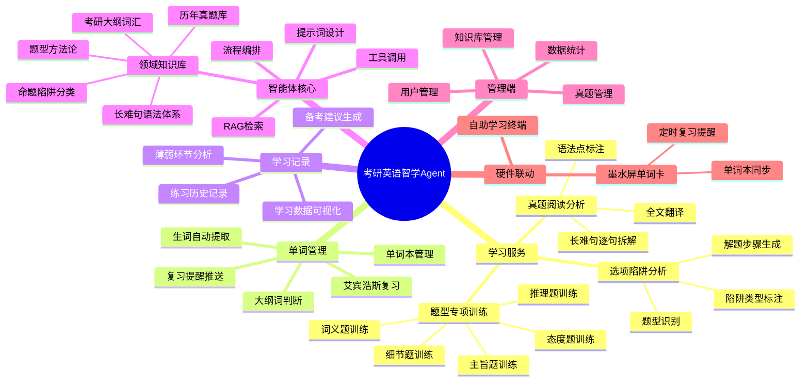
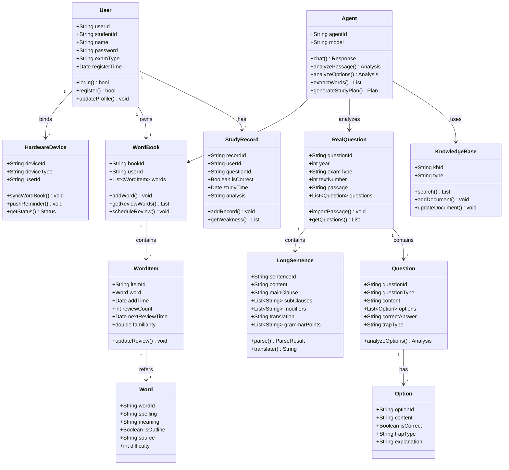

# 考研英语阅读/单词备考Agent — 需求分析文档

## 文档信息

| 项目名称 | 考研英语阅读/单词备考Agent（考研英语智学Agent） |
|:---|:---|
| 团队名称 | 福大智联 |
| 文档版本 | V1.0 |
| 编写日期 | 2026-10-21 |
| 编写人 | 黄炜杰、黄俊翔 |
| 审核人 | 全体成员 |

---

## 1. 迭代记录

| 迭代轮次 | 时间 | 目标 | 产出 | 状态 |
|:---:|:---:|:---|:---|:---:|
| Iter 0 | 10/11-10/26 | 选题确认、需求分析、团队展示 | 选题报告、需求文档V1.0、博客、答辩PPT | 进行中 |
| Iter 1 | 10/27-11/10 | 系统设计、Agent原型 | 系统设计文档、Agent原型、UI原型 | 待启动 |
| Iter 2 | 11/11-11/25 | 核心功能开发（Agent+后端） | 知识库、API、真题解析引擎 | 待启动 |
| Iter 3 | 11/26-12/10 | 前端开发与集成 | Streamlit完整界面、系统集成 | 待启动 |
| Iter 4 | 12/11-12/25 | 硬件联动、测试优化 | 墨水屏单词卡、测试报告 | 待启动 |
| Iter 5 | 12/26-期末 | 部署上线、最终验收 | 上线系统、验收报告、总结博客 | 待启动 |

---

## 2. 介绍

### 2.1 项目背景

考研是全国硕士研究生招生考试，每年报考人数超过400万。英语作为公共必考科目，阅读理解占40分，是拉开分数差距的核心题型。备考学生普遍反映：

1. **长难句理解困难**：考研阅读文章充斥复杂长难句，通用翻译工具只会直译，不会系统拆解语法结构
2. **选项陷阱难识别**：考研命题有固定套路（偷换概念、扩大范围、正反混淆等），通用AI不会讲解出题陷阱
3. **生词管理低效**：阅读中遇到的生词缺乏系统管理和科学复习规划，遗忘率高
4. **缺乏个性化指导**：网课是通用内容，不知道自己薄弱环节在哪

### 2.2 调研依据

**调研方法**：
1. **问卷调查**：面向福大及周边高校大三/大四备考学生，发放线上问卷，有效回收 XXX 份
2. **深度访谈**：选取不同基础水平（高/中/低）的备考学生各3-4位进行半结构化访谈
3. **资料分析**：梳理考研英语真题（2005-2025共21年）、教育部考研大纲词汇表、主流辅导名师方法论

**调研结论**：

| 调研问题 | 占比 | 说明 |
|:---|:---:|:---|
| 长难句是阅读最大障碍 | 87% | 每词都认识但整句不懂 |
| 无法系统识别选项陷阱 | 79% | 排除两个后总选错 |
| 缺乏科学生词复习规划 | 82% | 今天背明天忘 |
| 希望获得个性化备考指导 | 71% | 网课通用，不知薄弱在哪 |

> 📸 **截图建议**：此处插入调研问卷统计图表（问卷星导出的饼图/柱状图）

### 2.3 目标用户与使用场景

**目标用户**：

| 维度 | 描述 |
|:---:|:---|
| 核心用户 | 备考考研英语一/英语二的在校大学生 |
| 年龄 | 20-23岁 |
| 基础水平 | CET-4通过至CET-6优秀不等 |
| 使用场景 | 自习室/图书馆独立备考，使用笔记本/平板 |
| 使用频率 | 备考期间每日使用，单次30-60分钟 |

**典型使用场景**：

**场景1：真题精读**
> 小明正在做2024年考研英语一Text 1，遇到一个长难句读不懂。他打开考研英语智学Agent，导入真题，Agent逐句拆解长难句（找主干→剥离从句→划分修饰→翻译），并标注语法点。小明理解句子后，继续做题。

**场景2：选项分析**
> 小明做完题目后，对第2题不确定。Agent分析：题型=细节题，定位原文第3段第2句，选项A偷换概念（将"may"改为"must"），选项B扩大范围，选项C为正确答案（同义替换），选项D无中生有。给出完整解题步骤。

**场景3：生词管理**
> 阅读过程中Agent自动提取生词"ubiquitous"，判断为考研大纲词，加入单词本，安排复习计划（今天/明天/第4天/第7天/第15天），并关联真题出处。次日小明收到复习提醒。

**场景4：薄弱分析**
> 一周后，Agent分析小明的练习记录：细节题正确率85%，主旨题正确率仅55%。建议主旨题专项训练，并推荐3篇主旨题真题。

---

## 3. 项目标志

> 📸 **设计建议**：项目Logo可设计为"书本+AI大脑+考研"元素的组合，配色用福大校色（深蓝/白）。
>
> 请在此处插入项目标志图片：


**项目名称**：考研英语智学Agent
**Slogan**：懂考研英语的AI辅导老师

---

## 4. 思维导图



---

## 5. 类图



---

## 6. 功能描述

### 6.1 前端功能（学生端 — Streamlit Web应用）

#### FR-01：用户注册与登录
- **描述**：用户通过学号/手机号注册账号，选择考试类型（英语一/英语二），登录后进入主界面
- **输入**：学号、密码、考试类型
- **输出**：登录成功，跳转主界面
- **优先级**：高

#### FR-02：真题导入与展示
- **描述**：用户可导入历年真题阅读文章（粘贴文本/上传文件/选择内置真题库），系统展示文章全文
- **输入**：真题文本/文件
- **输出**：格式化展示阅读文章
- **优先级**：高

#### FR-03：长难句逐句拆解
- **描述**：Agent对文章中每个长难句进行系统拆解：①找主干 ②剥离从句 ③划分修饰 ④逐层翻译 ⑤标注语法点
- **输入**：用户选择句子或自动识别长难句
- **输出**：拆解结果（主干/从句/修饰/翻译/语法点）
- **优先级**：高（核心功能）

#### FR-04：选项陷阱分析
- **描述**：对每道题的选项进行分析：①识别题型（细节题/主旨题/推理题/词义题/态度题）②定位原文 ③标注每个选项的陷阱类型（偷换概念/扩大范围/正反混淆/无中生有）④给出解题步骤
- **输入**：题目及选项
- **输出**：题型、定位、陷阱分析、解题步骤、正确答案
- **优先级**：高（核心功能）

#### FR-05：生词自动提取与单词本
- **描述**：阅读过程中Agent自动提取生词，判断是否为考研大纲词，加入个人单词本，关联真题出处
- **输入**：阅读文章
- **输出**：生词列表、大纲词标记、单词本更新
- **优先级**：高

#### FR-06：艾宾浩斯复习计划
- **描述**：基于艾宾浩斯遗忘曲线，为单词本中的每个词安排复习时间（1天/2天/4天/7天/15天/30天），到时推送复习提醒
- **输入**：单词本
- **输出**：复习计划、今日待复习单词
- **优先级**：高

#### FR-07：题型专项训练
- **描述**：按题型分类，从真题库中抽取对应题型的题目，进行专项训练
- **输入**：题型选择
- **输出**：专项训练题目集
- **优先级**：中

#### FR-08：学习记录与薄弱分析
- **描述**：记录每次练习的答题情况，分析各题型正确率，识别薄弱环节，生成备考建议
- **输入**：练习历史
- **输出**：正确率统计、薄弱题型、备考建议
- **优先级**：中

#### FR-09：学习数据可视化
- **描述**：以图表展示学习进度、正确率趋势、单词掌握度等
- **输入**：学习记录
- **输出**：折线图/柱状图/饼图等可视化
- **优先级**：中

### 6.2 前端功能（管理端 — Vue.js Web应用）

#### FR-10：知识库管理
- **描述**：管理员可对知识库（词汇库/真题库/方法论）进行增删改查
- **优先级**：中

#### FR-11：用户管理
- **描述**：查看注册用户、使用统计
- **优先级**：低

#### FR-12：数据统计
- **描述**：系统使用情况统计（活跃用户、功能使用频率等）
- **优先级**：低

### 6.3 后端功能

#### FR-13：Agent对话服务
- **描述**：提供Agent对话API，接收用户问题，调用LLM+RAG+工具，返回分析结果
- **接口**：POST /api/agent/chat
- **优先级**：高

#### FR-14：长难句解析引擎
- **描述**：基于spaCy句法分析+自研规则，对长难句进行结构化拆解
- **接口**：POST /api/nlp/parse-sentence
- **优先级**：高

#### FR-15：真题管理服务
- **描述**：真题的存储、检索、导入解析
- **接口**：GET /api/questions, POST /api/questions/import
- **优先级**：高

#### FR-16：单词本服务
- **描述**：单词的增删改查、复习计划生成、复习提醒
- **接口**：GET/POST/DELETE /api/wordbook
- **优先级**：高

#### FR-17：学习记录服务
- **描述**：记录和查询学习记录，薄弱分析算法
- **接口**：GET/POST /api/study-records
- **优先级**：中

#### FR-18：知识库检索服务（RAG）
- **描述**：基于向量数据库（FAISS/Chroma）的语义检索，为Agent提供领域知识
- **接口**：POST /api/kb/search
- **优先级**：高

#### FR-19：硬件联动服务
- **描述**：与ESP32墨水屏设备通信，同步单词本，推送复习提醒
- **接口**：POST /api/device/sync, POST /api/device/reminder
- **优先级**：低（可选）

### 6.4 非功能需求

| 编号 | 需求 | 描述 |
|:---:|:---:|:---|
| NFR-01 | 响应时间 | Agent对话响应≤10秒，页面加载≤3秒 |
| NFR-02 | 并发 | 支持50人同时在线 |
| NFR-03 | 可用性 | 系统可用率≥95% |
| NFR-04 | 安全性 | 用户密码加密存储，API鉴权 |
| NFR-05 | 可扩展性 | 知识库可动态更新，支持新增题型/真题 |
| NFR-06 | 兼容性 | 支持Chrome/Edge/Safari主流浏览器 |
| NFR-07 | 准确性 | 考研知识点解析准确率≥90%（人工校验） |

---

## 7. 领域知识与智能体定制

### 7.1 领域知识来源

| 知识类型 | 来源 | 说明 |
|:---:|:---|:---|
| 考研大纲词汇 | 教育部考试中心《全国硕士研究生招生考试英语考试大纲》 | 约5500词，标注词频/词义 |
| 历年真题 | 2005-2025年考研英语一/二真题（公开资源） | 21年×4篇×2类=168篇阅读 |
| 题型方法论 | 主流辅导名师公开课方法论（唐迟阅读/田静语法/刘晓艳等） | 细节题/主旨题/推理题/词义题/态度题的解题套路 |
| 长难句语法体系 | 田静《句句真研》语法体系 | 找主干→剥离从句→划分修饰→翻译 |
| 命题陷阱分类 | 考研辅导经验总结 | 偷换概念/扩大范围/正反混淆/无中生有/过于绝对 |
| 选项分析范式 | 考研真题解析标准格式 | 定位原文→识别题型→分析陷阱→排除→确认 |

### 7.2 智能体需要完成的任务

| 任务 | 描述 | 涉及工具 |
|:---:|:---|:---|
| 长难句拆解 | 逐句分析语法结构，系统拆解并翻译 | 句法分析工具、语法知识库 |
| 选项陷阱分析 | 识别题型，分析每个选项的陷阱类型 | 题型分类工具、陷阱匹配工具、原文检索工具 |
| 生词提取与管理 | 自动提取生词，判断大纲词，管理复习 | 词汇库检索、单词本工具、艾宾浩斯算法 |
| 薄弱环节分析 | 分析练习记录，识别薄弱题型 | 学习记录分析、统计工具 |
| 备考建议生成 | 根据薄弱环节生成个性化备考建议 | 知识库检索、建议生成 |

### 7.3 定制方法

#### 7.3.1 知识检索（RAG）
- 将考研词汇、真题、方法论、语法体系等构建为向量知识库
- 用户提问时，先检索相关知识，再注入Prompt，提升回答准确性

#### 7.3.2 提示词设计
```
角色：你是一位考研英语资深辅导老师，拥有10年教学经验。
原则：
1. 按考研辅导范式解析，不做泛泛翻译
2. 长难句按"找主干→剥离从句→划分修饰→翻译"拆解
3. 选项分析按"定位→题型→陷阱→排除→确认"流程
4. 陷阱类型仅使用：偷换概念/扩大范围/正反混淆/无中生有/过于绝对
5. 语言通俗易懂，像面对面辅导
输出格式：结构化JSON（题型/定位/陷阱分析/解题步骤/结论）
```

#### 7.3.3 工具调用
- `parse_long_sentence(text)` → 长难句拆解
- `classify_question_type(question)` → 题型分类
- `identify_trap(option, source)` → 陷阱识别
- `search_outline_word(word)` → 大纲词判断
- `add_to_wordbook(word, source)` → 加入单词本
- `schedule_review(word, algorithm)` → 安排复习
- `search_kb(query)` → 知识库检索

#### 7.3.4 流程编排
```
用户导入真题 →
  逐句识别长难句 → 调用parse_long_sentence拆解 → 展示结果
用户请求选项分析 →
  调用classify_question_type识别题型 →
  定位原文 →
  对每个选项调用identify_trap →
  生成解题步骤 → 展示结果
  自动提取生词 → search_outline_word → add_to_wordbook → schedule_review
用户请求学习报告 →
  分析练习记录 → 识别薄弱题型 → 生成备考建议
```

### 7.4 与软件功能和用户操作的关系

| 用户操作 | 软件功能 | Agent任务 | 知识/工具 |
|:---:|:---:|:---:|:---|
| 导入真题 | FR-02真题导入 | — | — |
| 点击"拆解句子" | FR-03长难句拆解 | 长难句拆解 | 句法分析+语法库 |
| 点击"分析选项" | FR-04选项分析 | 选项陷阱分析 | 题型分类+陷阱库+原文检索 |
| 阅读完成 | FR-05生词提取 | 生词提取与管理 | 词汇库+单词本工具 |
| 查看单词本 | FR-06复习计划 | — | 艾宾浩斯算法 |
| 查看学习报告 | FR-08薄弱分析 | 薄弱环节分析 | 学习记录+统计 |

### 7.5 硬件联动方案（可选加分）

**方案：ESP32墨水屏单词卡**
- **硬件**：ESP32 + 2.9寸电子墨水屏 + 按键
- **功能**：
  1. 自动同步用户单词本到设备
  2. 按复习计划定时显示待复习单词
  3. 按键翻页/标记已掌握
  4. 低功耗，待机数周
- **数据流**：后端单词本API → ESP32 WiFi同步 → 墨水屏显示 → 按键操作 → 回传掌握状态 → 更新复习计划
- **交互价值**：备考学生可随身携带单词卡，碎片时间复习，无需打开手机/电脑
- **加分依据**：硬件参与实际任务流程（单词复习），稳定可演示

---

## 8. 验收标准

### 8.1 核心功能验收

| 编号 | 验收项 | 验收标准 | 检查方式 |
|:---:|:---|:---|:---|
| AC-01 | 长难句拆解 | 导入真题，Agent能逐句拆解长难句，输出主干/从句/修饰/翻译/语法点，格式完整 | 导入2024年真题Text1，检查拆解结果 |
| AC-02 | 选项陷阱分析 | 对每题选项标注题型和陷阱类型，给出解题步骤，正确率≥90% | 用5道真题验证，人工校验准确性 |
| AC-03 | 生词提取 | 阅读后自动提取生词，正确判断大纲词，加入单词本 | 导入文章检查提取结果 |
| AC-04 | 复习计划 | 按艾宾浩斯曲线安排复习，到时提醒 | 检查复习时间间隔是否符合1/2/4/7/15/30天 |
| AC-05 | 薄弱分析 | 正确统计各题型正确率，识别薄弱题型 | 模拟10次练习记录验证 |

### 8.2 代表性领域任务及定制效果检查

**任务1：长难句拆解**
- 输入：2024年考研英语一Text 1中长难句
- 通用模型输出：直接翻译，不解释结构
- 定制Agent输出：①主干 ②从句 ③修饰 ④翻译 ⑤语法点，按田静体系拆解
- ✅ 检查：输出包含5个结构化部分，语法点标注正确

**任务2：选项陷阱分析**
- 输入：2023年考研英语一Text 2第3题
- 通用模型输出：翻译后说"选C"
- 定制Agent输出：题型=细节题，定位第2段，A偷换概念/B扩大范围/C正确(同义替换)/D无中生有，解题步骤
- ✅ 检查：4个选项均有陷阱分析，解题步骤完整

**任务3：生词管理闭环**
- 输入：阅读文章
- 通用模型：翻译完结束
- 定制Agent：提取生词→判断大纲词→加入单词本→安排复习→次日提醒
- ✅ 检查：单词本有记录，复习计划时间正确

### 8.3 非功能验收

| 验收项 | 标准 |
|:---:|:---|
| 响应时间 | Agent响应≤10秒，页面加载≤3秒 |
| 并发 | 50人同时在线不崩溃 |
| 准确性 | 考研知识点人工校验准确率≥90% |
| 上线 | 提供可访问的线上地址 |

---

## 9. 项目范围说明

### 9.1 核心功能（必做）
- ✅ 真题导入与展示
- ✅ 长难句逐句拆解（Agent核心）
- ✅ 选项陷阱分析（Agent核心）
- ✅ 生词提取与单词本
- ✅ 艾宾浩斯复习计划
- ✅ 学习记录与薄弱分析

### 9.2 扩展功能（尽力）
- ⬜ 题型专项训练
- ⬜ 学习数据可视化
- ⬜ 管理端知识库管理
- ⬜ ESP32墨水屏单词卡（硬件加分）

### 9.3 不做范围
- ❌ 听力/写作/翻译等其他题型（聚焦阅读）
- ❌ 模拟考试系统
- ❌ 付费/商业化功能

> **原则**：优先保证核心功能真实、完整、能够实现，合理控制项目范围。